# VMD Viewer for Mac 一般ユーザーマニュアル

> 2026年11月8日更新：[v0.58.4／build569の変更概要](docs/updates/codex-motion-2026-11-08.md)。保存・自動保存、モーフ／カメラの登録操作、HQ設定の説明を本文へ追記しました。その他の後続機能と検証上の制限は更新補足を参照してください。

PMXモデルとVMDモーションを読み込み、動きや表情を調整して、動画にするまでの操作を説明します。初めて使う方は「基本機能」から順に試してください。

**基礎資料：開発側のv0.56.49／build453（2026年10月19日確認）。更新補足：v0.58.4／build569（2026年11月8日確認）。** 後続版の保存・登録操作などを追記し、当時の検証記録は版を明記して残しています。版番号は開発側の記録であり、VvfMでの配布公開を示すものではありません。アプリ本体のソースコードは非公開です。非公開の開発資料へのリンクは掲載せず、対応範囲と制限を本文に記します。

**画面例（図1〜11）：VMD Viewer v0.58.4／build569、2026年11月8日撮影。** 起動中のアプリで開かれていた `5_uni_Crystal_Hall_Test.vmdviewer` を使用しています。DoFのON／OFF比較も、同じ450フレーム・VMDカメラの構図で撮影しました。モデル名、キーの数、設定値は掲載シーンの例です。バージョンやウインドウの大きさによって、配置が異なる場合があります。

キー表記は **⌘＝Command、⌥＝Option、⇧＝Shift、⌃＝Control** です。たとえば⌘Oは、Commandを押しながらOを押します。アプリの版は、アプリメニューの「VMD Viewerについて」で確認できます。

**目次**

1. [開発コンセプト](#開発コンセプト)
2. [VMD Viewer for Mac 概要](#vmd-viewer-for-mac-概要)
3. [導入と起動](#導入と起動)
4. [基本機能](#基本機能)
5. [VMD編集](#vmd編集)
6. [シェーダー説明](#シェーダー説明)
7. [動画出力](#動画出力)
8. [ショートカット早見表](#ショートカット早見表)
9. [困ったときは](#困ったときは)
10. [対応範囲と制限](#対応範囲と制限)
11. [素材・ライセンス・不具合報告](#素材ライセンス不具合報告)
12. [このマニュアルの参照元](#このマニュアルの参照元)

## 開発コンセプト

動画を確認していて、腕が服を突き抜けていることに気づいた。表情に、もう一つモーフを足したくなった。けれど出先にはMacしかなく、WindowsのMikuMikuDanceへすぐに戻れない――そんなときに、Macでモーションを開き、確認や調整を続けられることを目指したアプリです。

「Macでも好きなキャラクターのダンスを見たい」「モデルとモーションを組み合わせて動画を作ってみたい」という方にも、読み込み、再生、編集、動画出力を一つの画面から進められるようにしています。

## VMD Viewer for Mac 概要

### VvfMでできること

VMD Viewer for Macの略称は **VvfM** です。WindowsアプリケーションのMikuMikuDanceで使われるPMXモデルやVMDモーションを、Macで読み込み、再生・編集できます。

キャラクターの動き、表情、カメラをそれぞれのタイムラインで扱い、音声に合わせて調整できます。見た目はMetal、ToonShader LE、ToonShader HQから選び、作業全体をプロジェクトとして保存したり、映像を動画ファイルへ書き出したりできます。

**MikuMikuDanceとの完全な互換性を保証するものではありません。** 物理演算、材質、影、エフェクトなどの見え方は、素材や設定によって異なります。別のアプリへVMDを渡す場合も、渡した先で動きと表情を確認してください。

### Macの動作要件

| 項目 | 内容 |
|---|---|
| OS | macOS 14以降 |
| Mac | Metal対応Mac。掲載画面で使用した配布アプリはApple Silicon用です |
| MetalFX | M2以降を対象とする機能です。非対応環境ではTAA／FXAAへ切り替わります |
| 保存容量 | モデル、テクスチャ、音声、保存プロジェクト、出力動画を置く空き容量が必要です |
| メモリと負荷 | 必要量はモデル数、テクスチャ、物理、エフェクト、解像度で変わります |

配布されたアプリを使うだけなら、開発用のXcodeやHomebrewを用意する必要はありません。Intel Macでの利用可否は、入手したアプリがIntel用を含むか確認してください。全OS・チップの組み合わせでの動作を保証するものではないため、配布元の対応環境を優先してください。

### ファイルの役割

| 種類 | 主な内容 | 使いどころ |
|---|---|---|
| `.pmx` | モデルの形、骨組み、材質、モーフ、物理設定 | キャラクターやステージを読み込む |
| `.vmd` | ボーン、モーフ、カメラなどのキーフレーム | ダンス、表情、カメラワークを読み込む／保存する |
| `.vpd` | ボーンのポーズ | 指ポーズウインドウから取り込む |
| `.wav`／`.m4a` | 音声 | 曲に合わせて再生・編集する |
| `.mov`／`.mp4`／`.m4v` | 投影用の動画 | 背景や対応するスクリーン材質へ映像を表示する |
| `.vmdviewer` | 素材とシーン設定をまとめたプロジェクト | 作業を保存して、後から同じ構成で開く |
| `.dofvmd` | VvfM用のDoFやワールド・照明のキー | 追加のカメラ効果や照明アニメーションを保存する |
| `.fxdayo` | 対応エフェクトの定義 | 対応するPMXと組み合わせて使う |

PMXに付属するテクスチャ画像は、元のフォルダ構成を保って置いてください。PMXだけを別の場所へ移すと、画像が見つからなくなることがあります。

### 画面の見方

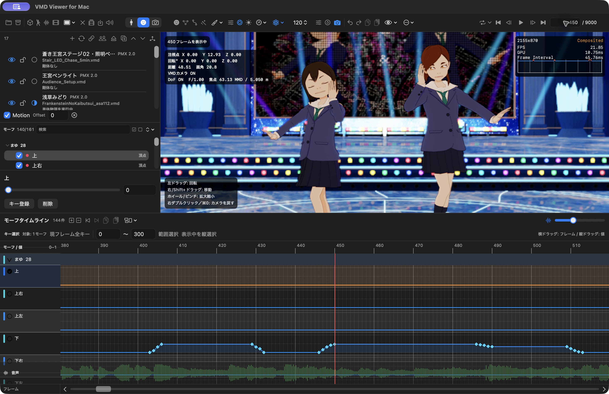

*図1：450フレームを表示したメイン画面。左にモデルとモーフの編集項目、右にモデル表示、下にモーフタイムラインがあります。*

| 場所 | 役割 |
|---|---|
| 上部左側のツールバー | プロジェクト、PMX、VMD、音声、投影用動画の読み込みと保存 |
| 上部中央 | ボーン／モーフ／カメラの切替、エフェクト、描画、照明、物理、表示設定 |
| 上部右側 | リピート、再生・停止、フレーム移動、現在／終端フレーム。これらは右詰めで配置 |
| 左上のシーン一覧 | 操作するモデルの選択、モデルごとの表示やロック |
| 左下の編集欄 | 選択したボーン、モーフ、カメラの値を編集 |
| 右のモデル表示領域 | 画角、姿勢、表情、見た目を確認。ビューポートとも呼びます |
| 下のタイムライン | キーの時刻、選択、移動、音声波形を確認 |

アイコンの意味が分からないときは、ポインタを重ねて説明を表示します。同じカメラの形でも、**編集モードのカメラ**と、**カメラVMDのON／OFF**は別のボタンです。

幅が狭いと描画・物理・補助操作、さらにファイル操作がメニューへ集約されます。画面例にあるボタンが見当たらないときは、設定メニューや「…」も確認してください。リピートの開始・終了欄は常時表示ではなく、リピートボタン横の下向き矢印から開きます。

## 導入と起動

### テスト版をインストールする

配布元からZIPを受け取った場合の手順です。公開版の配布情報は [Releases][releases] を参照し、その版の対応環境・配布条件を確認してください。

1. 入手元を確認し、SHA-256が案内されている場合はファイルと照合します。
2. ZIPを展開し、「VMD Viewer.app」を「アプリケーション」フォルダへ移動します。
3. アプリを開きます。アドホック署名のテスト版で初回起動がブロックされた場合は、Control＋クリックから「開く」を試します。
4. それでも開けない場合は、入手元を確認したうえで「システム設定 → プライバシーとセキュリティ」の「このまま開く」を使います。

Gatekeeperを無効にする必要はありません。入手元が不明なファイルや、想定と異なる警告が出るファイルは開かないでください。

### 更新・アンインストール

更新前にプロジェクトと必要なVMDを保存・バックアップしてから、アプリを置き換えます。アンインストールはアプリをゴミ箱へ移動します。プロジェクトや素材は別ファイルなので、必要なものを残してください。

## 基本機能

### プロジェクトを開いて再生する

1. 上部左端のフォルダアイコン「プロジェクトを開く」、または **⌘O** を使います。
2. 用意した `.vmdviewer` ファイルを選び、読み込みが終わるまで待ちます。
3. モデルとステージが表示されたら、右上の再生ボタン **▶** を押します。**Space**でも再生・一時停止できます。
4. 一時停止し、「現在フレーム」へ数値を入力して **Return** を押すと、その位置へ移動します。
5. 編集を試す前に、**⌥⌘S** で別名のプロジェクトとして保存しておくと、元のシーンを残せます。

掲載シーンは操作説明のための例です。プロジェクトをまだ作っていない場合は、自分で用意したPMX、VMD、音声を次の手順で読み込みます。

### PMX、VMD、音声を読み込む

#### 1. PMXモデルを追加する

上部の立方体アイコン「PMXを追加」、または **⇧⌘O** でPMXを選びます。FinderからPMXをウインドウへドラッグ＆ドロップすることもできます。

読み込んだモデルは左上のシーン一覧へ追加されます。複数のモデルを使う場合は、**編集したいモデルの行をクリックして選択**してください。目のアイコンは表示、鍵のアイコンはロックの切替です。

#### 2. 選択したモデルへVMDを読み込む

1. シーン一覧で対象のキャラクターを選びます。
2. 先頭からモーションを始めたい場合は、現在フレームを **0** にします。
3. 「VMDを開く」、または **⌥⌘O** でVMDを選びます。ドラッグ＆ドロップでも読み込めます。
4. 確認画面が出た場合は、対象と開始位置を確認します。

既にVMDがある場合は「読込済みVMDへ追加しますか？」と表示されます。同じ種類・名前・フレームのキーは、追加するVMDの内容で更新されます。途中のフレームで新たに読み込むと、「表示フレームからVMDを開始しますか？」と確認される場合があります。

**単純に最初から再生したいときは、0フレームへ戻ってから読み込む**と開始位置を合わせやすくなります。表示位置から開始する場合は、VMDの0フレームがその位置へ移ります。モデル用VMDを割り当てると「モデル配置」が初期値へ戻るため、配置の調整は読み込み後に行います。

**カメラキーを含むVMDはカメラ用として優先**され、カメラ・照明・セルフシャドウをシーン共通へ読み込みます。ボーン・モーフが混在していても、その操作で選択PMXへ同時適用されません。モデル用とカメラ用のVMDをそれぞれ用意すると、割り当て先を確認しやすくなります。

シーン一覧の **Motion** がOFFだと、そのモデルのモーションが反映されません。**Offset** はモデルのモーション開始位置をずらすための値です。初めて使うときは0のままにしておきます。

#### 3. 音声を読み込む

「音声を開く」、または **⌥⌘W** でWAV／M4Aを選びます。ファイルのドラッグ＆ドロップにも対応します。

読み込んだ音声は再生位置に合わせて鳴り、タイムラインの「音声波形」をONにすると、曲の強弱を見ながら編集できます。スピーカーアイコンからアプリの音量を調整できます。

M4AはAAC-LC／ALACを対象とします。試聴音量は0〜100%で、ミュートもできますが、**試聴音量・ミュートは動画出力の音声に反映されません**。Finderで音声をダブルクリックする方法ではなく、アプリ内の読み込み操作かドラッグ＆ドロップを使ってください。

#### 4. 背景やスクリーンへ動画を表示する

「動画を開く」、または **⌥⌘M** でMOV／MP4／M4Vを選びます。読み込んだ動画は、背景または `screen.bmp` に対応する材質へ投影できます。

動画もビューポートへのドラッグ＆ドロップで読み込めます。ツールバー、または設定 → 再生で「再生なし／screen.bmp／背景」を選びます。screen.bmpには対応材質を持つモデルが必要です。「再生なし」は動画を削除せず、投影先・開始位置・loopを保って動画の再生処理だけを外します。再有効化すると現在のVMD時刻へ同期し、表示はVMDの30 fps時間軸に合わせて進みます。

これはシーンに表示する映像の読み込みです。完成したシーンを動画へ保存する操作は、[動画出力](#動画出力)で説明します。

### 複数モデルの管理

PMXを追加し、シーン一覧で対象を選んでから、そのモデル用のVMDを読み込みます。モデルごとに、表示・ロック・Motion・物理のON／OFF、配置、表示倍率、開始オフセットを設定できます。

モデルの複製・アンロード、PMX行をドラッグして描画順を変える操作もできます。アンロード前は未保存の編集を保存してください。モデル間のボーンを関連付ける「PMX外部親」、モデル間の物理接触を設定する「PMX個体間衝突」も利用できます。まず個々のモデルの再生を確認してから設定します。

作業中に読み込んだ素材を移動・削除すると、テクスチャの表示や保存に失敗することがあります。素材の整理は、プロジェクトを保存し、開き直せることを確認してから行ってください。

#### モーションを残してPMXを入れ替える

1. シーン一覧で入れ替えるモデルを選びます。ロック中なら解除します。
2. モデル一覧の「＋」右隣にある循環矢印 **「選択PMXを入れ替え」** を押し、新しいPMXを選びます。モデル行の右クリックからも実行できます。
3. 確認画面で、DoF・追加レイヤー・外部親・指設定のボーンと、材質エフェクトの対応先を確認します。名前がない・重複する項目は、対応先または参照の解除を選びます。
4. 入れ替えを確定し、表示が整ってから動き・材質・焦点を確認します。

VMDのキーと未保存編集、モデルの配置・描画順・Offsetなどは引き継ぎます。新PMXに同名のないVMDトラックもキーは残りますが、その骨格で動くか確認が必要です。骨格の違いを自動で直す機能ではありません。入れ替えはUndoできます。

#### モデルからVMDを外す

選択モデルのVMD欄の「×」、またはモデル行の右クリック **「VMDをアンロード…」** を使います。未保存の編集があると、「保存してアンロード」「保存せずアンロード」「キャンセル」を選べます。PMX・配置・DoF・材質・他モデルは残り、解除はUndoできます。物理がONなら、VMDを外した後も揺れは動作します。

追加レイヤーをVMDへ保存すると合成されます。レイヤー構造を残したい場合はキャンセルし、先にプロジェクトを保存してください。

### VMDを再生する

| 操作 | ボタン／キー |
|---|---|
| 再生・一時停止 | ▶／一時停止ボタン、Space |
| 0フレームへ戻る | 「0フレームに戻る」、Home |
| 1フレーム戻る／進む | 前後のボタン、←／→、`,`／`.` |
| 終端へ移動 | 「終端フレームへ移動」、End |
| 指定フレームへ移動 | 右上の現在フレーム欄へ入力し、Return |
| 範囲を繰り返す | リピート横の下向き矢印で範囲を開き、開始・終了を入力してリピートをON |

ループは、腕や表情など、短い区間を繰り返し確認するときに便利です。**開始フレームが終了フレーム以下になるように設定**してください。図のループ欄は保存シーンの値であり、操作例の指定値ではありません。

テキスト入力欄を編集中は、Spaceや矢印キーが入力欄へ渡されることがあります。再生ボタンを直接押すか、入力を確定してから操作してください。

### タイムラインの基本

**キーフレーム**は「この時刻に、この姿勢・表情・カメラ位置にする」という記録です。タイムラインでは菱形で表示されます。赤い縦線は現在のフレームです。

VMDの時間は **30フレーム＝1秒** を基準にします。たとえば300フレームは開始から10秒の位置です。画面に「60 fps」と表示されていても、VMDの時間の数え方は変わりません。

| したいこと | 操作 |
|---|---|
| 時刻を移動する | キーのない場所をクリックするか、現在フレーム欄を使う |
| キーを選ぶ | 菱形をクリック。⌘／⇧を併用すると追加選択できます |
| モーフ／カメラのキーを登録・更新する（v0.58.4〜） | 値領域を修飾キーなしで左ダブルクリック。その行・フレームへ登録し、既存キーに命中した場合は更新 |
| 登録値を確認する（v0.58.4〜） | キーにポインタを重ねる。補間中の値ではなく、保存されたキーの値を表示 |
| まとめて選ぶ | 空いている場所から矩形で囲む、または「範囲選択」を使う |
| 1行の全キーを選ぶ | 行名をShift＋左クリック。画面外・範囲指定外のキーも対象 |
| 現在位置のキーを選ぶ | 「現フレーム全キー」を押す |
| 時刻をずらす | 選択したキーを左右へドラッグ |
| コピーして再利用する | ⌘C → 貼り付け先フレームへ移動 → ⌘V |
| 前後のキーへ移動する | タイムライン見出しの前／次ボタン、Shift＋←／→ |
| キーを削除する | キーを選んでDelete |
| 間違えた操作を戻す | ⌘Z。やり直しは⇧⌘Z |
| 横方向の表示を拡大する | タイムライン右上の表示倍率を調整。現在フレームを中心に拡縮 |
| 別の範囲を表示する | 最下段の「フレーム」横スクロールバーを動かす |

コピーと貼り付けは、ボーン同士、モーフ同士、カメラ同士で行います。移動・貼り付け先に同じ対象のキーがある場合は置き換わることがあるため、必要に応じて元に戻して確認します。

ダブルクリック登録では、クリック前の未登録編集があればその値を使い、なければ登録先フレームの評価値を使います。カメラ内のDoF・照明・HQ行も対象です。DoFは停止中に登録し、焦点ボーンなどの表示準備が必要な行は完了を待ちます。登録先の行だけを変更し、⌘Z／⇧⌘Zで戻す・やり直すことができます。

表示倍率は2〜24 point/frameです。倍率を変えても現在フレーム・再生速度・キーの内容は変わりません。旧画面の固定表示「30 fps」は削除されていますが、VMDの時間基準は30フレーム＝1秒のままです。拡縮の中心合わせと、再生時のスクロールが常に滑らかであることは別の確認事項です。

モデルにOffsetがあると、ボーン／モーフのタイムラインはモデル側の時刻を、カメラはシーン全体の時刻を示します。複数モデルのタイミングが合わないときはOffsetも確認してください。

行やグループは折り畳めます。「現在位置に1フレーム挿入」（⇧⌘I）／「現在位置の1フレームを削除」（⇧⌘D）で時間を空けたり詰めたりできます。ボーン・モーフは選択モデル、カメラは選択中カメラと共有の照明・影・HQキーが対象です。**DoFの焦点・光学設定キーは対象外**です。

### 物理演算のFPS

髪、スカート、小物などの揺れは、PMXに設定された物理演算によって変化します。ツールバーの原子のアイコンで動作モードを選び、その隣の数値で物理FPSを選びます。

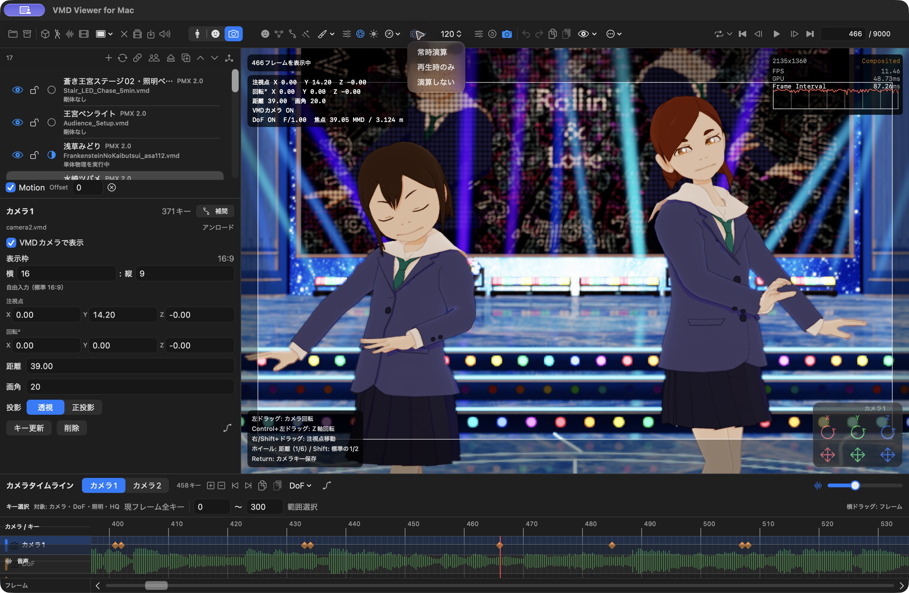

*図2：「常時演算」「再生時のみ」「演算しない」。右隣の120は、画面例で選ばれている物理FPSです。*

| モード | 動作と使いどころ |
|---|---|
| 常時演算 | 停止中も物理を進めます。ポーズを止めたまま揺れの収まりを見たいときに使います |
| 再生時のみ | 再生中に物理を進め、停止中は状態を保持します |
| 演算しない | 物理による動きを無効にし、モーションやポーズを確認します |

物理FPSは **60／120／180／240** から選べます。値を高くすると、1秒間をより細かく分けて計算しますが、処理負荷も増えます。まず60または120で動きを見て、揺れ方と操作の重さを比べてください。値を変えると揺れ方も変わり得るため、仕上げの確認と動画出力では設定を揃えます。

混同しやすい4つのFPSを整理すると、次のようになります。

| 設定・表示 | 何を表すか |
|---|---|
| VMDの30 fps | モーションやカメラの時刻の基準 |
| 物理FPS | 物理演算を1秒間に何回進めるか |
| 再生・描画FPS | 画面を描く頻度の設定。24固定／30固定／60上限／無制限から選択 |
| 動画の出力レート | 書き出した動画の1秒あたりのフレーム数 |

「表示フレームの物理状態を再計算」は、そのフレームの姿勢から物理状態を作り直す操作です。先頭から再生して到達したときの揺れを再現する操作とは異なります。最終的な揺れは、必要な区間を再生して確かめてください。

物理設定では、選択モデルの「柔らかさ」「揺れの収まり」と、シーン全体の重力も調整できます。元のPMXを書き換える操作ではありません。

### フレーム移動時の物理演算

**設定… → 再生 → シーク時の物理演算**から選びます。

| 選択肢 | 動作 |
|---|---|
| 0フレームから演算 | 従来の物理状態の復元・計算方法を使います。離れたフレームへの移動は時間がかかる場合があります |
| 移動先で演算 | 指定位置の姿勢で物理を初期化します。先頭から再生した揺れとは異なる場合があります。次の1フレーム送りは、その状態から演算します |

変更は**次の手動フレーム移動から**適用されます。物理OFFでは違いはありません。動画出力には、この編集用のシーク設定を使いません。

### Bulletモードと再生時の動作

1. **設定… → 再生 → 物理エンジンの動作（プロジェクト全体）**を開きます。
2. 「Bullet 3.25ネイティブ」または「Bullet 2.75互換」を選びます。
3. **「適用して再計算」**を押します。選ぶだけでは反映されません。
4. 0フレームから現在位置までの再計算が終わるのを待ちます。

既定は3.25ネイティブです。全モデルに適用され、プロジェクトへ保存され、動画出力にも使われます。再生中の変更は一時停止して再計算し、表示が整ってから再開します。「2.75互換」も同梱のBullet 3.25を使い、既知の空力・接触・ジョイントの違いを調整するモードです。MMDとの完全一致は保証しません。

標準のライブ再生は**物理優先**で、対象フレームまで物理を計算してから表示します。**v0.56.14の設定画面では「再生優先度」の選択項目を表示しません。** 以前の版で保存した再生優先モードの設定は引き継がれ、その場合は物理が遅れるとVMDの姿勢を先に表示し、物理が後から追従します。物理ON／OFFとは別の動作で、動画出力は常に物理優先です。

### 設定ウインドウを使う

アプリメニューの「設定…」には「一般」「再生」の2タブがあります。設定ウインドウは、タイトルバーやタブ周囲のツールバーの空白をドラッグして移動できます。

**一般 → 別ウインドUI** では、補助ウインドウの透過度を80〜0%に調整できます。0%は不透明で、初期値は42%です。「初期値に戻す」で復帰できます。本文の透過度を変えても、設定のタイトルバーと操作部品は表示されます。

### オーバーレイ表示

オーバーレイは、モデルを見るときに重ねて表示する編集・確認用の情報です。

| 表示したいもの | 開く場所 |
|---|---|
| ビューポートの情報表示 | 「…」→「ビューポートのオーバーレイを表示／非表示」 |
| 平面グリッドとY軸 | 「…」→「平面グリッドとY軸を表示／非表示」。⇧⌘Gでも切替 |
| モデル、ボーン、剛体、ジョイント | 目のアイコンの表示メニューで個別に切替 |
| ポリゴンの見え方 | 目のアイコン→「ポリゴン」。通常／ワイヤーフレーム／通常＋メッシュ |
| 音声波形 | タイムライン見出しの「音声波形」 |
| FPS表示 | 「表示 → FPS表示」または「設定… → 再生 → FPS表示」で、非表示／Metal HUD／詳細（Viewer）を選択 |

ボーン表示は姿勢を編集するとき、剛体・ジョイント表示は揺れの設定を確認するときに使います。鑑賞するときは不要な表示を隠すと見やすくなります。編集用のボーンやギズモ、タイムライン、FPS表示は、動画書き出しに含まれません。

目標FPSと、実際に表示できているFPSは別です。**表示 → フルスクリーン（⌃⌘F）**で編集UIを隠し、同じ操作で戻れます。全画面再生中の情報表示を自動で隠すかどうかは、「設定… → 再生」または「ウインドウ」メニューで変更します。

### 作業を保存する

**作業を続けるための保存は `.vmdviewer`、他のMMD系アプリへ動きを渡す保存は `.vmd`** を使います。

| 操作 | 内容 |
|---|---|
| プロジェクトを保存／⌘S | PMX、テクスチャ、VMD、音声、投影用動画、シーンの各設定をまとめて保存。開いているプロジェクトがあれば上書き |
| プロジェクトを別名保存／⌥⌘S | 元のファイルを残して、新しい名前で保存 |
| VMDを保存／⇧⌘S | 編集したモーションやカメラのキーをVMDへ保存 |

VMDだけでは、VvfMの材質エフェクトやシーン全体の設定は保存できません。**作業途中や完成時には、プロジェクトも保存**しておきましょう。

新規プロジェクトは単一のZIP形式で、拡張子は `.vmdviewer` のまま使います。PMX・テクスチャ・VMD・カメラ・音声・投影動画と、レイヤー・DoF・材質・照明・影・物理などをまとめた自己完結形式です。

カメラ1／2と選択状態、レイヤーの重み・制御、目線生成の設定もプロジェクトへ保存します。v0.58.4の保存形式はschema46です。新しいHQ機能を含むプロジェクトにはreader 46が必要です。旧版で開けない場合があるため、更新前の原本を残して別名保存してください。標準VMDには、独立カメラ2本や編集用レイヤー・生成設定をまとめて保存できません。

旧ディレクトリ形式も開けます。開くだけでは変換されず、上書き保存時に単一ファイルへ移行します。大切な作業は別名保存し、**保存完了後に開き直せることを確認**してください。自動保存や失われた素材の自動再リンクに頼らず、定期的に保存します。

終了時に未保存の変更を尋ねられて「保存…」を選ぶと、終了を中止して保存します。保存が終わったことを確認してから、もう一度終了してください。

#### 動画入りプロジェクトと自動保存（v0.58.4）

通常保存では背景・投影動画を無圧縮で同梱します。NAS保存の作業用コピーはMac内に置き、工程別の進捗を表示します。完成する保存ファイルのデータ検証は維持しています。

確定した編集はローカルの世代付き回復領域へ自動保存され、履歴から未保存のコピーとして開けます。自動保存には背景・投影動画の本体を含めず、参照先と投影設定を記録します。回復時は編集を先に復元し、動画を照合・再接続します。動画を見つけられない場合は編集を残したまま、通常保存の前に再指定または解除を案内します。

自動保存は動画を含む完全なバックアップではありません。回復結果と投影動画を確認し、通常の別名保存で保管してください。

## VMD編集

### 編集の共通手順

1. 再生を一時停止します。
2. シーン一覧で対象モデルを選びます。カメラ編集はシーン全体が対象です。
3. **ボーン＝⌘1、モーフ＝⌘2、カメラ＝⌘3** で編集モードを選びます。
4. 編集したいフレームへ移動し、対象と値を選びます。
5. 変更を残すには **「キー登録」または「キー更新」** を押します。
6. 前後を再生して確認し、プロジェクトまたはVMDを保存します。

**画面で姿勢や値を変えたことと、キーとして登録したことは別です。** 未登録の変更は確定済みのモーションとして扱われないため、登録を確認してから別のフレームへ進みます。

ボーンの未登録編集は、マウスを離したり補助ウインドウを閉じたりしてもキーになりません。フレーム移動・再生・モデルや編集対象の変更で破棄されます。「編集取消」で戻せるほか、ギズモのドラッグ中はEscでも取り消せます。未登録のボーン編集があると、保存・動画出力時に登録または取消を求められます。

### PMXのボーンを操作する

ボーンは、モデルの腕、脚、首などを動かす骨組みです。ボーン名と動かせる方向はモデルごとに異なります。

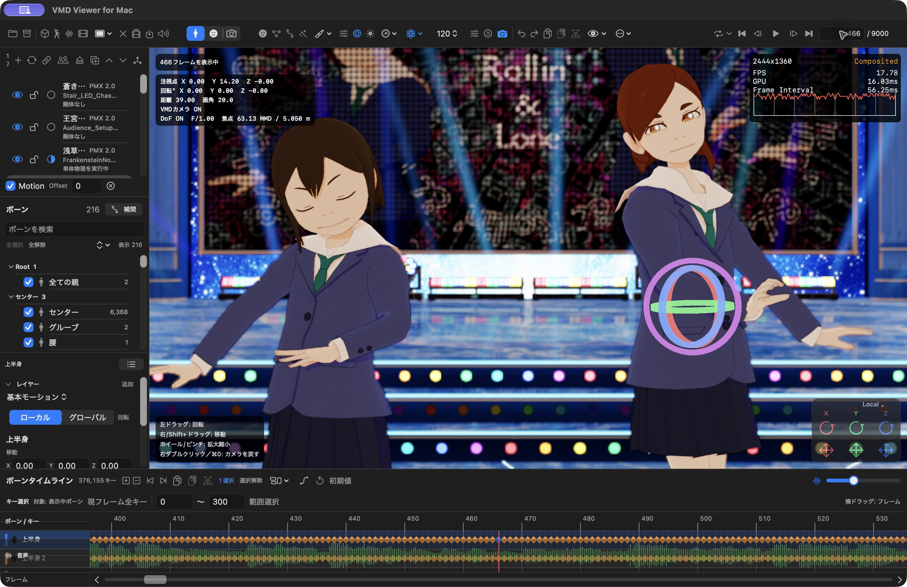

*図3：466フレームで、右側の水崎ツバメの「上半身」を選択した例。色付きの輪が回転用の3Dギズモです。*

#### ボーンを選んで動かす

1. **ボーンモード（⌘1）** に切り替えます。
2. 左の検索欄へ「上半身」「腕」「首」などを入力し、対象のボーン名を選びます。
3. 詳しい数値欄が見えない場合は、選択ボーン名の右にある「編集詳細を表示」を押します。
4. ビューポートのギズモ、または位置・回転の数値欄で調整します。
5. 「キー登録」を押し、前後の動きを確認します。

表示メニューでPMXボーンを表示している場合は、画面内のボーンをクリックして選ぶこともできます。

Returnで登録するときは、数値入力欄からフォーカスを外します。数値欄内のReturnだけではボーンキーは登録されません。モデルのMotionがOFFなら、ONにしてから登録してください。

Command／Shiftで複数のボーンを選べます。複数選択時の数値欄は移動・回転の差分です。親子ボーンを同時に選ぶと効果が重なる場合があります。

| 操作 | 見方 |
|---|---|
| 移動ギズモ | 軸の矢印をドラッグして位置を調整 |
| 回転ギズモ | 色付きの輪をドラッグして角度を調整 |
| 軸の色 | X＝赤、Y＝緑、Z＝青 |
| ローカル | 選択したボーンの向きに沿って操作 |
| グローバル | シーン全体の軸に沿って操作 |
| 数値欄 | 移動のX／Y／Z、回転角度のX／Y／Zを直接入力 |

移動できないボーンなど、PMX側の設定による制限があります。ギズモの種類は操作できる内容に応じて表示されます。物理の影響を受けるボーンは、再生時の揺れも含めて結果を確認してください。

#### 腕が服に入り込む部分を直す例

問題のフレームで腕やひじのボーンを選び、少しずつ角度を変えてキー登録します。その前後も確認し、急に腕が跳ねる場合は前後のキーや補間を調整します。一つのフレームの見た目だけで決めず、短いループ再生で動きのつながりを見ます。

この操作で編集するのはボーンの動きです。PMXの頂点形状を編集してPMXとして書き出す機能ではありません。

#### 指操作・指ポーズ

**編集 → 指操作…**で開き、「対応設定」でモデルの指関節・軸・角度を確認して有効にします。左右の握り・指開き・親指曲げを調整し、キーを登録します。対応はモデルごとの手動設定で、任意モデルへの自動対応や左右の自動鏡映はありません。

**編集 → 指ポーズ…**ではVPDを取り込み、左手／右手／両手／選択ボーンを選んで「適用」した後、キーを登録します。サムネイルを選ぶだけでは姿勢は変わりません。

#### モーションレイヤー

ボーンの「レイヤー」から追加・編集先の変更・改名・削除に加え、ミュート・ソロ・上下の並べ替え・重み0〜100%を指定できます。ソロは同じモデル個体・同じボーンの追加レイヤー内で働き、基本モーションは残ります。

重みキー欄で現在フレームへ重みを登録し、linear／holdの補間、移動・コピー／貼り付け・削除・Undoを使えます。重みキーがある場合は、その値を絶対重みとして使い、静的重みとの掛け算にはしません。「数値欄でレイヤー値を編集」を選べば、ミュート中や重み0でも合成前の値を登録できます。合成姿勢からの逆算編集は、有効重み100%の編集先に限られます。

レイヤー構造を残すときはプロジェクトで保存します。標準VMD保存は合成した通常キーを書き出します。物理の動きをキーに変換する「物理ベイク」には対応していません。

#### 左右を反転して使う

登録済みの基本モーションのボーンキーをコピーし、反転貼り付けボタンを使うと、左右の対応先へ鏡映して貼り付けられます。左右名は先頭の「左」「右」を対応させ、位置・回転・補間を扱います。対応先の欠落やレイヤー付きキーなど、曖昧な入力は理由を表示して拒否します。

未登録ポーズを反転する場合は **編集 → 選択ボーンのポーズを左右反転** を使います。登録済みキーの反転貼り付けとは別操作です。結果を確認してからキー登録し、必要ならUndoしてください。

#### PMX表示とIKのON／OFF

**編集 → IK on/off…** で、PMX表示とIK対象のON／OFFをプレビューし、現在フレームへ登録できます。キーはタイムラインから移動・コピー／貼り付け・削除でき、通常のVMDにも保存されます。現在表示の切替と、時刻付きのキー登録を区別してください。

### 補間曲線を使う

補間曲線は、前のキーから次のキーへ移るときの「動きの進み方」です。横軸は時間、縦軸は変化の進み具合を表します。

直線なら一定の割合で変化し、S字ならゆっくり始まって途中で速くなり、最後にゆっくり収まる動きを作れます。曲線はボーンやカメラの軌跡そのものを描いているわけではありません。

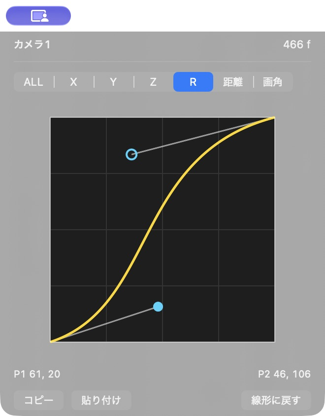

*図4：カメラ1の466フレーム、回転（R）チャンネルを表示した補間曲線ウインドウ。P1とP2の制御点で進み方を変えます。*

#### 別ウインドウで編集する

1. ボーンまたはカメラのキーを選びます。
2. 「補間」ボタン、上部の補間アイコン、または **⌥⌘I** で補間曲線ウインドウを開きます。
3. 編集するチャンネルを選びます。
4. P1／P2の点を動かし、前後を再生して確かめます。

ボーンは移動の **X／Y／Z** と回転の **R**、カメラはそれに **距離／画角** が加わります。「コピー」「貼り付け」で曲線を再利用でき、「線形に戻す」で直線にできます。

P1／P2のドラッグは離すと反映され、変更はUndo／Redoできます。このウインドウの「ALL」は、選択キーの全チャンネルへ同じ曲線を適用します。

#### タイムライン内で編集する

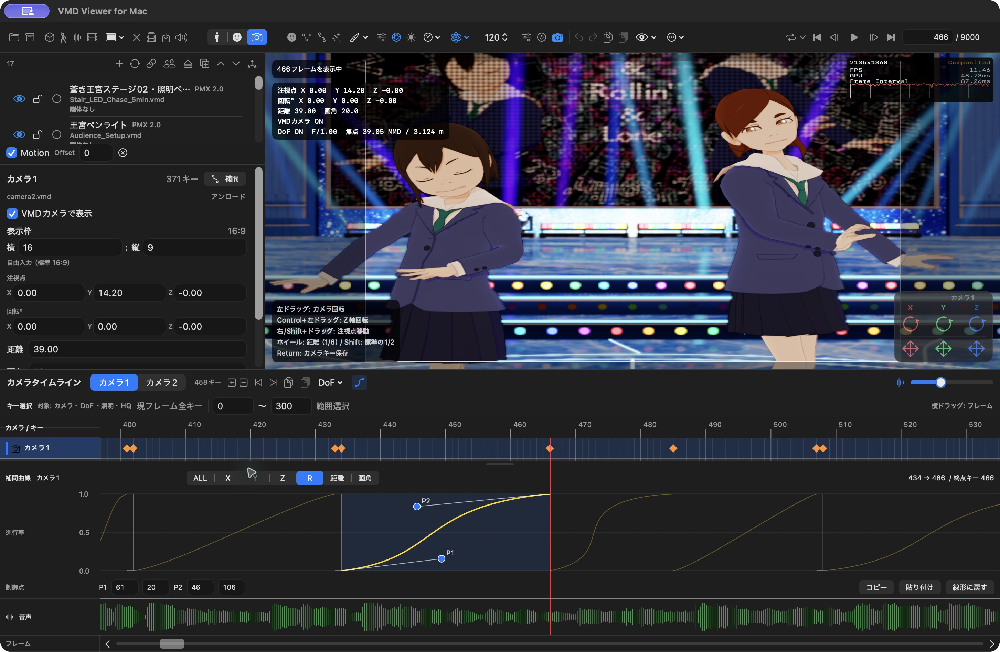

*図5：カメラ1の434→466フレームの補間区間を選んだ例。キーの行、回転（R）の曲線、音声波形を一緒に見られます。*

1. ボーン／カメラのタイムライン見出し、または左の操作欄にある曲線アイコンをONにします。両方のアイコンは同じ表示状態を切り替えます。
2. 編集したい区間、またはその区間の**終点側のキー**を選びます。
3. チャンネルを選び、P1／P2をドラッグするか、制御点の数値を入力します。
4. 数値入力はReturnまたは入力欄からのフォーカス移動で確定し、Escで取り消します。

制御点の数値は0〜127です。区間が短くて操作しにくい場合は、横方向に拡大するか数値欄を使います。補間欄の上端をドラッグすると高さを変えられます。

カメラの補間欄はONの間、再生中やキー選択の解除後、DoF・照明・HQ行の選択中も曲線を表示します。P1／P2や数値の編集は、補間区間を持つカメラキーを選んだときに使えます。ボーンでは対象ボーン・キーの選択に応じて曲線を表示し、対象がないときは欄が空白になります。

単独チャンネルを選んだときの線の色は次のとおりです。

| チャンネル | 線の色 |
|---|---|
| X | 赤 |
| Y | 緑 |
| Z | 青 |
| R（回転） | 黄 |
| 距離 | 白 |
| 画角 | オレンジ |

「ALL」は全チャンネルをまとめて扱います。選ぶだけでは値は変わりませんが、編集すると選択区間の終点キーの全チャンネルへ適用されます。移動のXだけを変えたいときはXを選んでください。

ALLでは複数の線を従来の色分けで表示するため、単独選択時と色が異なるチャンネルがあります。

先頭キーには直前の区間がありません。また、カメラの1フレーム区間はカットとして扱われ、補間編集が無効になります。モーフの値グラフは、このボーン／カメラ用の補間曲線とは別です。

### モーフを操作する

モーフは、まばたき、口の形、眉の動きなど、モデルに用意された変化を調整する機能です。衣装、材質、エフェクトの調整用モーフを持つモデルもあります。

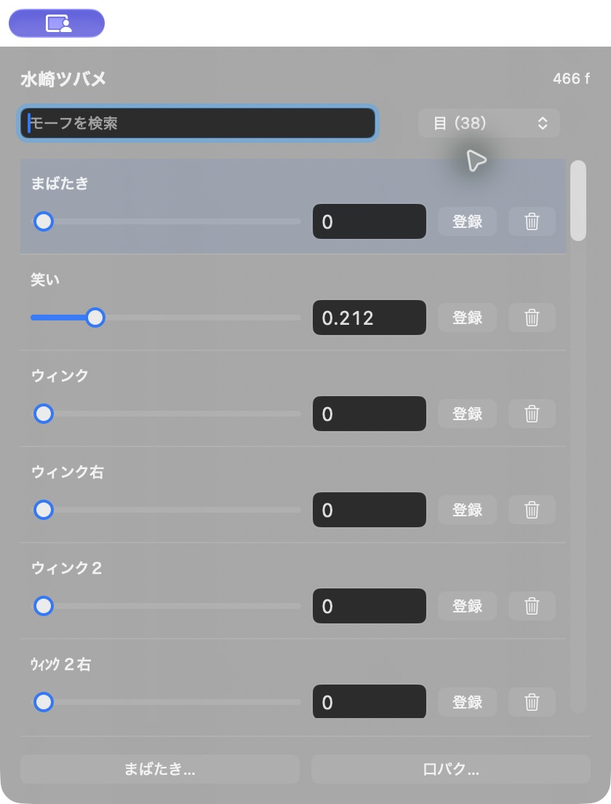

*図6：水崎ツバメの466フレームを表示したモーフ操作ウインドウ。「目」のグループから、まばたきや笑いを選べます。*

#### 表情を変えて登録する

1. 対象のキャラクターを選び、**モーフモード（⌘2）** に切り替えます。
2. 左の一覧や検索から「まばたき」などを選びます。
3. スライダーまたは数値欄で値を変えます。通常は **0＝変化なし、1＝最大** として使います。
4. 顔を確認して「キー登録」、または **K** を押します。

上部の顔アイコンで「モーフ操作」ウインドウを開くと、複数のスライダーを一覧で扱えます。このウインドウは、ボーンやカメラの編集モードでも使えます。各行の「登録」が、そのモーフを現在フレームへ記録する操作です。

たとえば、あるフレームでまばたきを0、数フレーム後で1、その少し後で0として登録すると、目を閉じて開く動きを作れます。既存のまばたきキーがある場合は、その位置と値を確認してから調整します。

#### ランダムまばたきを生成する

**編集 → ランダムまばたきを生成…** を開き、対象の閉眼モーフ・範囲・間隔などを設定します。生成前後の確認を経て適用すると、通常のモーフキーとして登録されます。既存の表情やキーを確認し、不要なら1回のUndoで戻してください。同じseedによる再現と、手修正したキーの保護を備えますが、すべてのモデルで自然に見えることを保証するものではありません。

#### モーフタイムラインの見方

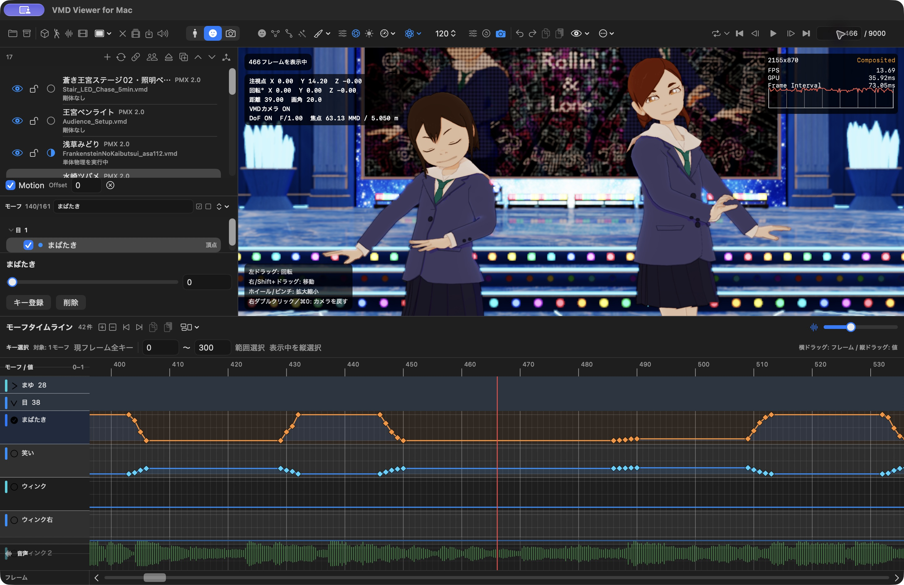

*図7：466フレームで「まばたき」の行を選択し、「目」グループを展開した例。横方向はフレーム、縦方向はモーフの値です。下の緑色の波形が音声です。*

モーフタイムラインは、菱形のキーを線で結んだ値のグラフです。横へドラッグすると時刻、縦へドラッグすると値を変えられます。複数キーを選んでいる場合は、まとめて同じ分だけ変更します。

左のモーフ一覧のチェックは、**タイムラインに表示する対象の選択**です。チェックを外しても、そのモーフのキーが削除されるわけではありません。見たいモーフだけを表示したり、まゆ・目・口・その他のグループを折り畳んだりすると、編集しやすくなります。

表示対象の全選択／全解除もできます。「設定… → 一般 → システムモーフを表示」でシステム分類を表示できます。非表示にしても、VMDやグループモーフからの評価は続きます。

### カメラを操作する

**カメラモード（⌘3）** では、シーン全体をどこから、どの大きさで見るかを編集します。モデルのモーションとは独立したカメラ用VMDを扱います。

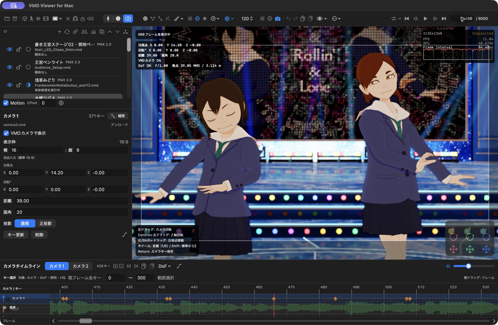

*図8：カメラ1の466フレームのキーを選んだ例。左に注視点・回転・距離・画角・投影、下にカメラキーと音声波形が表示されています。右下の軸操作パレットも使えます。*

#### カメラVMDで再生する

「VMDを開く」でカメラ用VMDを読み込み、「VMDカメラで表示」または上部のカメラVMDボタンをONにします。再生すると、読み込んだカメラの動きに沿って表示されます。

カメラVMDのON／OFFは、編集モード切替とは独立しています。ボーンやモーフを編集しながらカメラVMDの構図を見ることもできます。

再生中に周囲から確認したい場合は、「ウインドウ」メニューのカメラフリー／ロック切替を使います。動画出力の「VMDカメラを使用」は、これらのライブ表示設定と独立しています。

#### 停止中の自由視点とカメラ1／2

ボーン／モーフモードでは、VMDカメラがONでも停止中に回転・平行移動・ズームできます。この一時視点はカメラキーや保存内容を変更しません。**タイムライン移動・数値でのフレーム移動・コマ送りでは、移動先のVMD構図へ戻ります。** 同じフレームを明示指定した場合も対象です。「VMDカメラへ戻す」または再生開始でもVMD構図へ戻ります。

カメラモードのタイムライン見出しにある **カメラ1／カメラ2** で、編集・再生・VMD読み込み／保存・動画出力の対象を切り替えます。2本は独立し、加算やブレンドはしません。初めてカメラ2を選ぶと0フレームの初期キーを作ります。照明・影・DoF・HQは共通です。両カメラを残す場合はプロジェクトを保存してください。

#### カメラ目線のキーを生成する

1. 対象モデルとカメラVMDを準備し、VMDカメラをONにして再生を止めます。
2. 正面などの基準フレームで両目ボーンの向きを手動調整し、基本モーションへキー登録します。
3. **編集 → カメラ目線のキーを生成…** を開き、頭・両目・左右目、閉眼モーフ、可動範囲を設定します。
4. **現在フレームを視線基準に登録** し、基準プレビューを確認して設定を保存します。
5. 範囲・許容誤差を指定して **解析して登録** を実行し、生成した通常の両目・閉眼キーを確認します。

全フレームへキーを並べるのではなく、補間後の誤差を確認しながら編集しやすい少数キーへ減らします。正常終了すると、**要調整の区間も警告を残して登録**されます。失敗・中止・入力変更では登録しません。生成後の動きと警告を確認し、必要なら1回のUndoで戻してください。既存の左右目トラックを一律に置き換える機能ではありません。

「正面補正」は、正面姿勢として確認した基準へ目線を近づける設定で、初期値は0%です。近距離では「近接時に画面の奥を見る」を有効にし、カメラ背後または目→カメラの延長線へ1〜2m相当の目標を置けます。**1mに相当するscene単位、適用距離と解除距離は明示入力**し、PMXを自動でm単位とはみなしません。視線基準は維持されます。

実カメラへの誤差と、仮想目標・左右収束への誤差は別です。両目共通回転では寄り目が変わらないモデルもあり、v0.56.49の開発側の実素材比較でも寄り目解消・正面補正の見た目改善は未受入です。「登録できたこと」を見た目の合格とせず、対象シーンで確認してください。

#### マウスで構図を調整する

| 操作 | 動き |
|---|---|
| 左ドラッグ | カメラを回転 |
| 右ドラッグ／中ドラッグ／Shift＋左ドラッグ | カメラを平行移動 |
| ホイール／トラックパッドのピンチ | 拡大・縮小 |
| ⌘0／右ダブルクリック | カメラを初期位置へ戻す |

カメラモードで構図を作り、**Returnまたは「キー登録／キー更新」** で現在フレームへ確定します。入力欄を操作している場合は、まず入力内容を確定し、ビューポートへフォーカスを移してください。

| 設定 | 役割 |
|---|---|
| 注視点 X／Y／Z | カメラが見ている中心の位置 |
| 回転 X／Y／Z | 見る方向や傾き |
| 距離 | 注視点からカメラまでの距離 |
| 画角 | 画面に入る範囲と遠近感 |
| 透視 | 遠いものほど小さく見える投影 |
| 正投影 | 距離による大きさの変化がない投影 |
| 表示枠 | 構図を確認するための縦横比。標準は16:9 |

表示枠の比率と、動画書き出しの解像度は別の指定です。動画にするときは、出力する縦横比でも構図を確認してください。

#### カメラタイムラインで動きを整える

異なるフレームで構図を作ってキー登録すると、その間を補間してカメラが動きます。タイムライン上でキーを左右に動かすと、切替や移動のタイミングを変更できます。急に速くなる動きは、区間の長さと補間曲線の両方を確認します。

カメラタイムラインには、設定に応じてDoF、ワールド・照明、HQエフェクトのキーも表示されます。行の名前を見て、カメラのキーと区別してください。

### 編集したVMDを保存する

1. ボーン／モーフを保存する場合は、対象モデルを選び、その編集モードにします。カメラを保存する場合はカメラモードにします。
2. 「VMDを保存」、または **⇧⌘S** を使います。
3. 保存対象のボーン／モーフなどと、必要ならフレーム範囲を指定します。
4. 新しい名前で保存します。

保存対象のボーン・モーフ、またはカメラ・照明・セルフシャドウを選び、必要なら名前・グループで絞れます。範囲保存は開始と終了の両方を含み、**元のフレーム番号を維持**します。範囲の先頭を0へ詰めたり、境界キーを自動追加したりはしません。範囲内に保存対象キーがない場合は保存できません。

レイヤーを含む標準VMDは、検査付きで合成結果を書き出します。物理の動きをボーンキーに変換する「物理ベイク」ではありません。

作業全体を残すときは、別途 `.vmdviewer` も保存します。ボーンのレイヤー構造やVvfM独自の見た目の設定を、標準VMDだけで保管することはできません。

## シェーダー説明

### 標準搭載の3種類

シェーダーは、モデルの色、明るさ、影などの見え方を決めます。上部の筆アイコンのメニューから、描画方式を選びます。

| 方式 | 見た目・特徴 | 選び方 |
|---|---|---|
| **Metal** | 明るさが連続的に変化する基本の描画 | モデルやテクスチャの状態を確認するとき |
| **ToonShader LE** | 明部と2段階の影でアニメ調に描く軽量な方式 | 軽快に動きを確認したいとき |
| **ToonShader HQ** | Toonの描画に輪郭線、光、ぼかし、AOなどを加えられる方式 | 見た目を細かく仕上げたいとき |

HQは使う効果や解像度によって負荷が変わります。動作が重いときは、効果を一つずつ見直すか、編集中だけLE／Metalへ切り替えて確認します。

### 再生が重いときの描画解像度

筆アイコン → **描画解像度…**から、内部解像度を「互換・1/1・7/8・3/4・5/8・1/2」に変更できます。

| 表示方式 | 動作 |
|---|---|
| 標準 | 内部解像度で描いた結果を、通常のビューポート解像度へ再構成します |
| 内部解像度 | 縮小した解像度のまま表示します。輪郭が粗く見える場合があります |

内部解像度表示のHQでは、AAをTAA／FXAA／OFFから選べます。ライブ表示用の設定なので、**動画出力の解像度は出力画面で別に指定**してください。さらに負荷を減らす場合は、モデル数、物理FPS、AO、DoF、Bloomなどを一つずつ見直します。一定FPSを保証する設定ではありません。

### ToonShader HQのエフェクト

ToonShader HQを選び、隣の調整アイコン「高品質Toonエフェクト調整」を開きます。設定欄は縦にスクロールできます。

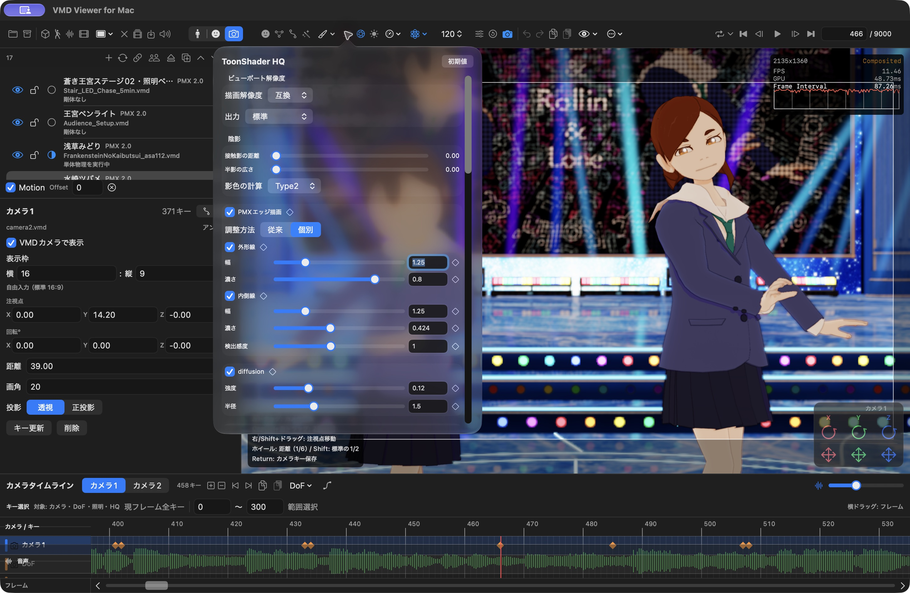

*図9：HQの調整画面。影色の計算（Type2）、PMXエッジの個別調整、diffusionなどの設定が並びます。表示値は撮影中のプロジェクトの設定です。*

#### 影色の計算

HQ調整の **陰影 → 影色の計算** で、Type1（従来方式）／Type2（msToonCoordinator標準自動影色）を選べます。v0.58.0以降の新規プロジェクトと「初期値」はType2です。影色指定やHQ設定を持たない旧プロジェクトはType1で復元します。Type2は色相・彩度・輝度を使った自動影色のMetal実装で、プロジェクトへ保存します。静的な切替であり、キーアニメーションや元MMEエフェクト全体の互換を示すものではありません。

v0.58.4では、HQ設定の静的な説明をラベルや操作部のヘルプへ移しました。説明を確認するときは対象へポインタを重ねます。エラーや現在状態、未適用の変更に関する操作は画面に残ります。

#### PMXエッジ描画

モデルの輪郭線を調整します。「幅」は線の太さ、「濃さ」は見え方の強さです。「従来」でまとめて調整するほか、「個別」で外形線と内側線を分けられます。

外形線はシルエットを、内側線は形状の内部の線を見やすくするために使います。「検出感度」は内側線の出方を調整します。テクスチャ画像に描き込まれた線は、この設定では消えません。

#### diffusion

画面へ柔らかいにじみを加えます。「強度」は混ぜる量、「半径」は広がりです。強くすると輪郭や細部も柔らかく見えるので、顔や髪を見ながら控えめな値から調整します。

#### RimLight

モデルの縁に光を足し、背景から浮き立たせます。「強度」で光の量、「指数」で光の広がり方を調整します。暗い背景で輪郭を見せたいときに役立ちます。

#### アンチエイリアス

斜めの線や輪郭のギザギザを抑えます。方式は同時併用ではなく、一つを選びます。

| 方式 | 特徴・調整の目安 |
|---|---|
| OFF | アンチエイリアスを使わない |
| FXAA | その時点の画像から輪郭を滑らかにする軽量な方式。「FXAA品質」を調整 |
| TAA | 前のフレームも使ってちらつきを抑える方式。「履歴」「ジッター」を調整 |
| MetalFX | 対応Macで、内部解像度から拡大しながら滑らかにする方式 |

MetalFXでは「最高（100%）」「高品質（77%）」「バランス（67%）」「自動」から解像度の方針を選べます。細部の見え方と負荷を見比べて決めてください。「透過・発光の残像を抑える」は、半透明部分や光の残り方を調整するための項目です。

非対応環境ではTAA／FXAAへ切り替わります。

#### Bloom

明るい部分や発光材質から、光がにじむように見せる効果です。ステージ照明やペンライトなどに使います。

| 項目 | 何を変えるか |
|---|---|
| しきい値 | 通常の明るい部分を、どこから光として取り出すか |
| 強度 | にじむ光の強さ |
| 材質発光倍率 | PMXの発光モーフや材質ノードから指定された発光の強さ |
| 半径／ぼかし強度 | 光の広がりと柔らかさ |
| 光芒方向数 | 星のように伸びる光の方向数。表示には実際の本数も示されます |
| 芒角度／光芒長さ | 光の筋の向きと長さ |
| 点滅／周期／波形 | タイムラインに同期する点滅。「滑らか」「矩形波」を選択 |
| 明示材質名 | 光らせる対象の材質名をカンマ区切りで指定 |

白くつぶれる場合は、強度や材質発光倍率を下げて比べます。BloomはVvfM側の効果で、MMEのAutoLuminousを完全に再現するものではありません。

#### AO

物の重なりや隙間に陰影を足し、立体感を出します。「半径」は周囲のどれくらいの範囲を見るか、「強度」は陰影の濃さです。顔や衣装が黒く見えすぎるときは、強度を下げて確認します。

#### Tonemapper

光を加えた後の画面全体の明るさや色を整えます。

| 項目 | 調整するもの |
|---|---|
| 露出 | 全体の明るさ |
| コントラスト | 明暗の差 |
| 彩度 | 色の鮮やかさ |
| 白レベル | 明るい部分のまとまり方 |

顔、白い服、照明の近くなど、明るさの異なる場所を見比べながら調整してください。

#### DoFと照明

**DoF（被写界深度）** は、ピントを合わせた位置の前後をぼかす機能です。上部の絞りアイコンから設定を開き、焦点位置やPMXのボーンターゲット、絞り、ボケ量を調整します。ToonShader HQの透視投影で使います。小さいF値ほど背景をぼかす方向になりますが、距離などによって結果は変わります。

DoFを有効にし、焦点を保存する手順です。

1. 描画を**ToonShader HQ**、カメラを**透視投影**にします。
2. 絞りアイコンで「カメラDoF」を開き、**「DoF全体」**をONにします。
3. 「現在フレームの記録値」と「現在フレームの描画条件」がONか確認します。enabledキーがない場合は「enabledキー未適用時のDoF」をONにします。
4. 焦点ターゲットを「手動距離」または「PMXボーン」にし、距離またはモデル・ボーンを選びます。
5. 再生を止めて、**「現在フレームへ焦点ターゲットをキー登録／更新」**を押します。
6. F-stop、ボケ量係数、絞り羽根、品質、最大CoC（ぼけの最大量）を調整し、プロジェクトを保存します。

**焦点ターゲットを選ぶだけでは保存キーは変わらず、焦点キーの登録だけでもDoFはONになりません。** 既存のenabledキーがOFFなら、そのキーが優先されます。「DoF全体」をOFFにしても、保存したキーや設定は残ります。

対象ボーンが見つからない・非表示などで焦点を解決できない場合は、保存された距離を使います。状態表示と解決済み焦点距離を確認してください。DoFはプロジェクトに含まれ、専用の `.dofvmd` としても扱えます。Metal・LE・正投影でのぼかしには対応していません。

**画面から焦点を選択**は、停止中・HQ・透視投影・モデル表示で使えます。モデル表面をクリックして候補を確認し、明示登録するとワールド位置の焦点キーになります。背景は選択できず、ボーンへ追従する焦点が必要な場合はPMXボーンを指定します。フレーム・カメラ・モデル・画面寸法が変わった後の古い選択結果は登録しません。

「DoF設定キー」では、有効・焦点距離・F値・絞り羽根数・回転・縦横比を種類別に登録できます。カメラタイムラインの「DoF」メニューで行を展開し、選択・移動・値編集・コピー／貼り付け・削除を使います。異なる種類の同時選択では共通の時間移動だけを行い、値の編集は同じ種類のキーで行います。

投影スクリーン動画のDoF量は通常材質と同じです。旧v0.56.29の追加2倍処理はv0.56.44で撤去されているため、旧版の説明や画像のボケ量を現行版の固定倍率として使わないでください。動画投影部分のBloom除外は維持されています。

次のON／OFF比較は、どちらも450フレーム・同じVMDカメラの構図です。キャラクターの顔と、背景のステージや投影スクリーンの輪郭に注目してください。

**DoF OFF**

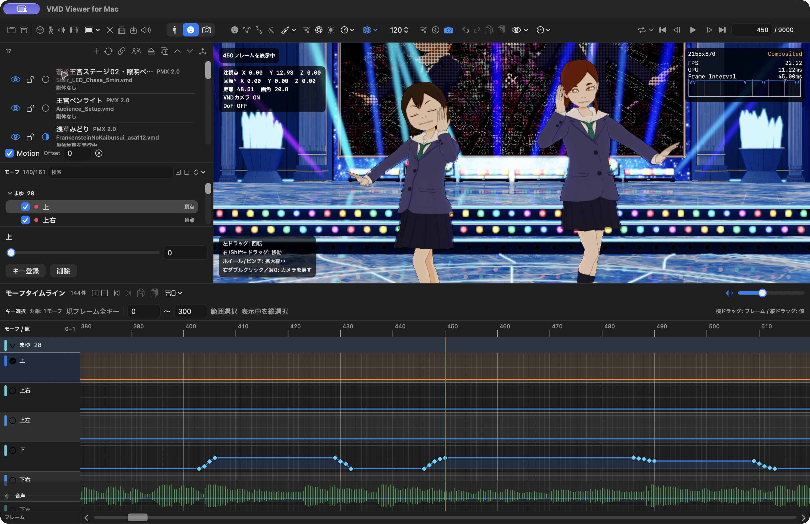

*図10：DoF全体をOFFにした例。背景の柱や投影スクリーンの細部まで、輪郭がはっきり見えます。*

**DoF ON**

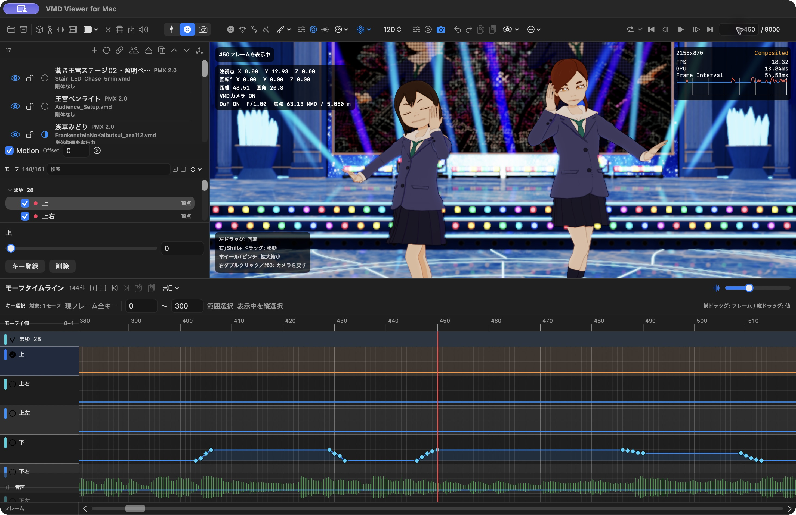

*図11：DoF ON、F/1.00。浅草みどりの左目を焦点の追従先にした設定で、背景をぼかした例です。キャラクターへ視線を集めたいときに使います。*

太陽アイコンの「ワールド・平行光源設定」では、背景色／透明、環境光、光源の色・強度・方向、地面影などを調整できます。材質やBloomだけで見た目が整わない場合は、照明も確認します。

平行光源をキーで動かす場合は **「照明キーを使用」** をONにします。OFFにしても登録したキーは保持・保存されます。モデルごとのセルフシャドウも設定できます。

#### 背景色と照明をアニメーションさせる

1. 太陽アイコンの「ワールド・平行光源設定」を開き、登録したいフレームへ移動します。
2. **背景色・環境光色・光源色・方向** のうち、変更する項目の値を調整します。
3. その項目の菱形ボタンで現在フレームへキー登録します。同じフレームにキーがあれば更新します。
4. 別のフレームでも値を調整して登録し、再生して変化を確認します。

キーを登録した項目だけ、カメラタイムラインのDoF直下へ専用行が表示されます。時刻の移動・コピー・貼り付け・削除・Undoはタイムラインで、色や方向の値は照明設定で編集します。各項目は別々の時刻に登録できます。背景色と環境光色のキーは、DoFやカメラVMDのON／OFFに関係なく動作します。

未登録の変更はプレビューで、フレーム移動・再生・保存・動画出力で取り消されます。変化を残すには菱形ボタンで確定し、プロジェクトを保存してください。DoFと4項目の独立キーは拡張 `.dofvmd` にも保存できます。標準VMDだけでは、背景色や環境光色を含む作業全体を保存できません。

#### 時間とともに効果を変える

対応するHQ項目の菱形ボタンで、現在フレームへ設定キーを登録できます。たとえば、曲の盛り上がりに合わせてBloomの強度を変えられます。登録したキーはカメラタイムライン側で確認します。

キーがある項目の一時的な調整値は、登録するまでプレビューです。移動、再生、画面を閉じる、保存などで取り消される場合があるので、変化を残すときは菱形ボタンで確定します。「初期値」で戻すのは静的な設定で、既存キーの削除はタイムラインで行います。

### エフェクトノード

上部の「エフェクトの材質割当て」を開くと、**材質／シーン／読込状況** の3つの表示があります。ノードとは処理を表す箱、接続線とは処理や値の受け渡しを表す線です。

| 表示 | 対象 |
|---|---|
| 材質 | 服、髪、小物など、モデルの材質ごとの見た目 |
| シーン | ToonShader HQによる画面全体の処理 |
| 読込状況 | 外部の`.fxdayo`が検出・対応・実行されているか |

#### 材質へエフェクトを割り当てる

1. 再生を止め、「材質」を選びます。
2. 「PMXモデル」から対象を選び、左の材質一覧で変更する材質を選びます。
3. 「追加・変更」から、Holographicの追加、基本シェーダーのPBR／Rhinestoneへの変更などを選びます。
4. 中央のノードを選び、右の設定欄で値や画像を調整します。
5. 必要な端子を接続し、**「変更を適用」** を押します。
6. Viewerで見た目を確認して、プロジェクトを保存します。

端子はドラッグ、またはクリックで接続できます。右クリックで切断、Escで配線操作を取り消せます。ノードを画面上で並べ替えただけでは実行順は変わりません。出力へ接続されていない効果は描画されません。

適用前は「未適用の変更」です。左下のPMXプレビューは**適用済み**の状態を表示し、未適用の配線やシーン全体のDoF、他モデルからの影・反射などは含みません。最後はメインのViewerでも確かめます。

変更はUndo／Redoで戻せます。保存・動画出力前に未適用の変更を適用または取消してください。Holographicのモーフ値を変えた場合は「キー登録」も必要です。材質・ノード・画像・HQ設定はプロジェクトへ保存します。

| 主な選択肢 | 用途 |
|---|---|
| 標準材質 | 元の基本的な材質表示へ戻す |
| PBR | 金属度、粗さ、色、法線、発光などを調整する |
| Rhinestone | 反射や模様、発光を持つ装飾的な材質にする |
| Holographic | 模様や色、光の変化を重ねる |
| 画像ノード | 効果で使用する画像を指定する |
| 汎用ノード | 数値、計算、範囲変換、色、色の混合、材質調整を組み合わせる |

これらはVvfMが対応する処理の組合せです。任意のBlenderノードやMMEエフェクトを、そのまま読み込める機能ではありません。

#### シーン全体の処理順を変える

「シーン」では、HQのノードと設定を編集します。「HDRの接続」から **Diffusion → Bloom**、**Bloom → Diffusion**、片方のみ、両方をバイパスなどを選べます。順序を変えると、ぼかした画像へ光を足すか、光を含む画像をぼかすかが変わります。

変更後は「変更を適用」を押します。AA、DoF、Tonemapperなどには固定された処理段階があり、すべてを自由な順序に並べ替えることはできません。ロック付きの入力はアプリが供給します。

### `.fxdayo`への対応

[MikuMikuDayo](https://github.com/pennennennennennenem/MikuMikuDayo) の`.fxdayo`に一部対応しています。

PMXと同じ場所に、拡張子を除いて同じ名前の`.fxdayo`があると、PMX読み込み時に検出されます。付属画像なども含め、エフェクトの配布時の構成を保って配置してください。

確認するには、「エフェクトの材質割当て」→ **「読込状況」** を開きます。ここでは次の3つを分けて読みます。

| 状態 | 意味 |
|---|---|
| 解析 | 定義ファイルの内容を読み取れたか |
| 互換性 | VvfMが対応する定義・機能か |
| 実行状況 | 実際に描画へ使われているか。理由の表示も確認します |

**ファイルを検出できたことや、解析できたことだけでは、効果が描画されるとは限りません。** `unsupported`などの未対応表示がある場合は、名前を変えるだけでは対応になりません。

`detected`／`parsed`は検出・解析の状態、`ported`は対応する移植アダプター、`approximate`は近似アダプターの区分です。`unsupported`は現在のアプリでは実行できないことを表します。

「設定… → 再生 → .fxdayo 動作」の**RealTime**は、停止中も壁時計で効果を更新します。**FrameTime**はVMDの表示フレームに合わせ、停止中の効果も止まります。RealTimeでも、VMD・音声・物理の時間が自動で進むわけではありません。

対応済みの専用処理には、**MobFesPenlight_3、MMDayo_SSR、beam、Cracker、ikHolographic** があります。これに加え、同梱のJsonnet／DXC／SPIRV-Crossを使い、限定profileに適合する原文をMetalへ変換して実行する経路があります。利用者のMacへのHomebrew導入は不要です。**任意のHLSLやすべてのDayo効果を無条件に実行するものではなく、原版との画像一致も保証しません。** `exactSource`も、確認済みのソースに一致するという意味で、同じ見た目の保証ではありません。

未知の原文は検査結果を確認し、「この原文を試す」で明示実行します。条件不一致・コンパイル失敗・不適合では理由を表示し、通常表示を維持します。再読み込みはモデル・物理・未登録編集を保持し、新候補のGPU成功と実表示を確認してから採用します。失敗や取消では、既に採用済みの版を保持します。

読込状況にはHDR・tone mapper・表示linearなどの色段階と担当も表示します。色処理専用profileと内蔵FXAAの併用や、骨・別モデル個体を参照するcontrollerには、対応profile・明示的な割り当てが必要です。共有Fog／Fluid simulation、任意の端数dispatch、すべての描画方式の混在へ一般化はできません。

動画書き出しは、停止中・失敗中の原文を黙って除外せず、既定では拒否します。除外する場合は書き出し側で明示選択してください。GPU自体の障害は通常の原文不適合とは別で、描画と書き出しを停止し、保存後のアプリ再起動が必要になります。詳しい作者向けの契約と旧資料との差分は [.fxdayo資料の案内](docs/fxdayo/README.md) を参照してください。

効果ごとに動画出力の制限もあります。たとえばbeamでは衝突設定が0の範囲に限られ、透明なProRes出力は拒否されます。エラーになった場合は、「読込状況」と動画書き出しの説明を確認してください。

## 動画出力

### 動画を書き出す流れ

**ファイル → アニメーション動画を書き出す…（⇧⌘E）**、または上部の重なったフィルムのアイコンで専用ウインドウを開きます。単独のフィルムアイコンは入力動画の読み込みです。動画は指定された区間を計算して作成するため、通常再生の画面を録画する操作とは異なります。

1. ボーン、モーフ、カメラ、エフェクトに未登録・未適用の変更があれば確定し、プロジェクトを保存します。
2. 「動画を書き出す」を開きます。
3. **開始／終了** に書き出すVMDフレームの範囲を入力します。
4. **出力レート**、**コーデック**、**コンテナ**、**解像度**を選びます。
5. **「VMDカメラを使用」** と **「読み込んだ音声を含める」** を確認します。
6. 「保存先フォルダを選択…」で場所を指定し、ファイル名を確認します。
7. 「概要」のフレーム数と長さを確認して、「書き出す」を押します。
8. 完了後、保存された動画を開き、構図、動き、揺れ、音声を確認します。

初めての出力は、**H.264／MP4／1080p／30または60 fps** から試せます。全編の前に短い区間を書き出すと、仕上がりを確認しやすくなります。

### 出力コーデックとコンテナ

**コーデック**は映像の圧縮方式、**コンテナ**は映像や音声をまとめるファイル形式です。

| コーデック | コンテナ | 透明度 | 主な使いどころ |
|---|---|---|---|
| H.264 | MP4／MOV | 不透明 | 再生・共有用の一般的な動画 |
| HEVC | MP4／MOV | 不透明 | HEVCを扱える再生環境向け |
| ProRes 4444 | MOV | アルファを自動で含む | 編集・合成用の素材 |
| ProRes 4444 XQ | MOV | アルファを自動で含む | XQを必要とする編集・合成工程向け |

ProResを選ぶとコンテナはMOVになります。ProResは容量が大きくなりやすいため、保存先の空きを確認します。選んだ方式が利用できない環境では、エラーの内容を確認し、別の方式を選んでください。

### 出力レートとフレーム範囲

出力レートには23.98／24／29.97／30／59.94／60 fpsのプリセットと、1〜240 fpsのカスタム指定があります。出力レートを変えても、VMDの時間の基準は30 fpsです。

範囲には開始と終了の両方のフレームを含みます。**開始0、終了299** は、30 fps出力なら300枚、60 fps出力なら600枚の、10秒の動画になります。300フレームの位置まで含めたい場合は、終了300を指定します。

端数のレートでは出力枚数の丸めがあるため、最終的な長さは設定ウインドウの「概要」で確認してください。

### 解像度を選ぶ

| 選択肢 | 画素数 |
|---|---|
| 720p | 1280 × 720 |
| 1080p | 1920 × 1080 |
| 4K | 3840 × 2160 |
| カスタム | 幅・高さを指定。各辺は2以上の偶数 |

高い解像度ほど、細部を大きく出力できますが、処理時間や必要な資源も増えます。画面のプレビュー解像度とは別に指定する設定です。

### カメラと音声の注意点

**「VMDカメラを使用」は動画書き出し専用の選択**です。Viewer側のカメラ表示ボタンとは別に確認します。

| 条件 | 動画の構図 |
|---|---|
| ONでカメラVMDが読み込み済み | カメラVMDに沿って動く |
| OFF | 書き出し開始時の構図で固定 |
| ONでもカメラVMDが未読み込み | 書き出し開始時の構図で固定 |

音声を入れる場合は、先にWAV／M4Aを読み込み、「読み込んだ音声を含める」をONにします。設定欄に表示される音声ファイル名も確認してください。投影用動画を読み込んだだけで、その動画の音声も同じように含まれると考えず、必要な音声を別途読み込んで指定します。

M4AはPCMへ復号して処理します。アプリでの試聴音量・ミュートは、出力の音声設定には反映されません。

### 透明な素材を書き出す

合成用の透明な部分を残す場合は、ProRes 4444またはProRes 4444 XQを選びます。アルファはコーデックから自動的に決まるため、書き出し画面に独立した透明度ON／OFFの切替はありません。

アルファ対応を選んでも、ステージや不透明な背景モデルが自動で消えるわけではありません。必要な背景・モデルの表示状態も確認します。H.264とHEVCは、このアプリでは不透明な動画になります。

透明動画ではMetalFXを選んでいても、書き出し時にはTAAへ切り替わります。エフェクトによっては透明出力自体が未対応なので、短い区間で背景との合成結果を確認してください。

ProResのアルファはpremultiplied（色が透明度で乗算された）形式です。編集ソフトへ取り込む際は、透明度の解釈も確認してください。

### 物理演算と出力完了の確認

動画出力は指定範囲を順に計算し、物理は常に物理優先で評価します。編集用シークの「移動先で演算」は使いません。選択したBulletモードは出力に使われます。ライブ再生の速度や「再生優先モード」での一時的な表示が、そのまま動画に記録されるわけではありません。

全コーデック・全素材・4K・長尺・音声の全組み合わせが検証済みというわけではありません。未対応の構成や必要な素材の読み込み失敗では、出力を停止する場合があります。既存ファイルへの上書きには確認が表示されます。

書き出し中は進捗と状態を確認し、中止するときは「キャンセル」を使います。成功表示が出るまでは完了と扱わず、完了後に動画を開いて映像・音声・必要なら透明部分を確認します。作業用の `.vmdviewer` も一緒に保管してください。

## ショートカット早見表

入力欄や補助ウインドウにフォーカスがある場合は、キーの操作先が変わることがあります。入力を確定してフォーカスを外すか、メニュー・対象ボタンを使ってください。

| 操作 | キー |
|---|---|
| プロジェクトを開く | ⌘O |
| PMXを開く | ⇧⌘O |
| VMDを開く | ⌥⌘O |
| 音声を開く | ⌥⌘W |
| 投影用動画を開く | ⌥⌘M |
| プロジェクト保存／別名保存 | ⌘S／⌥⌘S |
| VMDを別名で保存 | ⇧⌘S |
| 動画出力 | ⇧⌘E |
| ボーン／モーフ／カメラ編集 | ⌘1／⌘2／⌘3 |
| カメラを初期位置へ戻す | ⌘0 |
| 行の全フレームのキーを選択 | タイムライン行名をShift＋左クリック |
| 再生・一時停止 | Space |
| 先頭／終端へ移動 | Home／End |
| 1フレーム戻る／進む | ←／→、`,`／`.` |
| 前／次のキーへ移動 | Shift＋←／→ |
| モーフキーを登録 | K |
| ボーン／カメラキーを登録 | 入力欄からフォーカスを外してReturn |
| 補間曲線ウインドウ | ⌥⌘I |
| 1フレーム挿入／削除 | ⇧⌘I／⇧⌘D |
| 取り消し／やり直し | ⌘Z／⇧⌘Z |
| グリッド表示 | ⇧⌘G |
| フルスクリーン／終了 | ⌃⌘F |

## 困ったときは

| 症状 | 確認すること |
|---|---|
| モデルが見えない | シーン一覧の表示ON、ビューポートの「PMXモデル」表示、⌘0での視点リセット |
| モデルが動かない | 対象モデルへVMDが割り当てられているか、MotionがONか、Offsetや現在位置が合っているか |
| 別のモデルが動く・動きが合わない | 選択PMX、VMDの割り当て先、Offset、モデルとVMDのボーン名。カメラ専用VMDはモデルを動かしません |
| テクスチャが見つからない | PMXに付属する画像とフォルダ構成を保っているか |
| 編集値が戻る | キー登録／キー更新、またはノードの「変更を適用」を済ませたか |
| 音が出ない | WAV／対応M4Aの読み込み、アプリのミュート、Macの音量と出力先 |
| 音が入っていない | 音声ファイルを読み込み、「読み込んだ音声を含める」をONにしたか |
| 動画のカメラが動かない | 書き出し側の「VMDカメラを使用」とカメラVMDの読み込み状態 |
| 違うカメラが編集・出力される | カメラタイムラインのカメラ1／2で選択中の対象を確認 |
| 目線生成後も寄り目・視線ずれが残る | 基準・可動範囲・scene単位/m、解析後の要調整と左右収束の残差を確認。自動登録は見た目の合格ではありません |
| DoFが効かない | HQ・透視投影・DoF全体ON・現在フレームの記録値／描画条件、焦点ボーンの解決状態。焦点キーだけでは有効になりません |
| 効果が出ない | 選択した描画方式、材質への適用、ノードの接続、`.fxdayo`の実行状況 |
| 再生が重い・シークが遅い | 描画解像度、HQの効果、モデル数、物理FPS、シーク方式 |
| 設定ウインドウを移動したい | タイトルバーやタブ周囲の空白をドラッグ。入力欄やスライダーは通常の操作に使います |
| 揺れが再生と出力で違う | 「移動先で演算」や物理リセット直後か、物理FPS・Bulletモード・モデルの物理設定。先頭からの再生でも確認します |
| 保存が始まらない | 未登録のボーン編集、未適用のノード変更、欠けた素材、保存先の空き容量。保存中・物理再計算中は完了を待ちます |
| 範囲を指定したVMD保存ができない | 指定範囲に保存対象のキーがあるか |
| 書き出しが始まらない | 範囲、出力レート、偶数の解像度、保存先、エフェクトの対応条件、表示されたエラー |
| 書き出しに時間がかかる | 高解像度、モデル数、物理FPS、効果の負荷。必要なら短区間や低解像度で確認 |
| GPUエラーで再生・描画が止まった | 編集をプロジェクト／VMDへ保存し、アプリを終了・再起動。サイズ・AA変更だけでは停止を解除しません。進行中の書き出しは成功扱いになりません |

出力の問題は、短い範囲、偶数の解像度、対応するコーデック／コンテナで確認します。必要なら音声なしで映像だけを試します。未対応効果や必要素材の読み込みエラーは、原因を解消してから再出力してください。

### 旧版で報告されていた症状

v0.56.49の開発記録には、次の症状が既存の制約や原因未確定の報告として残っています。以下は旧版の報告の概要で、現行版で同じ症状が起きることを断定するものではありません。

- Motion OFFの状態でHomeへ移動すると、表示が更新されない。
- 全画面・シーク・ループ付近で「描画待機を終了しました」と表示され、再生が止まる。

同じ症状が起きた場合は、必要な編集を保存し、アプリの版と操作順を添えて報告してください。Motion OFFの問題は、モーションONでも同じ位置を確認すると状況を伝えやすくなります。

## 対応範囲と制限

### PMX・物理・エフェクト

- PMX 2.0／2.1を読み込めます。PMX 2.1のTriMesh／Ropeソフトボディ、拡張ジョイント、頂点カラー、点・線描画などに対応し、シーン一覧にはPMXの版も表示します。ただし、全モデル・全係数や、MMDとの画像・物理結果の完全一致を保証するものではありません。
- 追加UVは保持・評価されます。UV1は対応するサブテクスチャや頂点カラーへ使われますが、UV2〜4を任意シェーダーへ渡す汎用機能はありません。
- 頂点カラーとSphere mode 3を併用するモデルは、UV1の用途が競合するため読み込みを拒否します。RopeでclusterがONかつ数が0のSoftBodyなど、生成できない構成もあります。
- PMXそのものの編集・再書き出しには対応していません。指・レイヤー・物理ベイクの制限は [ボーンの操作](#pmxのボーンを操作する) も参照してください。
- PBR・Holographic・Rhinestone・`.fxdayo`・Bloomは対応範囲内のMetal実装／近似です。Holographicの半透明部分や鏡面内部の効果などには制限があります。MMEや任意のHLSLをそのまま実行する機能ではありません。

### 負荷と確認範囲

モデル数、HQ、DoF、高い物理FPSを同時に使うと負荷が増えます。開発側の検証記録でも、全体性能と長時間安定性の正式な受入確認は未完了で、**安定30／60 fpsを保証する記録ではありません**。

全OS・複数画面・全コーデック・4K長尺・長時間耐久を網羅した確認も完了していません。重要な作業は短い試行と別名バックアップを先に行ってください。骨なしPMXの通常表示・再生・シークは生成モデルで確認済みですが、以前問題のあった外部Holographicプロジェクトを含む全素材の再検証は未完了です。

### v0.56.49までの主な変更（旧版の概要）

- **v0.56.49**：現在フレーム中心のタイムライン拡縮、操作説明、近接目線目標。寄り目解消・スクロールの滑らかさ改善は未受入です。
- **v0.56.47〜48**：GPU障害後の再投入停止と保存維持、旧コード・テストの監査。GPU timeoutの根本原因や長時間安定性の解決とは区別します。
- **v0.56.44〜46**：独立カメラ1／2、DoF設定キーと画面からの合焦、重み付きレイヤー、保存・Undo・読み込みの所有者修正。スクリーンDoFを通常材質と同じ量へ戻しました。
- **v0.56.37〜43**：目線の自動登録・基準・正面補正、まばたき・左右反転、行全キー選択、停止中自由視点と移動時のVMD復帰、限定`.fxdayo`共通機能の拡張。
- **v0.56.15〜36**：動画再生方法の3択、IK表示キー、原文エフェクトの検査・再読み込み・フェイルセーフ、HQ影色Type1／Type2、スクリーン動画のBloom除外など。
- **v0.56.14**：設定ウインドウのタイトルバー・ツールバーからの移動を修正し、再生優先度の選択UIを非表示にしました。
- **v0.56.13と追補**：補間欄の表示保持・高さ調整・ON／OFF操作・単独チャンネル色を整え、物理検索や連続編集、材質準備の重複処理を減らしました。局所処理の短縮とアプリ全体のFPS改善は別に記録されています。
- **v0.56.12**：背景色・環境光色・平行光源色・方向の独立キーと、拡張 `.dofvmd` の保存に対応しました。
- **v0.56.11**：ボーン／カメラのタイムライン内で補間曲線を表示・編集できるようになりました。
- **v0.56.10**：編集を引き継ぐPMXの入れ替えと、確認・保存を伴うVMDアンロードを追加しました。

それ以前にはPMX 2.1、Bulletモード、シーク方式や物理挙動の更新があります。後続版の概要は[2026年11月8日の更新補足](docs/updates/codex-motion-2026-11-08.md)を参照してください。

## 素材・ライセンス・不具合報告

公開文書の [MIT License](LICENSE) と、今後のアプリ独自バイナリに適用する [補足EULA 2.0・日本語原本](Licenses/VMDViewer-EULA-ja.md)（[英訳](Licenses/VMDViewer-EULA-en.md)） は対象を分けています。[ライセンス適用範囲](LICENSING.md)と、使用するReleaseの案内を確認してください。EULAにはリバースエンジニアリング禁止と、法令・第三者ライセンス・既存MIT許諾による例外を定めています。既存版の条件を遡及変更するものではありません。

同梱ライブラリ・画像・エフェクトには [THIRD_PARTY_NOTICES.md](THIRD_PARTY_NOTICES.md) と各原文の条件が適用されます。Bullet、ZIPFoundation、共有Toon画像、Holographic、Rhinestone、MMDayo_MobFesには、それぞれの告知・利用条件があります。

プロジェクトには素材も含まれます。公開・共有するときは、モデル、モーション、音源、動画、エフェクトの改変・再配布条件とクレジットを確認してください。作者の許可なく素材入りプロジェクトを配布しないでください。

不具合は [VvfMのIssues][issues] へ、次の情報を添えて報告してください。

- アプリのバージョン・build番号
- macOSのバージョンとMacのチップ
- 問題が起きたフレームと、そこまでの操作
- モデル数、物理モード／FPS、描画方式、エフェクト、出力設定
- エラーメッセージと、可能なら問題部分のスクリーンショット

個人情報、未公開作品、再配布禁止の素材は添付しないでください。

## このマニュアルの参照元

基礎資料は、2026年10月19日に確認した開発版の記録ID `3620662`、**v0.56.49／build453** です。2026年11月8日に確認した **v0.58.4／build569** の保存・登録操作などを追記しました。画面例（図1〜11）も、同日に起動中の **v0.58.4／build569** から撮り直しました。

メニュー・ツールバー・設定画面の操作名、操作仕様、PMX 2.0／2.1の対応範囲、各版の検証記録を照合し、概要を本文にまとめました。画面の撮影時には掲載するモード・パネル・フレームの表示を確認しました。機能全体の再テストや再ビルドは実施していません。

別冊の [.fxdayo資料の案内](docs/fxdayo/README.md) には、同じ参照版の開発者ガイド・設計の概要と、後続runtimeとの差分をまとめています。ガイド本文の研究時点や、従来収録したv0.56.20の検証記録は、現行版の再検証結果ではありません。

現在の配布状況は [Releases][releases] を確認してください。参照元のローカルリリース版番号だけでは、GitHubでの配布公開を意味しません。

このマニュアルの画像は `images` フォルダを相対参照しています。別の場所へ移すときは、Markdownと `images` フォルダをまとめて移動してください。

[releases]: https://github.com/opopoposiop/VvfM/releases
[issues]: https://github.com/opopoposiop/VvfM/issues
