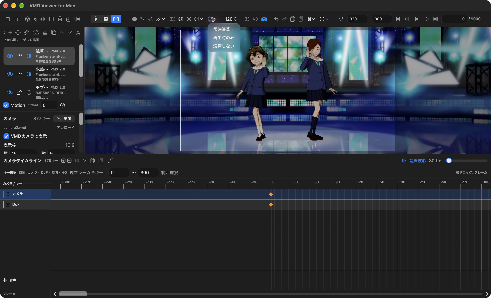
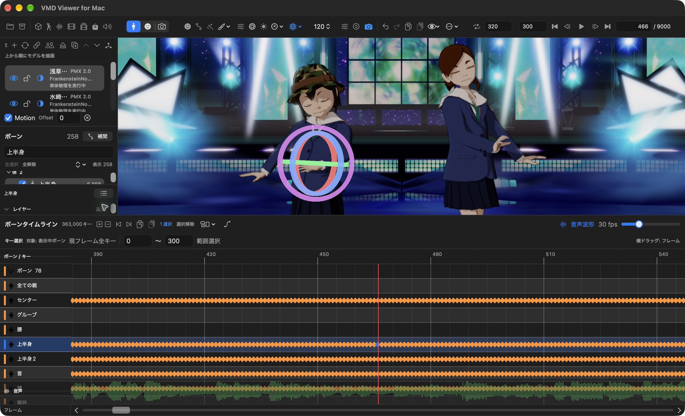
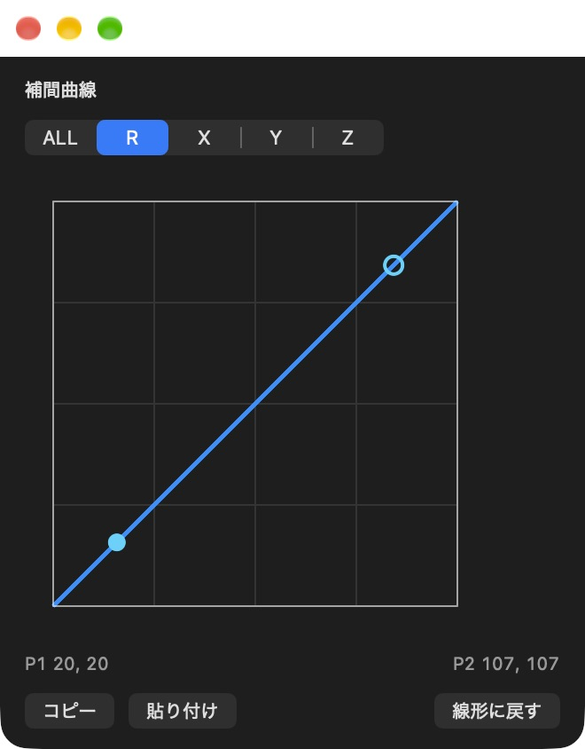
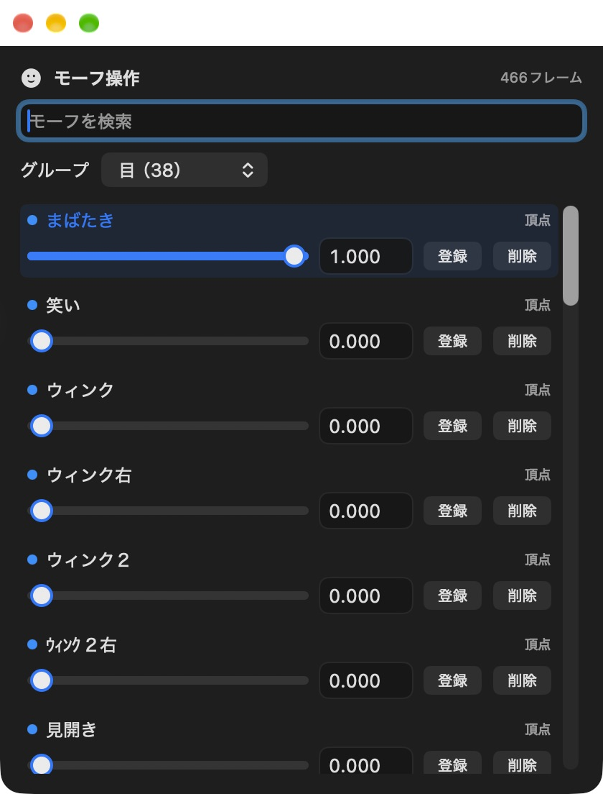
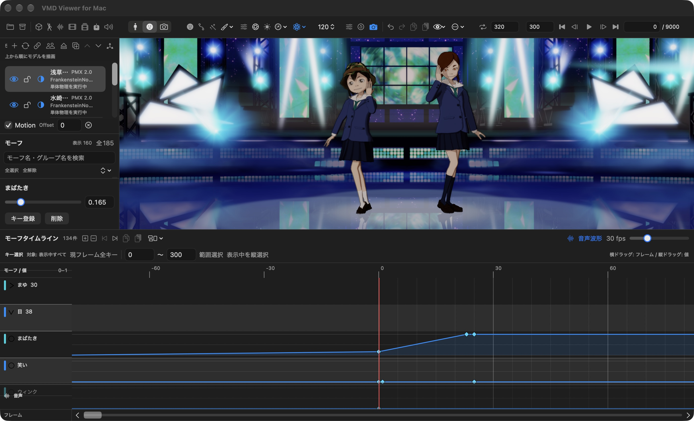
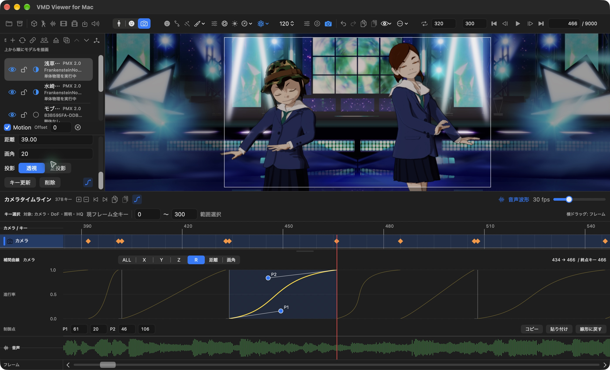
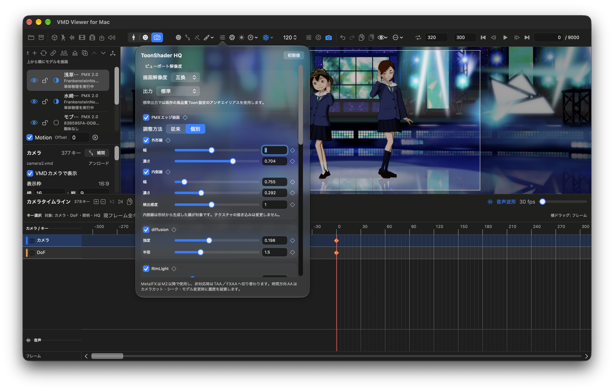
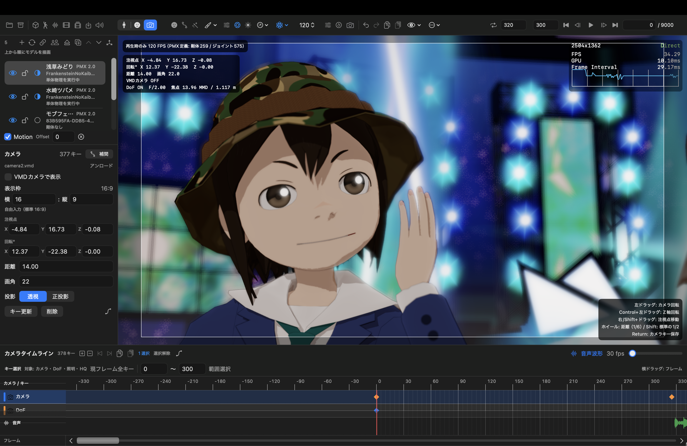

# VMD viewer for Mac 一般ユーザーマニュアル

PMXモデルとVMDモーションを読み込み、動きや表情を調整して、動画にするまでの操作を説明します。初めて使う方は「基本機能」から順に試してください。

**画面例（図1〜9）：VMD Viewer v0.56.13／build398、2026年10月6日撮影。** 使用許可を受けた `Scene3.vmdviewer` を実際のアプリで開いて撮影しています。DoFのON／OFF比較（図10・11）には、提供された画面キャプチャを使用しています。モデル名、キーの数、設定値は掲載シーンの例です。バージョンやウインドウの大きさによって、配置が異なる場合があります。

キー表記は **⌘＝Command、⌥＝Option、⇧＝Shift** です。たとえば⌘Oは、Commandを押しながらOを押します。

**目次**

1. [開発コンセプト](#開発コンセプト)
2. [VMD viewer for Mac 概要](#vmd-viewer-for-mac-概要)
3. [基本機能](#基本機能)
4. [VMD編集](#vmd編集)
5. [シェーダー説明](#シェーダー説明)
6. [動画出力](#動画出力)

## 開発コンセプト

動画を確認していて、腕が服を突き抜けていることに気づいた。表情に、もう一つモーフを足したくなった。けれど出先にはMacしかなく、WindowsのMikuMikuDanceへすぐに戻れない――そんなときに、Macでモーションを開き、確認や調整を続けられることを目指したアプリです。

「Macでも好きなキャラクターのダンスを見たい」「モデルとモーションを組み合わせて動画を作ってみたい」という方にも、読み込み、再生、編集、動画出力を一つの画面から進められるようにしています。

## VMD viewer for Mac 概要

### VvfMでできること

VMD viewer for Macの略称は **VvfM** です。WindowsアプリケーションのMikuMikuDanceで使われるPMXモデルやVMDモーションを、Macで読み込み、再生・編集できます。

キャラクターの動き、表情、カメラをそれぞれのタイムラインで扱い、音声に合わせて調整できます。見た目はMetal、ToonShader LE、ToonShader HQから選び、作業全体をプロジェクトとして保存したり、映像を動画ファイルへ書き出したりできます。

**MikuMikuDanceとの完全な互換性を保証するものではありません。** 物理演算、材質、影、エフェクトなどの見え方は、素材や設定によって異なります。別のアプリへVMDを渡す場合も、渡した先で動きと表情を確認してください。

### Macの動作要件

| 項目 | 内容 |
|---|---|
| OS | macOS 14以降 |
| Mac | Metal対応Mac。掲載画面で使用した配布アプリはAppleシリコン用です |
| MetalFX | M2以降を対象とする機能です。非対応環境ではTAA／FXAAへ切り替わります |
| 保存容量 | モデル、テクスチャ、音声、保存プロジェクト、出力動画を置く空き容量が必要です |
| メモリと負荷 | 必要量はモデル数、テクスチャ、物理、エフェクト、解像度で変わります |

配布されたアプリを使うだけなら、開発用のXcodeを用意する必要はありません。Intel Macでの利用可否は、入手したアプリがIntel用を含むか確認してください。

### ファイルの役割

| 種類 | 主な内容 | 使いどころ |
|---|---|---|
| `.pmx` | モデルの形、骨組み、材質、モーフ、物理設定 | キャラクターやステージを読み込む |
| `.vmd` | ボーン、モーフ、カメラなどのキーフレーム | ダンス、表情、カメラワークを読み込む／保存する |
| `.wav`／`.m4a` | 音声 | 曲に合わせて再生・編集する |
| `.mov`／`.mp4`／`.m4v` | 投影用の動画 | 背景や対応するスクリーン材質へ映像を表示する |
| `.vmdviewer` | 素材とシーン設定をまとめたプロジェクト | 作業を保存して、後から同じ構成で開く |
| `.dofvmd` | VvfM用のDoFやワールド・照明のキー | 追加のカメラ効果や照明アニメーションを保存する |
| `.fxdayo` | 対応エフェクトの定義 | 対応するPMXと組み合わせて使う |

PMXに付属するテクスチャ画像は、元のフォルダ構成を保って置いてください。PMXだけを別の場所へ移すと、画像が見つからなくなることがあります。

### 画面の見方

*図1：Scene3を開いたメイン画面。左にモデルと編集項目、右にモデル表示、下にタイムラインがあります。*

| 場所 | 役割 |
|---|---|
| 上部左側のツールバー | プロジェクト、PMX、VMD、音声、投影用動画の読み込みと保存 |
| 上部中央 | ボーン／モーフ／カメラの切替、エフェクト、描画、照明、物理、表示設定 |
| 上部右側 | ループ範囲、再生・停止、フレーム移動、現在フレーム |
| 左上のシーン一覧 | 操作するモデルの選択、モデルごとの表示やロック |
| 左下の編集欄 | 選択したボーン、モーフ、カメラの値を編集 |
| 右のモデル表示領域 | 画角、姿勢、表情、見た目を確認。ビューポートとも呼びます |
| 下のタイムライン | キーの時刻、選択、移動、音声波形を確認 |

アイコンの意味が分からないときは、ポインタを重ねて説明を表示します。同じカメラの形でも、**編集モードのカメラ**と、**カメラVMDのON／OFF**は別のボタンです。

## 基本機能

### まずScene3を開いて再生する

1. 上部左端のフォルダアイコン「プロジェクトを開く」、または **⌘O** を使います。
2. `Scene3.vmdviewer` を選び、読み込みが終わるまで待ちます。
3. モデルとステージが表示されたら、右上の再生ボタン **▶** を押します。**Space**でも再生・一時停止できます。
4. 一時停止し、「現在フレーム」へ数値を入力して **Return** を押すと、その位置へ移動します。
5. 編集を試す前に、**⌥⌘S** で別名のプロジェクトとして保存しておくと、元のシーンを残せます。

Scene3はこのマニュアルの画面例です。通常は、自分で用意したPMX、VMD、音声を次の手順で読み込みます。

### PMX、VMD、音声を読み込む

#### 1. PMXモデルを追加する

上部の立方体アイコン「PMXを追加」、または **⇧⌘O** でPMXを選びます。FinderからPMXをウインドウへドラッグ＆ドロップすることもできます。

読み込んだモデルは左上のシーン一覧へ追加されます。複数のモデルを使う場合は、**編集したいモデルの行をクリックして選択**してください。目のアイコンは表示、鍵のアイコンはロックの切替です。

#### 2. 選択したモデルへVMDを読み込む

1. シーン一覧で対象のキャラクターを選びます。
2. 先頭からモーションを始めたい場合は、現在フレームを **0** にします。
3. 「VMDを開く」、または **⌥⌘O** でVMDを選びます。ドラッグ＆ドロップでも読み込めます。
4. 確認画面が出た場合は、対象と開始位置を確認します。

既にVMDがある場合は「読込済みVMDへ追加しますか？」と表示されます。同じ種類・名前・フレームのキーは、追加するVMDの内容で更新されます。途中のフレームで新たに読み込むと、「表示フレームからVMDを開始しますか？」と確認される場合があります。

**単純に最初から再生したいときは、0フレームへ戻ってから読み込む**と開始位置を合わせやすくなります。カメラ用VMDは内容を判定してカメラ側へ読み込まれ、モデルのモーションとは別に扱われます。

シーン一覧の **Motion** がOFFだと、そのモデルのモーションが反映されません。**Offset** はモデルのモーション開始位置をずらすための値です。初めて使うときは0のままにしておきます。

#### 3. 音声を読み込む

「音声を開く」、または **⌥⌘W** でWAV／M4Aを選びます。ファイルのドラッグ＆ドロップにも対応します。

読み込んだ音声は再生位置に合わせて鳴り、タイムラインの「音声波形」をONにすると、曲の強弱を見ながら編集できます。スピーカーアイコンからアプリの音量を調整できます。

#### 4. 背景やスクリーンへ動画を表示する

「動画を開く」、または **⌥⌘M** でMOV／MP4／M4Vを選びます。読み込んだ動画は、背景または `screen.bmp` に対応する材質へ投影できます。

これはシーンに表示する映像の読み込みです。完成したシーンを動画へ保存する操作は、[動画出力](#動画出力)で説明します。

### VMDを再生する

| 操作 | ボタン／キー |
|---|---|
| 再生・一時停止 | ▶／一時停止ボタン、Space |
| 0フレームへ戻る | 「0フレームに戻る」、Home |
| 1フレーム戻る／進む | 前後のボタン、`,`／`.` |
| 終端へ移動 | 「終端フレームへ移動」、End |
| 指定フレームへ移動 | 右上の現在フレーム欄へ入力し、Return |
| 範囲を繰り返す | 開始・終了フレームを入力し、ループボタンをON |

ループは、腕や表情など、短い区間を繰り返し確認するときに便利です。**開始フレームが終了フレーム以下になるように設定**してください。図のループ欄は保存シーンの値であり、操作例の指定値ではありません。

テキスト入力欄を編集中は、Spaceや矢印キーが入力欄へ渡されることがあります。再生ボタンを直接押すか、入力を確定してから操作してください。

### タイムラインの基本

**キーフレーム**は「この時刻に、この姿勢・表情・カメラ位置にする」という記録です。タイムラインでは菱形で表示されます。赤い縦線は現在のフレームです。

VMDの時間は **30フレーム＝1秒** を基準にします。たとえば300フレームは開始から10秒の位置です。画面に「60 fps」と表示されていても、VMDの時間の数え方は変わりません。

| したいこと | 操作 |
|---|---|
| 時刻を移動する | キーのない場所をクリックするか、現在フレーム欄を使う |
| キーを選ぶ | 菱形をクリック。⌘／⇧を併用すると追加選択できます |
| まとめて選ぶ | 空いている場所から矩形で囲む、または「範囲選択」を使う |
| 現在位置のキーを選ぶ | 「現フレーム全キー」を押す |
| 時刻をずらす | 選択したキーを左右へドラッグ |
| コピーして再利用する | ⌘C → 貼り付け先フレームへ移動 → ⌘V |
| 前後のキーへ移動する | タイムライン見出しの前／次ボタン |
| キーを削除する | キーを選んでDelete |
| 間違えた操作を戻す | ⌘Z。やり直しは⇧⌘Z |
| 横方向の表示を拡大する | タイムライン右上の表示スケールを調整 |
| 別の範囲を表示する | 最下段の「フレーム」横スクロールバーを動かす |

コピーと貼り付けは、ボーン同士、モーフ同士、カメラ同士で行います。移動・貼り付け先に同じ対象のキーがある場合は置き換わることがあるため、必要に応じて元に戻して確認します。

モデルにOffsetがあると、ボーン／モーフのタイムラインはモデル側の時刻を、カメラはシーン全体の時刻を示します。複数モデルのタイミングが合わないときはOffsetも確認してください。

### 物理演算のFPS

髪、スカート、小物などの揺れは、PMXに設定された物理演算によって変化します。ツールバーの原子のアイコンで動作モードを選び、その隣の数値で物理FPSを選びます。

*図2：「常時演算」「再生時のみ」「演算しない」。右隣の120は、画面例で選ばれている物理FPSです。*

| モード | 動作と使いどころ |
|---|---|
| 常時演算 | 停止中も物理を進めます。ポーズを止めたまま揺れの収まりを見たいときに使います |
| 再生時のみ | 再生中に物理を進め、停止中は状態を保持します |
| 演算しない | 物理による動きを無効にし、モーションやポーズを確認します |

物理FPSは **60／120／180／240** から選べます。値を高くすると、1秒間をより細かく分けて計算しますが、処理負荷も増えます。まず60または120で動きを見て、揺れ方と操作の重さを比べてください。値を変えると揺れ方も変わり得るため、仕上げの確認と動画出力では設定を揃えます。

混同しやすい4つのFPSを整理すると、次のようになります。

| 設定・表示 | 何を表すか |
|---|---|
| VMDの30 fps | モーションやカメラの時刻の基準 |
| 物理FPS | 物理演算を1秒間に何回進めるか |
| 再生・描画FPS | 画面を描く頻度の設定。24固定／30固定／60上限／無制限から選択 |
| 動画の出力レート | 書き出した動画の1秒あたりのフレーム数 |

「表示フレームの物理状態を再計算」は、そのフレームの姿勢から物理状態を作り直す操作です。先頭から再生して到達したときの揺れを再現する操作とは異なります。最終的な揺れは、必要な区間を再生して確かめてください。

### オーバーレイ表示

オーバーレイは、モデルを見るときに重ねて表示する編集・確認用の情報です。

| 表示したいもの | 開く場所 |
|---|---|
| ビューポートの情報表示 | 「…」→「ビューポートのオーバーレイを表示／非表示」 |
| 平面グリッドとY軸 | 「…」→「平面グリッドとY軸を表示／非表示」。⇧⌘Gでも切替 |
| モデル、ボーン、剛体、ジョイント | 目のアイコンの表示メニューで個別に切替 |
| ポリゴンの見え方 | 目のアイコン→「ポリゴン」。通常／ワイヤーフレーム／通常＋メッシュ |
| 音声波形 | タイムライン見出しの「音声波形」 |
| FPS表示 | 「ファイル」→「設定…」で、非表示／Metal HUD／詳細（Viewer）を選択 |

ボーン表示は姿勢を編集するとき、剛体・ジョイント表示は揺れの設定を確認するときに使います。鑑賞するときは不要な表示を隠すと見やすくなります。編集用のボーンやギズモ、タイムライン、FPS表示は、動画書き出しに含まれません。

### 作業を保存する

**作業を続けるための保存は `.vmdviewer`、他のMMD系アプリへ動きを渡す保存は `.vmd`** を使います。

| 操作 | 内容 |
|---|---|
| プロジェクトを保存／⌘S | PMX、テクスチャ、VMD、音声、投影用動画、シーンの各設定をまとめて保存。開いているプロジェクトがあれば上書き |
| プロジェクトを別名保存／⌥⌘S | 元のファイルを残して、新しい名前で保存 |
| VMDを保存／⇧⌘S | 編集したモーションやカメラのキーをVMDへ保存 |

VMDだけでは、VvfMの材質エフェクトやシーン全体の設定は保存できません。**作業途中や完成時には、プロジェクトも保存**しておきましょう。

## VMD編集

### 編集の共通手順

1. 再生を一時停止します。
2. シーン一覧で対象モデルを選びます。カメラ編集はシーン全体が対象です。
3. **ボーン＝⌘1、モーフ＝⌘2、カメラ＝⌘3** で編集モードを選びます。
4. 編集したいフレームへ移動し、対象と値を選びます。
5. 変更を残すには **「キー登録」または「キー更新」** を押します。
6. 前後を再生して確認し、プロジェクトまたはVMDを保存します。

**画面で姿勢や値を変えたことと、キーとして登録したことは別です。** 未登録の変更は確定済みのモーションとして扱われないため、登録を確認してから別のフレームへ進みます。

### PMXのボーンを操作する

ボーンは、モデルの腕、脚、首などを動かす骨組みです。ボーン名と動かせる方向はモデルごとに異なります。

*図3：右側のキャラクターの「上半身」を選択した例。色付きの輪が回転用の3Dギズモです。*

#### ボーンを選んで動かす

1. **ボーンモード（⌘1）** に切り替えます。
2. 左の検索欄へ「上半身」「腕」「首」などを入力し、対象のボーン名を選びます。
3. 詳しい数値欄が見えない場合は、選択ボーン名の右にある「編集詳細を表示」を押します。
4. ビューポートのギズモ、または位置・回転の数値欄で調整します。
5. 「キー登録」を押し、前後の動きを確認します。

表示メニューでPMXボーンを表示している場合は、画面内のボーンをクリックして選ぶこともできます。

| 操作 | 見方 |
|---|---|
| 移動ギズモ | 軸の矢印をドラッグして位置を調整 |
| 回転ギズモ | 色付きの輪をドラッグして角度を調整 |
| 軸の色 | X＝赤、Y＝緑、Z＝青 |
| ローカル | 選択したボーンの向きに沿って操作 |
| グローバル | シーン全体の軸に沿って操作 |
| 数値欄 | 移動のX／Y／Z、回転角度のX／Y／Zを直接入力 |

移動できないボーンなど、PMX側の設定による制限があります。ギズモの種類は操作できる内容に応じて表示されます。物理の影響を受けるボーンは、再生時の揺れも含めて結果を確認してください。

#### 腕が服に入り込む部分を直す例

問題のフレームで腕やひじのボーンを選び、少しずつ角度を変えてキー登録します。その前後も確認し、急に腕が跳ねる場合は前後のキーや補間を調整します。一つのフレームの見た目だけで決めず、短いループ再生で動きのつながりを見ます。

この操作で編集するのはボーンの動きです。PMXの頂点形状を編集してPMXとして書き出す機能ではありません。

### 補間曲線を使う

補間曲線は、前のキーから次のキーへ移るときの「動きの進み方」です。横軸は時間、縦軸は変化の進み具合を表します。

直線なら一定の割合で変化し、S字ならゆっくり始まって途中で速くなり、最後にゆっくり収まる動きを作れます。曲線はボーンやカメラの軌跡そのものを描いているわけではありません。

*図4：補間曲線の別ウインドウ。P1とP2の制御点で進み方を変えます。*

#### 別ウインドウで編集する

1. ボーンまたはカメラのキーを選びます。
2. 「補間」ボタン、上部の補間アイコン、または **⌥⌘I** で補間曲線ウインドウを開きます。
3. 編集するチャンネルを選びます。
4. P1／P2の点を動かし、前後を再生して確かめます。

ボーンは移動の **X／Y／Z** と回転の **R**、カメラはそれに **距離／画角** が加わります。「コピー」「貼り付け」で曲線を再利用でき、「線形に戻す」で直線にできます。

#### タイムライン内で編集する

*図5：カメラの補間タイムライン。キーの行、区間ごとの曲線、音声波形を一緒に見られます。*

1. ボーン／カメラのタイムライン見出しにある曲線アイコンをONにします。
2. 編集したい区間、またはその区間の**終点側のキー**を選びます。
3. チャンネルを選び、P1／P2をドラッグするか、制御点の数値を入力します。
4. 数値入力はReturnまたは入力欄からのフォーカス移動で確定し、Escで取り消します。

制御点の数値は0〜127です。区間が短くて操作しにくい場合は、横方向に拡大するか数値欄を使います。補間欄の上端をドラッグすると高さを変えられます。

「ALL」は全チャンネルをまとめて扱います。選ぶだけでは値は変わりませんが、編集すると選択区間の終点キーの全チャンネルへ適用されます。移動のXだけを変えたいときはXを選んでください。

先頭キーには直前の区間がありません。また、カメラの1フレーム区間はカットとして扱われ、補間編集が無効になります。モーフの値グラフは、このボーン／カメラ用の補間曲線とは別です。

### モーフを操作する

モーフは、まばたき、口の形、眉の動きなど、モデルに用意された変化を調整する機能です。衣装、材質、エフェクトの調整用モーフを持つモデルもあります。

*図6：モーフ操作ウインドウ。「目」のグループから、まばたきや笑いを選べます。*

#### 表情を変えて登録する

1. 対象のキャラクターを選び、**モーフモード（⌘2）** に切り替えます。
2. 左の一覧や検索から「まばたき」などを選びます。
3. スライダーまたは数値欄で値を変えます。通常は **0＝変化なし、1＝最大** として使います。
4. 顔を確認して「キー登録」を押します。

**⌥⌘M** または上部の顔アイコンで「モーフ操作」ウインドウを開くと、複数のスライダーを一覧で扱えます。このウインドウは、ボーンやカメラの編集モードでも使えます。各行の「登録」が、そのモーフを現在フレームへ記録する操作です。

たとえば、あるフレームでまばたきを0、数フレーム後で1、その少し後で0として登録すると、目を閉じて開く動きを作れます。既存のまばたきキーがある場合は、その位置と値を確認してから調整します。

#### モーフタイムラインの見方

*図7：まばたきのキーを選択した例。横方向はフレーム、縦方向はモーフの値です。下の緑色の波形が音声です。*

モーフタイムラインは、菱形のキーを線で結んだ値のグラフです。横へドラッグすると時刻、縦へドラッグすると値を変えられます。複数キーを選んでいる場合は、まとめて同じ分だけ変更します。

左のモーフ一覧のチェックは、**タイムラインに表示する対象の選択**です。チェックを外しても、そのモーフのキーが削除されるわけではありません。見たいモーフだけを表示したり、まゆ・目・口・その他のグループを折り畳んだりすると、編集しやすくなります。

### カメラを操作する

**カメラモード（⌘3）** では、シーン全体をどこから、どの大きさで見るかを編集します。モデルのモーションとは独立したカメラ用VMDを扱います。

*図8：カメラキー466フレームを選んだ例。左に距離・画角・投影、下に選択区間の補間曲線が表示されています。*

#### カメラVMDで再生する

「VMDを開く」でカメラ用VMDを読み込み、「VMDカメラで表示」または上部のカメラVMDボタンをONにします。再生すると、読み込んだカメラの動きに沿って表示されます。

カメラVMDのON／OFFは、編集モード切替とは独立しています。ボーンやモーフを編集しながらカメラVMDの構図を見ることもできます。

#### マウスで構図を調整する

| 操作 | 動き |
|---|---|
| 左ドラッグ | カメラを回転 |
| 右ドラッグ／中ドラッグ／Shift＋左ドラッグ | カメラを平行移動 |
| ホイール／トラックパッドのピンチ | 拡大・縮小 |
| ダブルクリック | 正面カメラへ戻す |

カメラモードで構図を作り、**Returnまたは「キー登録／キー更新」** で現在フレームへ確定します。入力欄を操作している場合は、まず入力内容を確定してください。

| 設定 | 役割 |
|---|---|
| 注視点 X／Y／Z | カメラが見ている中心の位置 |
| 回転 X／Y／Z | 見る方向や傾き |
| 距離 | 注視点からカメラまでの距離 |
| 画角 | 画面に入る範囲と遠近感 |
| 透視 | 遠いものほど小さく見える投影 |
| 正投影 | 距離による大きさの変化がない投影 |
| 表示枠 | 構図を確認するための縦横比。標準は16:9 |

表示枠の比率と、動画書き出しの解像度は別の指定です。動画にするときは、出力する縦横比でも構図を確認してください。

#### カメラタイムラインで動きを整える

異なるフレームで構図を作ってキー登録すると、その間を補間してカメラが動きます。タイムライン上でキーを左右に動かすと、切替や移動のタイミングを変更できます。急に速くなる動きは、区間の長さと補間曲線の両方を確認します。

カメラタイムラインには、設定に応じてDoF、ワールド・照明、HQエフェクトのキーも表示されます。行の名前を見て、カメラのキーと区別してください。

### 編集したVMDを保存する

1. ボーン／モーフを保存する場合は、対象モデルを選び、その編集モードにします。カメラを保存する場合はカメラモードにします。
2. 「VMDを保存」、または **⇧⌘S** を使います。
3. 保存対象のボーン／モーフなどと、必要ならフレーム範囲を指定します。
4. 新しい名前で保存します。

作業全体を残すときは、別途 `.vmdviewer` も保存します。ボーンのレイヤー構造やVvfM独自の見た目の設定を、標準VMDだけで保管することはできません。

## シェーダー説明

### 標準搭載の3種類

シェーダーは、モデルの色、明るさ、影などの見え方を決めます。上部の筆アイコンのメニューから、描画方式を選びます。

| 方式 | 見た目・特徴 | 選び方 |
|---|---|---|
| **Metal** | 明るさが連続的に変化する基本の描画 | モデルやテクスチャの状態を確認するとき |
| **ToonShader LE** | 明部と2段階の影でアニメ調に描く軽量な方式 | 軽快に動きを確認したいとき |
| **ToonShader HQ** | Toonの描画に輪郭線、光、ぼかし、AOなどを加えられる方式 | 見た目を細かく仕上げたいとき |

HQは使う効果や解像度によって負荷が変わります。動作が重いときは、効果を一つずつ見直すか、編集中だけLE／Metalへ切り替えて確認します。

### ToonShader HQのエフェクト

ToonShader HQを選び、隣の調整アイコン「高品質Toonエフェクト調整」を開きます。設定欄は縦にスクロールできます。

*図9：HQの調整画面。輪郭線、diffusionなどの設定が並びます。ここに表示される数値はScene3の設定です。*

#### PMXエッジ描画

モデルの輪郭線を調整します。「幅」は線の太さ、「濃さ」は見え方の強さです。「従来」でまとめて調整するほか、「個別」で外形線と内側線を分けられます。

外形線はシルエットを、内側線は形状の内部の線を見やすくするために使います。「検出感度」は内側線の出方を調整します。テクスチャ画像に描き込まれた線は、この設定では消えません。

#### diffusion

画面へ柔らかいにじみを加えます。「強度」は混ぜる量、「半径」は広がりです。強くすると輪郭や細部も柔らかく見えるので、顔や髪を見ながら控えめな値から調整します。

#### RimLight

モデルの縁に光を足し、背景から浮き立たせます。「強度」で光の量、「指数」で光の広がり方を調整します。暗い背景で輪郭を見せたいときに役立ちます。

#### アンチエイリアス

斜めの線や輪郭のギザギザを抑えます。方式は同時併用ではなく、一つを選びます。

| 方式 | 特徴・調整の目安 |
|---|---|
| OFF | アンチエイリアスを使わない |
| FXAA | その時点の画像から輪郭を滑らかにする軽量な方式。「FXAA品質」を調整 |
| TAA | 前のフレームも使ってちらつきを抑える方式。「履歴」「ジッター」を調整 |
| MetalFX | 対応Macで、内部解像度から拡大しながら滑らかにする方式 |

MetalFXでは「最高（100%）」「高品質（77%）」「バランス（67%）」「自動」から解像度の方針を選べます。細部の見え方と負荷を見比べて決めてください。「透過・発光の残像を抑える」は、半透明部分や光の残り方を調整するための項目です。

#### Bloom

明るい部分や発光材質から、光がにじむように見せる効果です。ステージ照明やペンライトなどに使います。

| 項目 | 何を変えるか |
|---|---|
| しきい値 | 通常の明るい部分を、どこから光として取り出すか |
| 強度 | にじむ光の強さ |
| 材質発光倍率 | PMXの発光モーフや材質ノードから指定された発光の強さ |
| 半径／ぼかし強度 | 光の広がりと柔らかさ |
| 光芒方向数 | 星のように伸びる光の方向数。表示には実際の本数も示されます |
| 芒角度／光芒長さ | 光の筋の向きと長さ |
| 点滅／周期／波形 | タイムラインに同期する点滅。「滑らか」「矩形波」を選択 |
| 明示材質名 | 光らせる対象の材質名をカンマ区切りで指定 |

白くつぶれる場合は、強度や材質発光倍率を下げて比べます。BloomはVvfM側の効果で、MMEのAutoLuminousを完全に再現するものではありません。

#### AO

物の重なりや隙間に陰影を足し、立体感を出します。「半径」は周囲のどれくらいの範囲を見るか、「強度」は陰影の濃さです。顔や衣装が黒く見えすぎるときは、強度を下げて確認します。

#### Tonemapper

光を加えた後の画面全体の明るさや色を整えます。

| 項目 | 調整するもの |
|---|---|
| 露出 | 全体の明るさ |
| コントラスト | 明暗の差 |
| 彩度 | 色の鮮やかさ |
| 白レベル | 明るい部分のまとまり方 |

顔、白い服、照明の近くなど、明るさの異なる場所を見比べながら調整してください。

#### DoFと照明

**DoF（被写界深度）** は、ピントを合わせた位置の前後をぼかす機能です。上部の絞りアイコンから設定を開き、焦点位置やPMXのボーンターゲット、絞り、ボケ量を調整します。ToonShader HQの透視投影で使います。小さいF値ほど背景をぼかす方向になりますが、距離などによって結果は変わります。

次のON／OFF比較では、キャラクターの顔と、背景のステージや照明の輪郭に注目してください。

**DoF OFF**

*図10：DoF OFF。背景の柱やステージの骨組みまで、輪郭がはっきり見えます。*

**DoF ON**

*図11：DoF ON。顔付近にピントを合わせ、背景をぼかした例です。キャラクターへ視線を集めたいときに使います。*

太陽アイコンの「ワールド・平行光源設定」では、背景色／透明、環境光、光源の色・強度・方向、地面影などを調整できます。材質やBloomだけで見た目が整わない場合は、照明も確認します。

#### 時間とともに効果を変える

対応するHQ項目の菱形ボタンで、現在フレームへ設定キーを登録できます。たとえば、曲の盛り上がりに合わせてBloomの強度を変えられます。登録したキーはカメラタイムライン側で確認します。

キーがある項目の一時的な調整値は、登録するまでプレビューです。移動、再生、画面を閉じる、保存などで取り消される場合があるので、変化を残すときは菱形ボタンで確定します。「初期値」で戻すのは静的な設定で、既存キーの削除はタイムラインで行います。

### エフェクトノード

上部の「エフェクトの材質割当て」を開くと、**材質／シーン／読込状況** の3つの表示があります。ノードとは処理を表す箱、接続線とは処理や値の受け渡しを表す線です。

| 表示 | 対象 |
|---|---|
| 材質 | 服、髪、小物など、モデルの材質ごとの見た目 |
| シーン | ToonShader HQによる画面全体の処理 |
| 読込状況 | 外部の`.fxdayo`が検出・対応・実行されているか |

#### 材質へエフェクトを割り当てる

1. 再生を止め、「材質」を選びます。
2. 「PMXモデル」から対象を選び、左の材質一覧で変更する材質を選びます。
3. 「追加・変更」から、Holographicの追加、基本シェーダーのPBR／Rhinestoneへの変更などを選びます。
4. 中央のノードを選び、右の設定欄で値や画像を調整します。
5. 必要な端子を接続し、**「変更を適用」** を押します。
6. Viewerで見た目を確認して、プロジェクトを保存します。

端子はドラッグ、またはクリックで接続できます。右クリックで切断、Escで配線操作を取り消せます。ノードを画面上で並べ替えただけでは実行順は変わりません。出力へ接続されていない効果は描画されません。

適用前は「未適用の変更」です。左下のPMXプレビューは**適用済み**の状態を表示し、未適用の配線やシーン全体のDoF、他モデルからの影・反射などは含みません。最後はメインのViewerでも確かめます。

| 主な選択肢 | 用途 |
|---|---|
| 標準材質 | 元の基本的な材質表示へ戻す |
| PBR | 金属度、粗さ、色、法線、発光などを調整する |
| Rhinestone | 反射や模様、発光を持つ装飾的な材質にする |
| Holographic | 模様や色、光の変化を重ねる |
| 画像ノード | 効果で使用する画像を指定する |
| 汎用ノード | 数値、計算、範囲変換、色、色の混合、材質調整を組み合わせる |

これらはVvfMが対応する処理の組合せです。任意のBlenderノードやMMEエフェクトを、そのまま読み込める機能ではありません。

#### シーン全体の処理順を変える

「シーン」では、HQのノードと設定を編集します。「HDRの接続」から **Diffusion → Bloom**、**Bloom → Diffusion**、片方のみ、両方をバイパスなどを選べます。順序を変えると、ぼかした画像へ光を足すか、光を含む画像をぼかすかが変わります。

変更後は「変更を適用」を押します。AA、DoF、Tonemapperなどには固定された処理段階があり、すべてを自由な順序に並べ替えることはできません。ロック付きの入力はアプリが供給します。

### `.fxdayo`への対応

[MikuMikuDayo](https://github.com/pennennennennennenem/MikuMikuDayo) の`.fxdayo`に一部対応しています。

PMXと同じ場所に、拡張子を除いて同じ名前の`.fxdayo`があると、PMX読み込み時に検出されます。付属画像なども含め、エフェクトの配布時の構成を保って配置してください。

確認するには、「エフェクトの材質割当て」→ **「読込状況」** を開きます。ここでは次の3つを分けて読みます。

| 状態 | 意味 |
|---|---|
| 解析 | 定義ファイルの内容を読み取れたか |
| 互換性 | VvfMが対応する定義・機能か |
| 実行状況 | 実際に描画へ使われているか。理由の表示も確認します |

**ファイルを検出できたことや、解析できたことだけでは、効果が描画されるとは限りません。** `unsupported`などの未対応表示がある場合は、名前を変えるだけでは対応になりません。

対応済みの専用処理には、**MobFesPenlight_3、MMDayo_SSR、beam、Cracker、ikHolographic** があります。ただし、対応は確認された定義や条件の範囲に限られます。汎用の`.fxdayo`や任意のHLSLエフェクトを実行するものではなく、原版との画像一致も保証されません。`exactSource`は確認済みのソースに一致するという意味で、同じ見た目の保証ではありません。

効果ごとに動画出力の制限もあります。たとえばbeamでは衝突設定が0の範囲に限られ、透明なProRes出力は拒否されます。エラーになった場合は、「読込状況」と動画書き出しの説明を確認してください。

## 動画出力

### 動画を書き出す流れ

上部の「動画を書き出す」を押して、専用の設定ウインドウを開きます。動画は指定された区間を計算して作成するため、通常再生の画面を録画する操作とは異なります。

1. ボーン、モーフ、カメラ、エフェクトに未登録・未適用の変更があれば確定し、プロジェクトを保存します。
2. 「動画を書き出す」を開きます。
3. **開始／終了** に書き出すVMDフレームの範囲を入力します。
4. **出力レート**、**コーデック**、**コンテナ**、**解像度**を選びます。
5. **「VMDカメラを使用」** と **「読み込んだ音声を含める」** を確認します。
6. 「保存先フォルダを選択…」で場所を指定し、ファイル名を確認します。
7. 「概要」のフレーム数と長さを確認して、「書き出す」を押します。
8. 完了後、保存された動画を開き、構図、動き、揺れ、音声を確認します。

初めての出力は、**H.264／MP4／1080p／30または60 fps** から試せます。全編の前に短い区間を書き出すと、仕上がりを確認しやすくなります。

### 出力コーデックとコンテナ

**コーデック**は映像の圧縮方式、**コンテナ**は映像や音声をまとめるファイル形式です。

| コーデック | コンテナ | 透明度 | 主な使いどころ |
|---|---|---|---|
| H.264 | MP4／MOV | 不透明 | 再生・共有用の一般的な動画 |
| HEVC | MP4／MOV | 不透明 | HEVCを扱える再生環境向け |
| ProRes 4444 | MOV | アルファを自動で含む | 編集・合成用の素材 |
| ProRes 4444 XQ | MOV | アルファを自動で含む | XQを必要とする編集・合成工程向け |

ProResを選ぶとコンテナはMOVになります。ProResは容量が大きくなりやすいため、保存先の空きを確認します。選んだ方式が利用できない環境では、エラーの内容を確認し、別の方式を選んでください。

### 出力レートとフレーム範囲

出力レートには23.98〜60 fpsのプリセットと、1〜240 fpsのカスタム指定があります。出力レートを変えても、VMDの時間の基準は30 fpsです。

範囲には開始と終了の両方のフレームを含みます。**開始0、終了299** は、30 fps出力なら300枚、60 fps出力なら600枚の、10秒の動画になります。300フレームの位置まで含めたい場合は、終了300を指定します。

端数のレートでは出力枚数の丸めがあるため、最終的な長さは設定ウインドウの「概要」で確認してください。

### 解像度を選ぶ

| 選択肢 | 画素数 |
|---|---|
| 720p | 1280 × 720 |
| 1080p | 1920 × 1080 |
| 4K | 3840 × 2160 |
| カスタム | 幅・高さを指定。各辺は2以上の偶数 |

高い解像度ほど、細部を大きく出力できますが、処理時間や必要な資源も増えます。画面のプレビュー解像度とは別に指定する設定です。

### カメラと音声の注意点

**「VMDカメラを使用」は動画書き出し専用の選択**です。Viewer側のカメラ表示ボタンとは別に確認します。

| 条件 | 動画の構図 |
|---|---|
| ONでカメラVMDが読み込み済み | カメラVMDに沿って動く |
| OFF | 書き出し開始時の構図で固定 |
| ONでもカメラVMDが未読み込み | 書き出し開始時の構図で固定 |

音声を入れる場合は、先にWAV／M4Aを読み込み、「読み込んだ音声を含める」をONにします。設定欄に表示される音声ファイル名も確認してください。投影用動画を読み込んだだけで、その動画の音声も同じように含まれると考えず、必要な音声を別途読み込んで指定します。

### 透明な素材を書き出す

合成用の透明な部分を残す場合は、ProRes 4444またはProRes 4444 XQを選びます。アルファはコーデックから自動的に決まるため、書き出し画面に独立した透明度ON／OFFの切替はありません。

アルファ対応を選んでも、ステージや不透明な背景モデルが自動で消えるわけではありません。必要な背景・モデルの表示状態も確認します。H.264とHEVCは、このアプリでは不透明な動画になります。

透明動画ではMetalFXを選んでいても、書き出し時にはTAAへ切り替わります。エフェクトによっては透明出力自体が未対応なので、短い区間で背景との合成結果を確認してください。

### うまくいかないとき

| 症状 | 確認すること |
|---|---|
| モデルが動かない | 対象モデルへVMDが割り当てられているか、MotionがONか、Offsetや現在位置が合っているか |
| テクスチャが見つからない | PMXに付属する画像とフォルダ構成を保っているか |
| 編集値が戻る | キー登録／キー更新、またはノードの「変更を適用」を済ませたか |
| 音が入っていない | 音声ファイルを読み込み、「読み込んだ音声を含める」をONにしたか |
| 動画のカメラが動かない | 書き出し側の「VMDカメラを使用」とカメラVMDの読み込み状態 |
| 効果が出ない | 選択した描画方式、材質への適用、ノードの接続、`.fxdayo`の実行状況 |
| 書き出しが始まらない | 範囲、出力レート、偶数の解像度、保存先、エフェクトの対応条件、表示されたエラー |
| 書き出しに時間がかかる | 高解像度、モデル数、物理FPS、効果の負荷。必要なら短区間や低解像度で確認 |

書き出し中は進捗と状態を確認し、中止するときは「キャンセル」を使います。完了と表示された後にファイルを開いて確認し、作業用の `.vmdviewer` も一緒に保管してください。

このマニュアルの画像は `images` フォルダを相対参照しています。別の場所へ移すときは、Markdownと `images` フォルダをまとめて移動してください。
