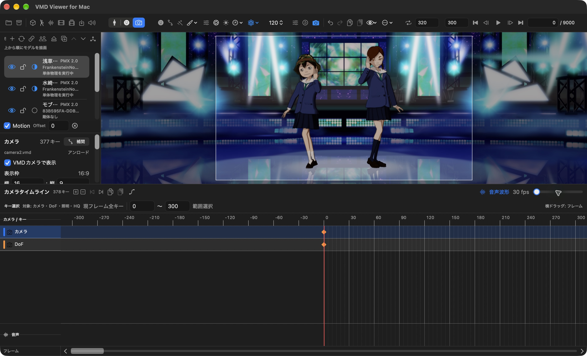

# VMD Viewer for Mac（VvfM）

PMXモデルとVMDモーションをMacで再生・編集し、音声付きの動画を書き出せるアプリです。ボーン・表情・カメラの調整から、見た目の仕上げ、作業の保存まで行えます。

**詳しい操作は [一般ユーザーマニュアル（GUIDE.md）](GUIDE.md) を参照してください。**

操作説明は、2026年10月19日に確認した [開発側の公開main（v0.56.49／build453）](https://github.com/opopoposiop/VMDviewer_for_Mac/tree/36206626a7214ad8b8de5bba362189a38c285529) に合わせています。掲載画像は旧版の画面例です。配布アプリの公開状況はReleasesで確認してください。

## 主な機能

- 複数のPMXモデルとVMDモーションの読み込み・再生、編集を引き継ぐPMXの入れ替え
- ボーン・モーフ・カメラのタイムライン編集、補間曲線、指ポーズ、重み付きモーションレイヤー
- 独立したカメラ1／2、停止中の自由視点、左右反転・まばたき・目線キーの生成
- WAV／M4A音声の再生・波形表示、背景・スクリーンへの動画投影
- Metal／ToonShader LE／ToonShader HQ、DoFの設定キー・画面からの合焦、対応範囲内の`.fxdayo`
- 背景色・環境光・平行光源のキーフレーム編集
- 素材と設定をまとめた `.vmdviewer` 保存、VMD保存、H.264／HEVC／ProRes動画出力

## 動作環境と入手

macOS 14以降のMetal対応Macが必要です。配布アプリの対応チップ・環境・利用条件は、入手元の案内を確認してください。アプリの実行にXcodeは不要です。

配布情報は [Releases](https://github.com/opopoposiop/VvfM/releases)、導入・初回起動は [GUIDEの「導入と起動」](GUIDE.md#導入と起動) を参照してください。

モデル・モーション・音源は、利用許諾を確認したものを別途用意します。

## 使い始める

1. PMXと付属テクスチャのフォルダ構成を保ち、**⇧⌘O** でPMXを読み込みます。
2. 対象モデルを選び、0フレームへ戻って **⌥⌘O** でVMDを読み込みます。
3. **Space** で再生し、必要に応じて音声・カメラを追加します。
4. **⌘S** で作業を保存します。動画出力は **⇧⌘E** から、短い区間で試せます。

編集や物理演算、エフェクト、動画出力の設定は [GUIDE.md](GUIDE.md) にまとめています。

## 利用時の注意

MikuMikuDanceとの画像・物理・エフェクトの完全一致は保証していません。負荷は素材と設定によって変わるため、短い試行と別名保存で確認してください。素材入りのプロジェクトを共有する場合は、各素材の再配布条件とクレジットを確認してください。

## ドキュメント・問い合わせ

- [一般ユーザーマニュアル](GUIDE.md)：操作手順、ショートカット、対応範囲、困ったときの確認事項
- [技術ガイド](VvfM_Technical_Note.md)：編集・描画・保存の仕組み、形式互換、性能の検証範囲
- [.fxdayo資料の案内](docs/fxdayo/README.md)：開発者向け解説、教材、対応条件と現行版との差分
- [LICENSE](LICENSE)／[THIRD_PARTY_NOTICES.md](THIRD_PARTY_NOTICES.md)：本体と同梱ライブラリ・画像・エフェクトの利用条件
- [Issues](https://github.com/opopoposiop/VvfM/issues)：不具合報告。アプリの版、Macの環境、操作手順、エラーを添えてください
- [開発リポジトリ](https://github.com/opopoposiop/VMDviewer_for_Mac)：実装と変更履歴
