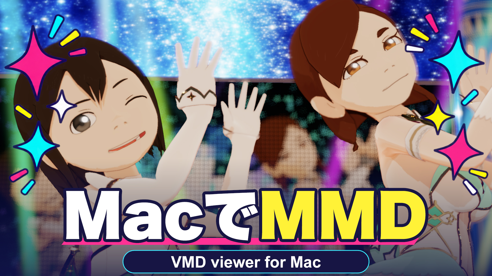

# VMD Viewer for Mac（VvfM）

> 2026年11月10日更新：[v0.58.8リリース](https://github.com/opopoposiop/VvfM/releases/tag/v0.58.8)を掲載。カメラ・DoF操作、自動保存・回復履歴、物理シーク、動画表示の遅延、再生停止の整合を改善しました。[変更概要・確認範囲](docs/updates/codex-motion-2026-11-08.md)

**[v0.58.8 アプリをダウンロード（ZIP）](https://github.com/opopoposiop/VvfM/releases/download/v0.58.8/VMD.Viewer.app.zip)**｜[リリース詳細](https://github.com/opopoposiop/VvfM/releases/tag/v0.58.8)｜[導入・初回起動](GUIDE.md#導入と起動)

[EULA 日本語原本](Licenses/VMDViewer-EULA-ja.md)｜[English](Licenses/VMDViewer-EULA-en.md)

PMXモデルとVMDモーションをMacで再生・編集し、音声付きの動画を書き出せるアプリです。ボーン・表情・カメラの調整から、見た目の仕上げ、作業の保存まで行えます。

　[作例/紹介動画](https://www.nicovideo.jp/watch/sm47023510)

このリポジトリには、配布案内・操作説明・スペックシートを掲載します。アプリ本体のソースコードは非公開とし、アプリは[Releases](https://github.com/opopoposiop/VvfM/releases)でバイナリ形式で配布しています。

**詳しい操作は [一般ユーザーマニュアル（GUIDE.md）](GUIDE.md) を参照してください。**

操作説明はv0.56.49／build453を基に、v0.58.4／build569までの変更点を本文と更新補足へ追記しています。v0.58.8の更新内容（v0.58.5〜v0.58.7の修正を含む）は本READMEと[更新補足](docs/updates/codex-motion-2026-11-08.md)にまとめています。READMEと一般ユーザーマニュアルの画面例は、2026年11月8日に起動中のv0.58.4／build569から撮影しました。[スペックシート](docs/spec-sheet/VMDViewer_SpecSheet_ja.md)は2026年10月28日・保存済みv0.57.22／build495を基準とする別資料です。

## v0.58.8の更新内容

2026年11月10日公開。[リリースノート](https://github.com/opopoposiop/VvfM/releases/tag/v0.58.8)に掲載された、v0.58.5〜v0.58.8の主な修正・改善をまとめています。

- **カメラ操作の修正**：XYZパネルのドラッグが画面更新で取り消され、値が元に戻る不具合を修正。
- **DoFの数値入力を追加**：F値、ボケ量、絞り羽根、回転、縦横比、最大CoC、ハイライト閾値を直接入力可能に。小数入力、確定・取消、Undo、保存に対応。
- **DoF画面の操作性を改善**：詳細項目を見出しの文字・余白から開閉できるようにし、設定キーの操作部を左寄せに整理。
- **自動保存・回復履歴を改善**：自動保存間隔を30秒〜30分から選択可能にし、件数確認付きの回復履歴一括削除を追加。
- **物理初期化とシーク復元を修正**：初期化位置のずれや、前後シークで保存状態が重複し、先頭から不要な再計算が発生する問題を解消。
- **動画・モデル表示の遅延を改善**：再生準備の待機中に背景動画を不要に読み直し、動画やモデルの表示が遅れる経路を修正。
- **停止位置と状態表示の整合を改善**：停止先の実表示を確認してから停止完了とするよう変更。停止後に「再生中」や、シーク後に「単体物理を初期化中」が残る問題を修正。
- **連続操作の安定性を改善**：再生・停止・シーク・プロジェクト再読込で、古い処理の完了が新しい表示、停止位置、通知を上書きする問題を修正。
- **物理計算の継続性を改善**：停止時も既存の物理状態を引き継ぎ、共有物理の計算途中の結果を失敗と判定して打ち切る問題を修正。
- **静止エフェクトによる停止待ちを修正**：必要な入力が揃う前の停止確定や、古い評価結果への差し戻りを防ぎ、停止表示が完了しない原因を解消。
- **自動検証の終了判定を改善**：停止先の表示と提出済み描画処理の完了を確認してから終了し、タイムアウトや記録失敗を成功扱いしないよう変更。
- **ライセンス案内を更新**：同梱EULAの日本語版・英訳をVvfM掲載内容に合わせて更新し、GitHub上のライセンス文書への導線を整備。

DoF／Beamの先行準備拡張は既定OFFで、全体FPS＋5%の目標は未達です。停止表示の待ち時間や非表示時のタイムアウトなど、確認範囲と残る制限は[更新補足](docs/updates/codex-motion-2026-11-08.md#確認範囲と残る制限)を参照してください。

## 主な機能

- 複数のPMXモデルとVMDモーションの読み込み・再生、編集を引き継ぐPMXの入れ替え
- ボーン・モーフ・カメラのタイムライン編集、補間曲線、指ポーズ、重み付きモーションレイヤー
- 独立したカメラ1／2、停止中の自由視点、左右反転・まばたき・目線キーの生成
- WAV／M4A音声の再生・波形表示、背景・スクリーンへの動画投影
- Metal／ToonShader LE／ToonShader HQ、DoFの設定キー・画面からの合焦、対応範囲内の`.fxdayo`
- 背景色・環境光・平行光源のキーフレーム編集
- 素材と設定をまとめた `.vmdviewer` 保存、VMD保存、H.264／HEVC／ProRes動画出力

## 動作環境と入手

macOS 14以降のMetal対応Macが必要です。配布アプリの対応チップ・環境・利用条件は、入手元の案内を確認してください。アプリの実行にXcodeは不要です。

配布アプリは [v0.58.8のZIP](https://github.com/opopoposiop/VvfM/releases/download/v0.58.8/VMD.Viewer.app.zip) からダウンロードできます。ZIPを展開してアプリを取り出し、[GUIDEの「導入と起動」](GUIDE.md#導入と起動) に従って起動してください。配布ファイル名は `VMD.Viewer.app.zip` です。過去の版やリリース情報は [Releases](https://github.com/opopoposiop/VvfM/releases) を参照してください。

モデル・モーション・音源は、利用許諾を確認したものを別途用意します。

## ライセンスと公開方針

公開文書とアプリのバイナリでは、ライセンスの適用対象を分けています。詳細は [ライセンス適用範囲（LICENSING.md）](LICENSING.md) を参照してください。

- **公開文書・MIT対象として提供するサンプル等**：[MIT License](LICENSE)を維持します。
- **今後EULAを明示して公開するアプリ独自バイナリ**：[補足EULA](Licenses/VMDViewer-EULA-ja.md)を適用し、逆コンパイル・逆アセンブル等のリバースエンジニアリングを禁止する条項を定めています。適用法令、第三者ライセンス、既に付与されたMIT等の許諾による例外を保持します。
- **第三者のライブラリ・SDK・エフェクト・素材**：各権利者の条件と通知を維持します。[第三者通知](THIRD_PARTY_NOTICES.md)と[ライセンス原文一覧](Licenses/README.md)を確認してください。

補足EULAは **2.0（2026年10月31日確定）** です。[日本語版](Licenses/VMDViewer-EULA-ja.md)を原本とし、[英語版](Licenses/VMDViewer-EULA-en.md)は参考訳です。内容に相違がある場合は、第9条に従い日本語原本が優先します。対象のversion/build、全文の提示・同意方法、配布物の条件は採用するReleaseで明示します。この案内と文書の追加によって、既存版のMIT許諾や保存済みbuild495のアプリ・ZIPの条件が変わることはありません。

## 使い始める

1. PMXと付属テクスチャのフォルダ構成を保ち、**⇧⌘O** でPMXを読み込みます。
2. 対象モデルを選び、0フレームへ戻って **⌥⌘O** でVMDを読み込みます。
3. **Space** で再生し、必要に応じて音声・カメラを追加します。
4. **⌘S** で作業を保存します。動画出力は **⇧⌘E** から、短い区間で試せます。

編集や物理演算、エフェクト、動画出力の設定は [GUIDE.md](GUIDE.md) にまとめています。

## 利用時の注意

MikuMikuDanceとの画像・物理・エフェクトの完全一致は保証していません。負荷は素材と設定によって変わるため、短い試行と別名保存で確認してください。素材入りのプロジェクトを共有する場合は、各素材の再配布条件とクレジットを確認してください。

## ドキュメント・問い合わせ

- [一般ユーザーマニュアル](GUIDE.md)：操作手順、ショートカット、対応範囲、困ったときの確認事項
- [技術ガイド](VvfM_Technical_Note.md)：編集・描画・保存の仕組み、形式互換、性能の検証範囲
- スペックシート：[PDF](docs/spec-sheet/VMDViewer_SpecSheet_ja.pdf)／[Markdown](docs/spec-sheet/VMDViewer_SpecSheet_ja.md)。2026年10月28日・v0.57.22／build495基準
- [.fxdayo資料の案内](docs/fxdayo/README.md)：開発者向け解説、教材、対応条件と現行版との差分
- [ライセンス適用範囲](LICENSING.md)／[MIT原文](LICENSE)／[EULA日本語原本](Licenses/VMDViewer-EULA-ja.md)・[英訳](Licenses/VMDViewer-EULA-en.md)／[第三者通知](THIRD_PARTY_NOTICES.md)
- [Issues](https://github.com/opopoposiop/VvfM/issues)：不具合報告。アプリの版、Macの環境、操作手順、エラーを添えてください

## 謝辞

VMD viewer for Macの開発にあたり技術的参考にさせていただきました お礼申し上げます

- [MikuMikuDance](https://sites.google.com/view/vpvp/?pli=1&authuser=0) 樋口M 様
- [MikuMikuDayo](https://github.com/pennennennennennenem/MikuMikuDayo) サンドマン 様
- [MikuMikuMoving](https://sites.google.com/site/mikumikumoving/) Mogg 様
- [PMXEditor](https://www.nicovideo.jp/watch/sm14024773) 極北P 様
- [AutoLuminous](https://www.nicovideo.jp/watch/sm19843111) そぼろ 様
- [msToonCoordinator](https://www.nicovideo.jp/watch/sm39850446) ましまし 様
- [ikHolographic](https://seiga.nicovideo.jp/seiga/im8315687) ikeno 様
- [浅草みどり](https://www.nicovideo.jp/watch/sm36384153) / [水崎ツバメ](https://www.nicovideo.jp/watch/sm36519353) くれよん 様
