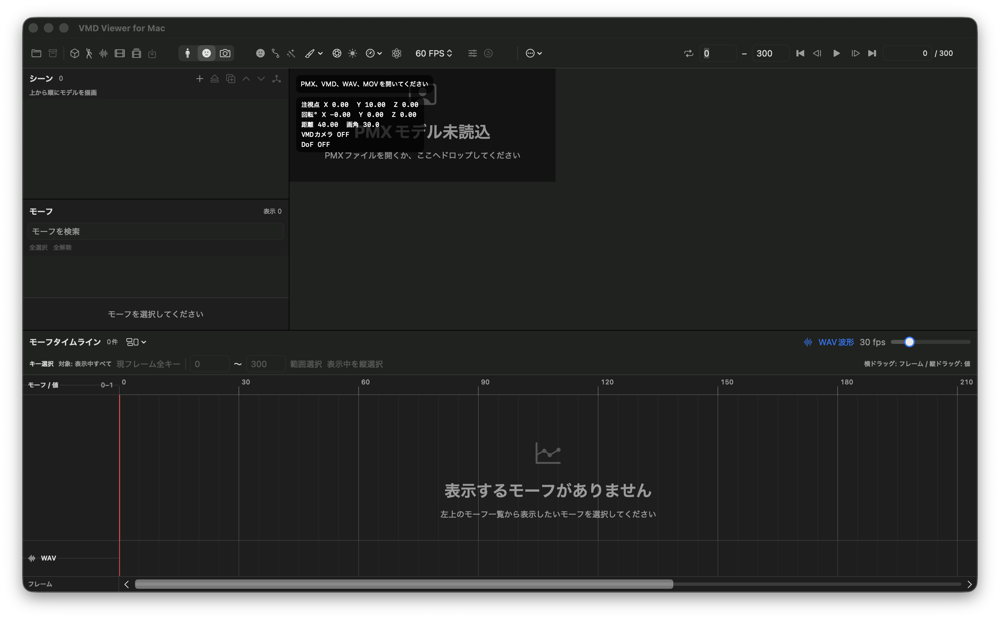
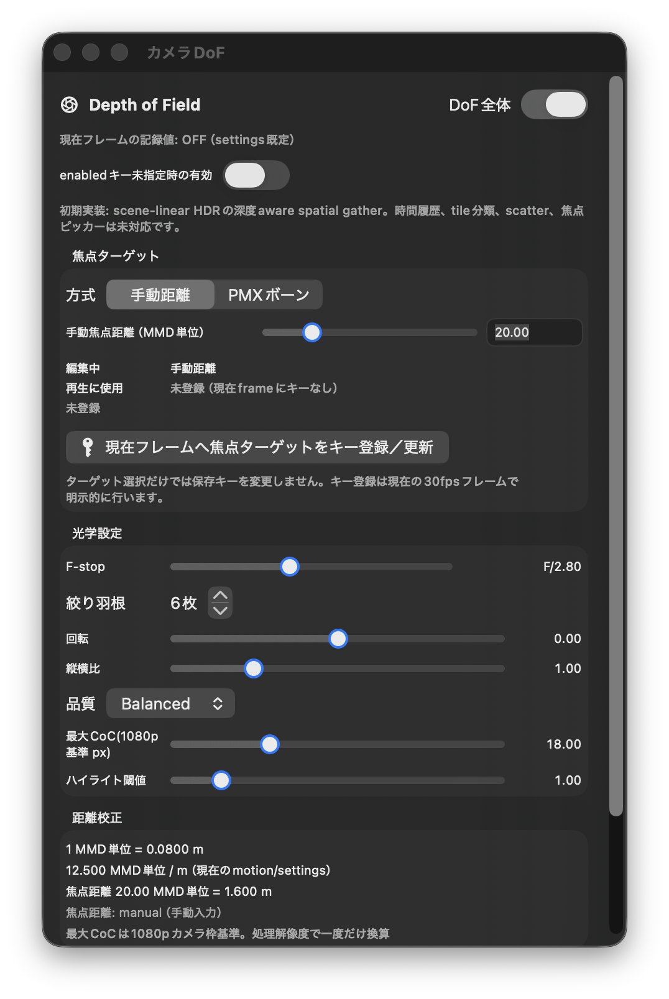

# VMD Viewer for Mac

> 一般ユーザー向けマニュアル（アドホック署名によるテスト配布版）

VMD Viewer for Mac は、MMD 用の PMX モデルと VMD モーションを macOS 上で再生・編集し、音声やエフェクトを組み合わせた動画として書き出すためのビューワーです。複数モデル、ボーン／モーフ／カメラ編集、Bullet 物理演算、Metal レンダリングを一つのシーンで扱えます。

この README は、[VMDviewer_for_Mac の `codex/fast` ブランチ](https://github.com/opopoposiop/VMDviewer_for_Mac/tree/codex/fast) に含まれる最新実装 **v0.53.1 / build240（2026-09-11）** を基準にしています。実際に配布されているアプリの対応範囲、SHA-256、配布条件は [Releases](https://github.com/opopoposiop/VvfM/releases) の説明を優先してください。

## 目次

- [インストール方法](#インストール方法)
- [基本機能](#基本機能)
- [最新版の主な追加・拡張](#最新版の主な追加拡張)
- [独自機能（MMD にはない機能）](#独自機能mmd-にはない機能)
- [ボーン／モーフ／カメラ編集機能・操作方法](#ボーンモーフカメラ編集機能操作方法)
- [エフェクト・DoF](#エフェクトdof)
- [.fxdayo 対応機能](#fxdayo-対応機能)
- [動画出力機能](#動画出力機能)
- [更新とアンインストール](#更新とアンインストール)
- [トラブルシューティング](#トラブルシューティング)

## まず確認すること

- 対応環境は **macOS 14 以降、Apple Silicon（arm64）** です。Intel Mac は現在のテスト対象外です。
- 実行に Xcode は必要ありません。Xcode は開発者がアプリをビルドするときに使用します。
- 配布されるアプリはアドホック署名によるテスト版です。初回起動時に macOS の確認が表示されます。
- PMX、VMD、音源、動画、エフェクトは、それぞれの作者・配布元の利用条件に従ってください。
- 動作確認には、公開時にサンプルが提供されている場合はそのサンプル、または利用許諾を確認済みの自分の素材を使用してください。

## インストール方法

### 1. アプリを取得する

1. Release の ZIP をダウンロードし、掲載された SHA-256 と照合します。
2. Finder で ZIP をダブルクリックして展開します。
3. 展開された `VMD Viewer.app` を「アプリケーション」フォルダへ移動します。

テスト版では、ダウンロード元が確認できる Release 以外からアプリを取得しないでください。Release に SHA-256 が掲載されている場合は、展開前に照合してください。

### 2. 初回起動する

アドホック署名版では、通常のダブルクリックで起動を拒否されることがあります。

1. `VMD Viewer.app` を Control キーを押しながらクリックします。
2. **開く** を選び、表示された確認ダイアログでも **開く** を選びます。
3. それでも開けない場合は、**システム設定 > プライバシーとセキュリティ** を開き、ブロックされたアプリについて表示された **このまま開く** を選びます。

この操作は、入手元とファイルを確認したうえで行ってください。Gatekeeper を無効にしたり、システム全体のセキュリティ設定を変更したりする必要はありません。



> PMXを読み込む前の開発中テスト版の画面です。PMX、VMD、WAV、動画を読み込むと、モデル、編集対象、キー、音声波形などが表示されます。公開版では画面構成や設定項目が変更される場合があります。

### 3. 素材を読み込む

- PMX、VMD、WAV、MOV/MP4/M4V は、メニューから開くか、ビューポートへドラッグ＆ドロップします。
- 最初は PMX を開き、必要に応じて VMD、WAV、動画を追加します。
- PMX とテクスチャの相対パスが変わると、モデルが正しく表示されないことがあります。モデル一式のフォルダ構成を保ってください。
- **ファイル > プロジェクトを保存** で `.vmdviewer` プロジェクトとして保存すると、PMX、テクスチャ、VMD、カメラ、DoF、音声、動画、表示設定などを一つにまとめて管理できます。新しい通常の ZIP 形式で保存でき、以前の directory package 形式も読み込めます。

プロジェクトへ保存した素材は、元ファイルと別にバックアップできる自己完結パッケージとして扱えます。外部動画やテクスチャを別の場所へ移動すると読み込みに失敗することがあるため、作業中は元のフォルダ構成を保ってください。

自動保存、素材の再リンク、外部参照の自動復旧はありません。編集中も定期的にプロジェクトと VMD を保存し、重要な作業は別名でバックアップしてください。

### 更新とアンインストール

- **更新**：新しい Release が公開されたら、現在のプロジェクトと VMD を保存してから新しい ZIP を取得し、古い `VMD Viewer.app` を置き換えます。プロジェクトや素材のバックアップは別に保管してください。
- **アンインストール**：「アプリケーション」フォルダの `VMD Viewer.app` をゴミ箱へ移動します。`.vmdviewer`、PMX、VMD、音声、動画などの作業ファイルは自動では削除されないため、不要かどうかを確認してから個別に整理してください。

## クイックスタート

1. PMX を 1 体だけ読み込みます。
2. VMD を読み込み、`Space` で再生します。
3. `⌘2` でモーフを選び、`K` で現在フレームへキーを登録します。
4. `⌘3` でカメラ編集を確認し、`Return` でカメラキーを登録します。
5. 必要に応じて HQ Toon と DoF を有効にします。
6. 再生が重い場合は「描画解像度…」で 3/4 や 1/2 を試します。
7. 30 fps、1080p、短い範囲で動画を出力します。
8. 問題がなければモデル数、エフェクト、出力範囲を増やします。

## 最新版の主な追加・拡張

- **再生準備の高速化（v0.53.1）**：VMD の Bezier 補間を事前変換し、IK で影響を受ける子孫ボーンの行列だけを更新することで、多数のキーやモデルを扱うときの姿勢評価を軽くしました。実際の FPS はモデル、物理演算、エフェクト、Mac の性能によって変わります。
- **Bloom の詳細設定（v0.53.0）**：HQ Toon の発光に、ぼかし強度、光芒の方向数・角度・長さ、点滅周期、点滅波形を追加しました。設定はプロジェクトへ保存され、停止・シーク・動画出力でも VMD のフレーム時間に基づいて再現されます。
- **再生優先モードの復帰改善（v0.52.4）**：再生優先モードで物理演算を使用しているとき、停止・再開後に物理姿勢が画面へ戻らない場合がある問題を修正しました。
- **ビューポート描画解像度**：互換、1/1、7/8、3/4、5/8、1/2 から内部解像度を選べます。標準出力へ再構成するか、縮小した内部解像度のまま表示するかも選択でき、内部解像度では TAA／FXAA／OFF を切り替えられます。
- **再生優先度**：「設定…」で物理優先モードと再生優先モードを切り替えられます。再生優先では、物理演算が追いついていないときも VMD の姿勢を優先して表示し、物理演算は追従を続けます。動画書き出しは常に物理優先です。
- **高品質Toonの MetalFX**：対応する Apple GPU では、AA 方式として MetalFX／TAA／FXAA／OFF、内部解像度からの Temporal Upscaling、Reactive Mask、最高／高品質／バランス／自動の品質設定を利用できます。
- **カメラDoF**：独立した設定ウインドウで、手動距離または PMX モデル／ボーンを焦点対象にできます。F 値のキー、ボケ量、絞り、品質を `.dofvmd` として扱え、焦点距離や対象の解決状態を確認できます。
- **複数PMXシーンの強化**：モデルごとの VMD 割り当て、モーション／物理の ON/OFF、フレームオフセット、表示倍率、配置、描画順、PMX 外部親、モデル間衝突を扱えます。
- **`.fxdayo` 対応の拡張**：MobFesPenlight_3、既知の MMDayo_SSR 系、既知の `beam.fxdayo` を対応する Metal アダプタで処理します。対応状況と動画出力前の検査結果を画面で確認できます。

## 基本機能

### 読み込み・保存

| 種類 | 用途 |
| --- | --- |
| `.pmx` | MMD モデルの読み込み。PMX 2.0/2.1 を対象とします。 |
| `.vmd` | ボーン、モーフ、カメラの編集・保存。照明は読み込み・補間、セルフシャドウは保持して再保存します。 |
| `.wav` | 再生および動画出力時の音声。タイムライン上に波形を表示できます。 |
| `.mov` / `.mp4` / `.m4v` | 背景・スクリーンへの動画投影、または参照動画としての読み込み。 |
| `.vmdviewer` | 素材とシーン設定をまとめるプロジェクト形式。 |
| `.dofvmd` | カメラDoF（被写界深度）の焦点・光学設定を保存するモーション形式。 |

### 再生・タイムライン

- VMD の 30 fps を基準に、再生、停止、スクラブ、ループ再生ができます。
- 表示フレームレートは 24 / 30 / 60 fps または無制限から選べます。
- 物理演算は表示とは独立した 60 / 120 / 180 / 240 Hz の固定ステップで動作させられます。
- 現在フレーム、開始・終了範囲、前後フレーム移動、キーの選択と削除に対応します。
- WAV を読み込むと、タイムラインに音声波形を重ねて確認できます。

### シーン・モデル表示

- 複数の PMX モデルを同じシーンに配置できます。
- モデルごとに VMD を割り当て、モーションの有効・無効、フレームオフセット、位置、拡大率、描画順を設定できます。
- モデルのロック、複製、アンロード、描画順の変更に対応します。PMX 行をドラッグして描画順を変更することもできます。
- PMX 外部親でモデル間のボーン関係を設定し、モデル間衝突のグループを管理できます。
- MMD 原点と XZ グリッド、ワイヤーフレーム表示、背景色・透明背景、環境光・指向性ライトを利用できます。
- PMX モデル、ボーン、剛体、ジョイントの表示を個別に切り替えられます。ビューポートだけのフルスクリーン表示も可能です。
- Metal による GPU スキニングと GPU 頂点モーフに対応し、BDEF／SDEF／QDEF のスキニング、頂点・基本 UV・材質・ボーン・グループ／反転・インパルスモーフを評価します。
- 物理演算は「常時演算」「再生時のみ」「演算しない」から選べます。リセット、重力、モデルごとの反応の強さや収まりも調整できます。

### 音声と外部動画

- WAV を読み込むと、音声を再生しながらタイムライン上の波形を確認できます。VMD の 30 fps 時計と音声を同期して再生します。
- MOV／MP4／M4V は、背景または PMX の `screen.bmp` 材質へ投影できます。投影先、開始フレーム、時間オフセット、ループを設定できます。
- 外部動画の読み込みは参照・投影のための機能です。読み込んだ動画が自動的に出力動画へ置き換わるわけではありません。

## 独自機能

ここでは、MMD 本体の標準操作とは異なる VMD Viewer 独自の表示・確認機能を紹介します。他の MMD 関連ツールに類似機能が存在する場合があります。

### 1. 物理演算 FPS

VMD の時間軸は常に 30 fps です。VMD Viewer では、物理演算を VMD の時間軸や画面表示とは独立した固定ステップで実行し、60／120／180／240 FPS から選択できます。

VMD 1 フレームあたりの物理計算回数は次のとおりです。

| 物理演算 FPS | VMD 1 フレームあたりの計算回数 |
| --- | ---: |
| 60 FPS | 2 回 |
| 120 FPS | 4 回 |
| 180 FPS | 6 回 |
| 240 FPS | 8 回 |

高い値ほど物理計算の間隔が細かくなりますが、処理負荷も増加します。まず 60 FPS で確認し、揺れや衝突の計算を細かくしたい場合に 120 FPS 以上を試してください。高い物理演算 FPS を選んでも、MMD と同じ結果になることや、画質が向上することは保証されません。

画面表示の 24／30／60 fps または無制限は、描画回数の設定です。表示 FPS を変更しても、VMD の再生速度や物理演算 FPS は変更されません。物理演算の動作は「常時演算」「再生時のみ」「演算しない」から選べます。PMX 2.1 のソフトボディ物理演算には現在対応していません。

### 2. エフェクト、DoF、`.fxdayo` 対応

描画スタイルには、次の 3 種類があります。

- **Metal**：標準的な連続拡散照明で表示します。
- **ToonShader Light**：少ない階調でセル風に表示する軽量モードです。
- **HQ Toon**：輪郭、拡散、Rim Light、AutoLuminous、AO、アンチエイリアス、トーンマッピングなどを組み合わせる高品質モードです。

DoF（被写界深度）は、焦点の合う距離の前後をぼかす機能です。DoF を描画するには、次の条件がすべて必要です。

- 描画スタイルが **HQ Toon** であること
- DoF 全体が ON であること
- カメラが透視投影であること

Metal、ToonShader Light、正射影カメラでは、DoF の設定は保持されますが、ぼかしは描画されません。焦点ピッカーや一部の時間方向の処理には現在対応していません。

`.fxdayo` は MikuMikuDayo 用のエフェクト記述形式です。MME 用の `.fx` とは互換性がありません。汎用 HLSL や任意の `.fxdayo` をそのまま実行する機能ではありません。

現在の対応は、MobFesPenlight_3 系の専用移植、既知の MMDayo_SSR 系バリエーションの近似対応、既知の `beam.fxdayo` の近似対応に限定されています。PMX と同じフォルダに同名の `.fxdayo` を置くと、PMX 読み込み時に自動検出します。

`beam.fxdayo` は Standard／Lightweight／HQ の描画経路と不透明動画出力に対応します。衝突値が 0 以外の構成と、透明背景の ProRes 出力には対応していません。対応対象以外の `.fxdayo` は、構文を解析できても描画できるとは限りません。

ステータス画面では、解析状態、互換性、Metal 描画経路への接続状態を確認できます。

- `ported`：対応済みの移植経路を使用します。
- `approximate`：元の機能を近似して描画します。完全な画面一致は保証されません。
- `unsupported`：現在の VMD Viewer では実行しません。

`detected` または `parsed` と表示されても、描画対応済みとは限りません。これらは解析に成功したことを示す表示であり、実行や画面への反映を保証するものではありません。

### 3. カメラモード、フリーカメラ

VMD カメラを編集する **カメラ編集モード** と、再生時の表示方法を切り替える **フリーカメラ** は別の設定です。

カメラ編集モードでは、現在フレームのカメラ位置、注視点、距離、画角、透視投影／正射影を調整できます。`Return` を押すと、現在の状態をカメラキーとして登録または更新します。

再生時は、ウインドウメニューから次の表示方法を選べます。

- **再生中：VMD ロック**：読み込んだ VMD カメラに従って再生します。
- **再生中：カメラフリー**：ボーン、モーフ、音声などの再生を続けながら、VMD カメラに固定されない自由な視点でシーンを確認します。

フリーカメラで視点を操作しても、読み込んだ VMD カメラキーは書き換えられません。VMD カメラキーを変更する場合は、カメラ編集モードで明示的に登録または更新してください。VMD カメラが読み込まれていない場合や「VMD カメラで表示」が OFF の場合は、VMD ロックを選んでも VMD カメラには追従しません。

### 4. 再生優先度

「設定…」の **再生優先度** では、ライブ再生時に何を優先して表示するかを選べます。

- **物理優先モード**：対象フレームまでの固定ステップを省略せずに評価してから表示します。物理演算の再現性を優先したいときに使用します。
- **再生優先モード**：物理演算が一時的に追いつかないときは VMD の姿勢を先に表示し、物理演算はバックグラウンドで追従します。操作感や再生の追従性を優先したいときに使用します。

これは物理演算そのものの ON/OFF とは別の設定です。動画書き出しは設定にかかわらず、常に物理優先で決定論的に実行されます。

### 5. ビューポート描画解像度

レンダー方式メニューの **描画解像度…** から、ライブビューポートの処理量と表示方法を調整できます。

| 設定 | 内容 |
| --- | --- |
| 互換 | 既存の高品質Toon／MetalFXの解像度設定を使用します。 |
| 1/1、7/8、3/4、5/8、1/2 | ウインドウ基準の画素数に対する内部描画サイズです。小さくすると軽くなります。 |
| 標準 | 内部解像度で描画した結果を、ビューポートの基準解像度へ再構成して表示します。 |
| 内部解像度 | 縮小した内部解像度のまま表示します。輪郭が粗く見えることがあります。 |

「内部解像度」を選んだ場合は、HQ Toon の内部 AA を **TAA**（滑らかさ重視）、**FXAA**（軽さ重視）、**OFF**（最小負荷）から選べます。Metal／ToonShader Light ではこの内部 AA 設定は適用されません。この設定はライブビューポート用で、動画出力の解像度設定とは別です。

## ボーン／モーフ／カメラ編集機能・操作方法

### 基本的な編集手順

1. PMX モデルを開きます。
2. VMD を開くか、空のタイムラインで編集を始めます。
3. `⌘1`（ボーン）、`⌘2`（モーフ）、`⌘3`（カメラ）で編集モードを切り替えます。
4. 編集したいフレームへ移動し、ビューポートまたはタイムラインで対象を選びます。
5. 値を変更してキーを登録します。
6. **ファイル > VMD を保存**（`⇧⌘S`）で VMD を保存します。シーン全体は **プロジェクトを保存**（`⌘S`）で保存します。

### ビューポート操作

#### 通常の表示・確認モード

| 操作 | 動作 |
| --- | --- |
| 左ドラッグ | カメラを回転 |
| 右ドラッグ／中ドラッグ／`⇧` + 左ドラッグ | カメラを平行移動 |
| ホイール／トラックパッドのピンチ | ズーム |
| `⌘0` | カメラをリセット |
| 右ダブルクリック | カメラをリセット |

#### カメラ編集モード

- 左ドラッグでカメラの向きを変更します。
- 右ドラッグ、または `⇧` + 左ドラッグで注視点を移動します。
- ホイールでカメラ距離を変更します。`⇧` を併用すると移動量を調整できます。
- `Return` で現在のカメラ状態を現在フレームのキーとして登録します。

### タイムライン共通操作

- 空いている場所をクリックすると、そのフレームへ移動します。
- キーを横方向へドラッグすると、フレーム位置を移動します。
- キーのない場所をドラッグすると矩形選択になります。
- `⌘` または `⇧` を併用すると、選択を追加できます。
- `Delete` で選択キーを削除します。
- `⌘C` / `⌘V` で選択キーをコピー・貼り付けします。
- `⌘Z` / `⇧⌘Z` で Undo / Redo を行います。
- `←` / `→` は前後のフレーム、`Home` / `End` は先頭・末尾へ移動します。
- `,` / `.` でも前後フレームへ移動できます。`Space` は再生・停止です。
- 再生中はタイムラインが現在位置に追従します。下部のスクロールバーで任意の範囲を表示できます。

### ボーン編集

- ボーン編集モードでボーンを選び、移動・回転ギズモまたは数値編集を使用します。
- ギズモはローカル軸／グローバル軸を切り替えられます。X/Y/Z の移動と回転を個別に調整できます。
- タイムライン上でボーンキーを選択、移動、複製、削除できます。
- VMD ボーンキーに含まれる物理 ON/OFF を読み込み、物理ボーンを個別またはグループ単位で切り替えるキーを登録できます。
- `⌥⌘I` で補間曲線エディタを開き、Bezier 曲線の編集、補間キーのコピー・貼り付け、線形化を行えます。
- 物理演算が有効なボーンは再生時に物理の影響を受けます。手動編集の結果を確認するときは、必要に応じて物理演算を一時的に OFF にしてください。

### 補間曲線編集

補間曲線は、連続するキーの間で「どのような速さで値が変化するか」を決める Bezier 曲線です。ゆっくり動き始める、途中で加速する、ゆっくり止まる、といった動きを調整できます。補間値は選択中のキーに保存され、再生時は前のキーから選択中のキーへ向かう区間に反映されます。

1. ボーン編集またはカメラ編集で、補間を変更したいキーを選択します。
2. ツールバー／サイドバーの **補間** ボタン、または `⌥⌘I` で補間曲線ウインドウを開きます。キーを選択していない場合はウインドウを開けますが、編集するにはボーンキーまたはカメラキーを選択してください。
3. 編集対象のチャンネルを選び、グラフ上の青い曲線にある `P1` と `P2` のハンドルをドラッグします。マウスを離すと、選択中のキーへ変更が反映されます。
4. `⌘S` でプロジェクトを保存するか、`⇧⌘S` で編集後の VMD を保存します。

グラフの左下から右上へ伸びる対角線は、時間に対して一定の割合で変化する線形補間のイメージです。横軸はキー間の時間、縦軸は値の進み具合を表し、`P1`／`P2` は曲線の形を決める制御点です。制御点の表示値は VMD の範囲で `0〜127` です。

- ボーンでは `ALL`、`R`（回転）、`X`、`Y`、`Z` を切り替えます。カメラでは `ALL`、`X`、`Y`、`Z`、`R`（回転）、`距離`、`画角`を切り替えます。
- `ALL` は、選択中のキーの全チャンネルへ同じ曲線を適用します。特定の動きだけを変えたい場合は、個別のチャンネルを選びます。
- `コピー` は現在のチャンネルの曲線をクリップボードへコピーし、`貼り付け` は `VMDBezier:x1,y1,x2,y2` 形式の曲線を読み込みます。同じ曲線を別のキーへ設定するときに利用できます。
- `線形に戻す` は現在のチャンネルをアプリの線形補間プリセットへ戻します。キー自体は削除されません。
- `⌘Z`／`⇧⌘Z` で補間曲線の変更も Undo／Redo できます。

補間曲線ウインドウはボーン編集またはカメラ編集で使用できます。モーフ編集モードでは使用できません。

### モーフ編集

- モーフ編集モード、またはツールバー／メニューからモーフ操作ウインドウを開いてモーフを選びます。
- 表情、頂点、基本 UV、材質、ボーン、グループ、反転、インパルスなど、PMX に含まれるモーフを種類に応じて編集できます。
- モーフ行のクリックで単一選択、`⌘` / `⇧` クリックで複数選択ができます。
- 選択キーを縦方向へドラッグすると値をまとめて変更できます。横方向のドラッグはフレーム位置を変更します。
- 現在フレームへの一括登録、範囲選択、行の選択、キーの削除に対応します。
- `K` で現在フレームのモーフキーを登録できます。
- システムモーフを一覧に表示するかどうかを「設定…」で切り替えられます。表示を隠しても、VMD 再生やグループモーフ内部の評価は継続します。
- 再生中にモーフのチェックボックスやグラフを表示して、表情の変化を確認できます。

### カメラ編集

- カメラ編集モードで、位置、注視点、距離などを調整します。
- 透視投影と正射影を切り替えられます。ただし、DoF は正射影カメラでは使用できません。
- カメラ VMD はモデルのモーションとは独立して読み込み、編集、保存できます。
- `Return` で現在フレームにカメラキーを登録します。
- 再生中に VMD カメラをロックして確認する方法と、自由カメラでシーンを確認する方法を使い分けられます。

### 便利なショートカット

| ショートカット | 機能 |
| --- | --- |
| `⌘O` | プロジェクトを開く |
| `⇧⌘O` | PMX を開く |
| `⌥⌘O` | VMD を開く |
| `⌥⌘W` | WAV を開く |
| `⌥⌘I` | 補間曲線エディタ |
| `⌘S` | プロジェクトを保存 |
| `⇧⌘S` | VMD を保存 |
| `⇧⌘E` | 動画を書き出す |
| `⇧⌘I` | 現在位置に1フレーム挿入 |
| `⇧⌘D` | 現在位置の1フレームを削除 |
| `⌃⌘F` | ビューポートのみのフルスクリーン |

## エフェクト・DoF

### 描画スタイル

描画スタイルには次のモードがあります。

- **Metal**：標準的な連続拡散照明。
- **ToonShader Light**：少ない階調でセル風に表示する軽量モード。
- **HQ Toon**：HDR、輪郭、拡散、Rim Light、Bloom（AutoLuminous互換の発光表現）、AO、アンチエイリアス、トーンマッパーなどを組み合わせる高品質モード。

HQ Toon ではアンチエイリアスを **OFF / FXAA / TAA / MetalFX** から選べます。MetalFX の品質は **最高（100%）／高品質（77%）／バランス（67%）／自動** です。対応 GPU では内部解像度からの Temporal Upscaling を行い、Reactive Mask によって透過部分や発光部分の残像を抑えます。シーク、カメラの切り替え、モデル変更、AA方式の変更時には時間履歴をリセットします。MetalFX 非対応時は TAA、さらに対応できない場合は FXAA へ切り替わります。

設定項目が多いモードほど GPU 負荷が高くなります。再生が重い場合は、AO・輪郭・アンチエイリアスを OFF にする、品質を下げる、DoF の最大 CoC を小さくする、といった調整を試してください。

### Bloom（発光・光芒・点滅）

HQ Toon の Bloom 設定では、発光の広がり方と時間変化を調整できます。

| 設定 | 選択範囲・意味 |
| --- | --- |
| ぼかし強度 | 0〜1。Bloom の広がりを調整します。0 は光芒の広がりを抑えますが、発光強度を OFF にする設定ではありません。 |
| 光芒方向数 | 0〜9。1方向につき左右2本、最大18本の光芒を追加します。 |
| 光芒角度 | 0〜180度。画面上の光芒の向きを回転します。 |
| 光芒長さ | 0〜2。光芒の長さを調整します。0 では追加光芒を表示しません。 |
| 点滅周期 | OFF、または 0.05〜10秒。発光の点滅間隔を指定します。 |
| 点滅波形 | 滑らか、または矩形波。点滅の変化の仕方を選びます。 |

点滅は VMD のシーンフレームを基準に評価されるため、停止中は状態が進まず、シークや動画出力でも同じフレームから再現されます。Bloom は VMD Viewer 独自の近似実装で、AutoLuminous4 の完全移植や MMD との画面一致を保証するものではありません。元のアルファ（透明度）は保持されますが、半透明材質では見え方が異なる場合があります。

### ワールドと影

太陽アイコンの設定から、背景色または透明背景、環境光、MMD 平行光源、VMD 照明、地面影を調整できます。モデルごとのセルフシャドウも個別に切り替えられ、照明・影の設定はプロジェクトへ保存されます。

### DoF（被写界深度）

DoF は、焦点の合う距離の前後をぼかして、カメラの被写界深度を表現する機能です。

1. HQ Toon を選びます。
2. DoF の設定ウインドウを開き、マスター ON にします。
3. 焦点モードを **手動距離** または **PMX モデル／ボーン** にします。
4. 現在フレームで焦点距離を調整し、登録または更新します。
5. F 値、絞り羽根、羽根の回転、アスペクト比、品質、最大 CoC（ぼけの最大量）、ハイライトしきい値を調整します。

F 値は F/0.50〜F/32 の 13 段階から選べます。ボケ量は光学計算結果に対する倍率（×0.50〜×5.00）として別に調整できます。F 値と焦点ターゲットは現在フレームへキー登録でき、キー間は Bezier／ホールド補間で再生されます。

DoF 設定ウインドウとカメラ座標表示では、現在の F 値、焦点距離（MMD 単位／メートル）、焦点対象、対象を解決できているか、CoC 上限の状態を確認できます。焦点ターゲットのキーを選んで、該当フレームへ移動することもできます。



> 開発中テスト版のDoF設定ウインドウ上部です。DoFはHQ Toon、透視投影、DoF全体ONの条件で描画されます。この画像は設定UIを示すもので、実際のぼけ結果や処理性能を示す比較画像ではありません。

注意事項：

- DoF は HQ Toon でのみ描画されます。Metal または ToonShader Light では設定を保持していても描画されません。
- 正射影カメラは DoF 対応外です。透視投影へ切り替えてください。
- PMX のボーンを焦点対象にした場合、対象ボーンを解決できないと距離ベースへフォールバックすることがあります。
- 焦点対象を選んだだけでは保存キーは変わりません。現在フレームで登録・更新してください。
- DoF のキーデータは `.dofvmd` として扱われ、プロジェクトの保存・読み込みに含まれます。
- 現在のテスト版では、焦点ピッカーや高度な時間方向の蓄積など、一部の高度な機能は未対応です。
- PMX ボーンを焦点対象にした場合、モデルの削除・非表示・差し替えなどで対象を解決できないときは、保存済みの距離へフォールバックします。画面の状態表示を確認してから使用してください。

## `.fxdayo` 対応機能

`.fxdayo` は **MikuMikuDayo 用のエフェクト記述形式**です。MME 用の `.fx` とは互換性がありません。VMD Viewer は汎用 HLSL 実行環境として `.fxdayo` をそのまま動かすのではなく、既知の構造に対する Metal アダプタ（Metal で描画するための変換経路）と対応状況表示を提供します。

### 検出方法

PMX と同じフォルダに、同じ名前の `.fxdayo` を置きます。

```text
model.pmx
model.fxdayo
```

PMX を読み込むと隣接する `.fxdayo` が自動検出されます。魔法の杖アイコンのステータス画面で、解析状態、互換性、Metal アダプタへの接続状態、カテゴリ、コントローラ／パスの概要を確認できます。これは静的な対応状況の表示であり、描画中の内部状態をすべて表示するものではありません。

### ステータスの見方

| 表示 | 意味 |
| --- | --- |
| `detected` / `parsed` | ファイルを検出・解析できた状態です。描画対応を意味しません。 |
| `ported` | 対応済みの移植アダプタで実行される状態です。 |
| `approximate` | 構造や機能を対応アダプタで近似する状態です。元エフェクトとの完全な画面一致は保証されません。 |
| `unsupported` | 現在のアプリでは実行しません。 |

現在のテスト版で確認対象としているのは、MobFesPenlight_3 系の専用移植、既知の MMDayo_SSR 系バリエーションの近似対応、既知の `beam.fxdayo` の近似対応です。未知の `.fxdayo` や、見た目が似ているだけのファイルを自動的に対応済みとは扱いません。

`beam.fxdayo` は Standard／Lightweight／HQ の描画経路と不透明動画出力に対応します。衝突値が 0 以外の構成と、透明背景の ProRes 出力には対応していません。

`.fxdayo` の構文を読めたことと、エフェクトが描画できることは別です。`unsupported` と表示されたエフェクトは、表示されないまま出力へ進めるのではなく、対応状況を確認してから使用してください。動画出力時も、未対応のアクティブなエフェクトは事前検査で停止する場合があります。

### 動作時間モード

- **RealTime**：壁時計の経過時間を使って、停止中でも時間依存エフェクトを更新します。VMD、カメラ、音声、物理演算の時間は進みません。
- **FrameTime**：表示中のフレームを 30 fps のエフェクト時間として使います。停止中はエフェクトも停止します。

再現性を重視し、書き出し範囲にかかわらず VMD フレームとエフェクト時間を対応させたい場合は、FrameTime と固定されたフレーム範囲を使用することを推奨します。

## 動画出力機能

### 出力手順

1. モデル、モーション、カメラ、音声、必要なエフェクトを読み込みます。
2. 画面上部のフィルムアイコン、または `⇧⌘E` で動画出力を開きます。
3. 開始フレームと終了フレームを指定します。範囲は両端を含みます。
4. フレームレート、コーデック、コンテナ、解像度、音声、保存先、ファイル名を指定します。
5. 出力前の確認内容を読み、書き出しを開始します。

書き出しは表示中の一時的な再生状態ではなく、指定したフレーム範囲を順番に評価する決定論的な処理です。ライブ再生で「再生優先モード」を選んでいても、動画出力では物理優先が使われます。

### 設定項目

| 項目 | 選択肢・説明 |
| --- | --- |
| フレームレート | 23.98 / 24 / 29.97 / 30 / 59.94 / 60 fps、または 1～240 fps のカスタム値 |
| コーデック（選択可能な候補） | H.264、HEVC、ProRes 4444、ProRes 4444 XQ |
| コンテナ | MP4、MOV。ProRes は MOV を使用します。 |
| 解像度 | 720p、1080p、4K、またはカスタムサイズ |
| 音声 | 読み込んだ WAV を動画へ追加 |
| 出力操作 | 進捗表示、キャンセル、上書き確認 |

カスタム解像度は、映像エンコーダーの都合により幅・高さを偶数にしてください。

### 透明背景と音声

- ProRes 系はアルファ付き映像を扱える設定です。アルファは premultiplied alpha（RGB に透明度をあらかじめ掛けた形式）として扱われます。
- H.264 / HEVC は通常の不透明映像として出力され、透明部分は背景と合成されます。
- WAV を選択すると音声を追加できますが、コーデックやコンテナ、macOS の利用可能なメディア構成によって結果が異なる場合があります。

### 外部動画の表示と動画出力の違い

MOV/MP4/M4V の読み込みは、シーンの背景またはスクリーンへ動画を投影する機能です。一方、動画出力は現在の PMX、VMD、カメラ、照明、エフェクトを新しい動画ファイルへレンダリングする機能です。入力動画を読み込んだだけでは、入力動画自体が出力動画になるわけではありません。

### 出力時の注意

- 最初は短いフレーム範囲、1080p、30 fps で試し、映像・音声・透明部分を確認してから長時間出力してください。
- 出力中にアプリを終了したり、出力先を移動したりしないでください。
- 未対応 `.fxdayo`、正しく読み込めない素材、非対応のコーデック／コンテナの組み合わせがあると、出力前または出力中に停止することがあります。
- コーデック欄は選択可能な候補であり、すべてが検証済みとは限りません。実機で確認済みなのは HEVC / MOV + AAC の 1080p 短時間出力です。ProRes、全コーデックの probe（利用可能かを調べる検査）、4K、長時間出力は未完了です。利用できない構成へ自動フォールバックせず、エラーで停止する場合があります。

## トラブルシューティング

### アプリを開けない

アドホック署名版では初回起動がブロックされます。「インストール方法」の初回起動手順を確認し、入手元が正しいことを確認してから「このまま開く」を使用してください。

### モデルが表示されない、テクスチャが欠ける

PMX とテクスチャの相対パスを確認してください。モデルを単独で移動せず、元のフォルダ構成を保ったまま読み込むか、プロジェクトへ保存してください。

### DoF が効かない

HQ Toon、DoF マスター ON、透視投影カメラの 3 点を確認してください。焦点対象を選択した後、現在フレームへ登録・更新する必要があります。

### `.fxdayo` が表示されない

PMX と同じフォルダ・同じベース名になっているか、ステータス画面で `ported` / `approximate` / `unsupported` のどれが表示されているかを確認してください。`detected` / `parsed` だけでは描画対応を意味しません。

### 動画出力に失敗する

短い範囲で再試行し、カスタム解像度が偶数であること、ProRes と MP4 を組み合わせていないこと、未対応 `.fxdayo` が有効になっていないことを確認してください。必要なら音声なしで映像だけを先に確認します。

## 既知の制限（テスト配布版）

- 配布アプリはアドホック署名のテスト版です。Developer ID、Hardened Runtime、公証、Intel 対応、ユニバーサルバイナリ、更新通知はこのテスト版の保証範囲ではありません。
- PMX／VMD のすべてのモデル、物理演算、照明、エフェクトについて、MMD との完全な画面一致を確認したわけではありません。
- 追加 UV1～UV4 モーフは未対応です。対応するのは基本 UV モーフです。
- PMX 2.1 のソフトボディなど、一部の物理機能は未対応または限定対応です。
- `.fxdayo` は汎用実行ではなく、既知の構造に対する限定的な移植・近似対応です。`beam.fxdayo` の衝突値が 0 以外の構成と、透明背景の ProRes 出力も未対応です。
- DoF の正射影、焦点ピッカー、一部の時間方向処理は未対応です。
- すべての動画コーデック、長時間・4K出力、すべての音声構成、長時間連続再生について、正式な受け入れ試験は完了していません。
- 高品質エフェクト、複数モデル、物理演算、DoF、4K 出力を同時に使用すると、GPU メモリや処理時間の制約で再生・出力が遅くなることがあります。

## 素材とライセンス

現時点で VvfM には `LICENSE` および `THIRD_PARTY_NOTICES` の実体ファイルがありません。そのため、配布条件はまだ確定していません。`LICENSE` と `THIRD_PARTY_NOTICES` が配布物へ同梱されるまで、公開版として再配布しないでください。

現行コードの確認では、VMD Viewer 本体は MIT License、同梱 Bullet 3.25 は zlib License の対象です。ただし、最終的な配布条件とクレジットは、公開時に実体ファイルへ記載された内容を優先します。公開前にこれらのファイルを同梱し、README からリンクします。

モデルやモーションを含むプロジェクトを公開する場合は、作者名、配布元 URL、改変・再配布の可否、クレジット表記を確認してください。アプリの動作確認用に取得した素材を、そのままサンプルとして再配布しないでください。

## 不具合報告

再現できる問題は [VvfM の Issues](https://github.com/opopoposiop/VvfM/issues) へ報告してください。次の情報があると調査しやすくなります。

- macOS のバージョンと Mac のチップ（Apple Silicon の世代）
- VMD Viewer の Release 名または配布 ZIP のファイル名
- PMX / VMD / `.fxdayo` / DoF / 出力設定の概要
- 問題が起きたフレーム、操作手順、エラーメッセージ
- 可能であれば、素材を再配布しない範囲での最小再現データまたはスクリーンショット

個人情報、未公開作品、再配布禁止の素材は Issue に添付しないでください。
