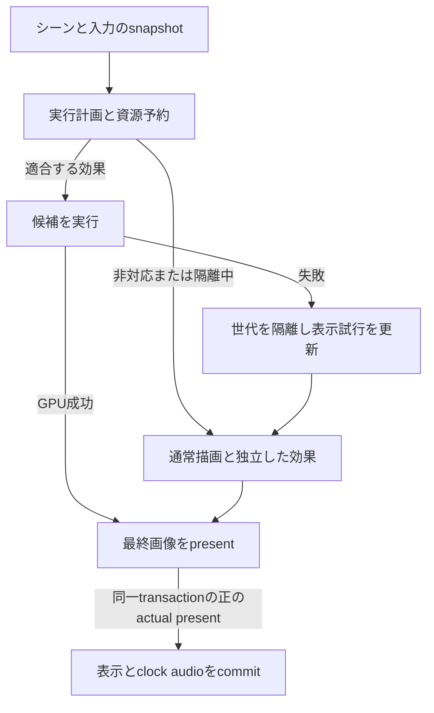

# .fxdayoが動作しない場合のフェイルセーフ設計

> VvfM収録注（2026-10-19）：開発版v0.56.49／build453（記録ID `3620662`）から取り込みました。本文はv0.56.21導入時の設計・検証です。v0.56.47以降のGPU device障害では、通常描画を継続せず保存を維持して再起動を案内します。後続の境界は[資料の案内](README.md)を参照してください。本取込ではビルド・実機試験を再実施していません。

2026-10-07。設計対象は、未知の`.fxdayo`の読込・再読込・live実行が失敗しても、通常のモデル表示、操作、再生、保存を継続できること。失敗した効果とその依存先を実行対象から外し、新しい通常フレームを表示する。効果の失敗をViewer全体の表示失敗へ直結させない。

**v0.56.21で本設計の通常経路を実装。** 基準はHEAD `1b9cdf2e2cde9f57f4098c70662a30c1d3f759d4`、v0.56.20 / build409。本書の受入条件と実施済みの証拠を区別する。以下は導入時の検証概要であり、最新の全機能検証を示すものではない。原文との画像同等性や正式性能合格を意味しない。build410を保存したが、600秒連続再生の停止と指定Astraレビューは未完了。

## 現在の問題と変更する境界

当時のMotionBlurの再現試験では、原文のcompileは成功している。しかしMetal選択、native effect混在などが原文実行profileに適合せず、フレーム全体が中断し、再生開始も失敗する。MotionBlurだけを非表示にすると通常描画と再生が復帰する。

| 現在の接続 | 設計で変更する責務 |
|---|---|
| `MetalModelView`の原文実行前検査とencodeのcatchが`failRendererPresentationSubmission`を呼ぶ | optional effectの不適合を実行計画からの除外へ変換する。通常描画自身の失敗は引き続きrendererの失敗とする |
| `AppModel`が表示transactionのterminal失敗で音声・再生を停止する | effectの除外後に通常表示を試み、その表示transactionの結果でclock／audioを確定する |
| `stageFxDayoAttachment`がモデル全体の編集transactionに入る | 同じPMXのpostprocess差替えを独立した候補採用へ分離し、不要な物理resetとViewer全体の入力無効化を避ける |
| PMX読込とproject復元が原文compile／実行ownerの復元に依存する | 正常なモデル・原文データの復元と、その環境で実行できるかの判定を分離する |

描画、編集状態、原文の取込、PMX解析、プロジェクト保存を横断した設計である。既存の非対応契約を緩めて無理に実行する変更ではない。

## 維持する契約

- UI、ファイル処理、PMX／VMD評価、通常描画をeffectのcompile完了待ちにしない。MainActorで同期waitしない。
- attachmentごとの実行ownerは最大一つ。terminalな契約拒否を別のadapter／原文実行への自動迂回で隠さない。
- 失敗した候補の画像、頂点、履歴を採用しない。全ownerのGPU成功と正のactual-presentが同一の表示transactionに揃ってから表示・clock／audioをcommitする。
- effectの再試行でVMD時計を巻き戻したり、物理stepやimpulseを重複実行したりしない。通常のlossless fixed-step契約を維持する。
- ユーザーの描画設定、effect有効化の意図、原文、controller値を自動で書き換えない。自動停止は実行状態として表示する。
- 動画書出しはactive effectの失敗で停止する。liveの自動停止を、効果を欠いた動画の成功へ転用しない。

互換性の検査、単一の実行経路、実表示後の再生確定、未完了GPU資源の保持、書出しの成功時だけの確定を共通の条件とする。過去のnative限定の説明と、現在の限定profileによる原文実行は区別する。

## 失敗の分類と停止範囲

以下は失敗の責務分類。`FxDayoFailureClass`と作者UIの準備状態へ接続し、通常rendererのterminal処理は既存経路を保持する。

| 分類 | 例 | liveの処理 | 再判定・再試行 |
|---|---|---|---|
| `conditionMismatch` | Metal／LE、AA、native混在、投影、透過材質、FrameTime、非対応の内部寸法 | 該当効果を外して通常描画。ユーザー設定は維持 | 関連条件が変わったときに再検査。compileし直さない |
| `contractRejected` | 未対応pass／ABI、owner不在・競合、依存契約の欠落 | 効果と必要な依存先を非実行にする | 原文・実装契約の世代変更、または明示的な再検査 |
| `prepareFailed` | parse／compile失敗、prepare資源不足、timeout | 適合する正常旧版があれば維持。なければ通常描画 | 原文変更または明示的な再試行で一度だけ |
| `executionFailed` | encode例外、GPU error、不正な出力の検出 | 実行世代を隔離し、新しい通常表示を要求 | hard quarantine。resizeや再生操作では解除しない |
| `executionStalled` | 提出済み候補がwatchdog期限までに完了しない | 新しいeffect提出を止め、通常表示への切替を試みる | 自動再試行しない。未完了GPU資源は保持 |
| `baseRendererFailed` | 通常描画も失敗、device利用不可 | 既存の表示失敗・再生停止処理へ。UIと保存は利用可能に保つ | rendererの復旧方針に従う |

停止単位は`attachmentID + sourceFingerprint + executionGeneration`。sourceFingerprintは原文・include・契約に必要なsidecarを含む。モデル名だけをキーにしない。同じ原文を使う複数モデルのcontroller／履歴は個体ごとに分離する。

GPU errorから原因passを特定できない場合は、失敗したcommandに含まれる原文の実行集合とその依存先を隔離する。個別の原因を推測で確定せず、正常なnative effectまで一律に失敗扱いしない。

依存関係は実行計画の有向graphとして扱う。Aの出力をBが読むならAの停止時にBも停止し、独立したCは継続する。欠損bufferをゼロ値や別世代の出力で代用しない。動的依存を確定できない原文は、その不確定な実行集合をまとめて非実行にする。

postprocessのbypassは、そのpassに入る直前の正常な色を後段へ渡す。deform／独自描画では、正しい通常PMX経路がある場合だけそこへ戻す。失敗した頂点を再利用せず、通常skinと独自skinを二重に適用しない。安全な表示がないモデルはそのモデルの描画だけを停止し、他ownerに必要な姿勢・物理評価は継続する。effect用carrierの不可視性など既存のモデル契約も維持する。

## 作者の意図と実行状態を分離する

一つの`enabled`だけで全状態を表さない。次の三つを独立して管理する。

| 軸 | 保持する内容 |
|---|---|
| `EffectIntent` | ユーザーのON／OFF、選択owner、原文参照・package、controller値。保存対象 |
| `EffectPreparation` | 未検査、検査中、候補準備中、準備済み、失敗。jobと候補の世代を持つ |
| `EffectRuntimeState` | `disabledByUser`、`awaitingTrial`、`bypassedCondition`、`active`、`quarantinedFailure`。live環境に依存 |

「正常旧版はactive、新版はprepare中／失敗」を表せるようにする。compile成功だけでactiveにしない。候補が採用対象のtransactionで表示されて初めてactiveとする。

未知の原文shaderには、計算量・終了性の保証がない。安全側の既定では、未承認のfingerprintは検査まで行い、通常描画を続けて`awaitingTrial`とする。ユーザーの「この原文を試す」で一度の試行を許可する。既に明示された原文実行の選択は尊重し、毎回確認を要求しない。ただし過去にGPU失敗した世代は自動で再試行しない。新たな未知fingerprintの実行は改めて試行対象とする。

これは現在の自動原文実行からの挙動変更となる。既知native adapterは既存の契約検査に従う。制限profileに適合することと、任意shaderのGPU安全性が証明されたことを同一視しない。

## フレームを作る前に実行計画を確定する

`FxDayoLiveExecutionPlan`でsource間の依存と履歴世代を保持する。モデル・controller・描画設定のimmutable snapshotから、採用owner、順序、依存関係、除外理由、資源予約を決める。実装は同一journalのimmutable入力を使い、原文encoder作成前にpreflightと除外対象を確定する。原文結果の履歴登録は原文GPU成功後、公開は同一attemptの正のpresent後に限る。

検査を読込／再読込／通常frame／書出しで共有し、各入口で異なる条件だけを明示する。シーンの適合条件とGPU資源量の上限検査に加え、以下を計画に含める。

- renderStyle、投影、AA・MetalFX、DoF／Bloom／Diffusion、透明背景、native混在、材質・textureの性質。
- FrameTime／RealTime、controller入力の有限性・範囲、pass依存、vertex／buffer ABI、読書き範囲。
- windowの論理寸法ではなく、実際の内部render寸法から計算したtarget／dispatch寸法と境界条件。
- 全effect、履歴、in-flight候補を含む資源予約。通常描画用資源を先に確保し、その残量内だけでeffectを準備する。

current profileがnative混在を拒否した場合はsource側を外し、正常なnative effectを維持する。AAやレンダー方式を勝手に変更して原文の条件に合わせない。

softな条件不一致は、関連するcontext fingerprintが変わったときだけ再検査する。hard quarantineは設定切替で解除しない。毎frameのcompile、同じ警告の発行、失敗からの無限再帰を禁止する。

## 失敗したframeから通常表示へ戻す

1. **encode前の不適合**は、そのeffectを含めない計画で同じ入力snapshotを描く。除外済みeffectをjournalの必須ownerに残さない。
2. **未提出commandへの部分encode後の失敗**は、候補commandを提出せず破棄する。影響した状態を巻き戻し、新しいcommandで通常描画する。部分commandをcommitして成功扱いしない。
3. **提出後のGPU失敗**は、その候補から画像・履歴・表示ACKを採用しない。隔離を反映した計画を作り直し、通常表示を要求する。
4. **表示試行の識別**には既存transaction IDに加えてattempt ID、plan revision、source generation、入力snapshotを結びつける。古い成功通知や遅れて到着したpresentで新しい試行を完了させない。
5. **再描画するpose**は既に評価済みのimmutable入力を再利用する。必要な次の物理stepは通常のschedulerだけが進める。同じ再生／seek意図を引き継ぎ、effect失敗を理由とするphysics resetやclockの飛ばしを行わない。
6. **clock／audio**は既存の表示復旧方針に従う。通常表示の正のactual-presentが出るまで復旧成功にせず、表示途絶中の音声・時計の扱いもその契約に従う。通常表示まで失敗したときだけterminalへ進む。

フレーム履歴のGPU成功・正のpresent・世代一致の条件を維持する。破棄は正確なleaseに対して行い、別の正常なeffectの履歴を巻き込まない。停止対象と依存先のtemporal epochだけを更新し、再有効化時に古い履歴を混ぜない。

通常描画へ切り替えるだけで済む不適合は、再生停止を経由せず表示を続ける。既に表示を失っている場合は復旧待ちとなり、連続再生や無停止を未確認のまま保証しない。

## GPU障害を広げない構成と限界

失敗し得る原文passと通常描画を同じcommand bufferに入れたままでは、そのcommandのGPU失敗から通常画像だけを救済できるとは限らない。強い隔離段階では、通常描画の出力をimmutableにし、原文処理を別command bufferと専用scratch資源へ分離する。

通常描画と原文処理はsubmission queueとin-flight枠も分離し、原文の未完了が通常描画のCPU側提出枠を消費し尽くさない構造にする。原文は通常描画の入力完成を待てるが、通常描画を原文の完了待ちへ逆依存させない。GPU上で両queueが必ず並列に進むとは仮定しない。

最終合成は、同じ入力snapshotの原文出力が期限内に成功した場合だけそれを選択する。未完了・失敗なら、そのsnapshotの通常画像を使う。最終合成側へ無期限のGPU event待ちを入れず、古い原文出力を新しいposeへ被せない。effectが通常出力をin-placeで破壊することも許可しない。継続的に期限に間に合わないeffectは停止状態へ移す。

実装した初期上限は、scene全体で未知原文の試行を同時に一つ、同一世代の失敗後の自動再試行をゼロとする。GPU完了watchdogは提出から500 msを初期の設計値とし、通常表示の期限とは分離する。通常表示はこの500 msを待たない。値は性能合格値ではない。表示期限は1/60秒、連続3回の期限超過でも隔離する。実機の故障注入と継続再生の結果は実装記録へ分離する。

watchdogは「待つのをやめて新規提出を止める」ためのもの。commit済みcommandをCPU timerで取り消せるとは扱わない。未完了commandのbuffer／texture、in-flight枠、budget reservationは完了通知まで保持し、timeoutだけで解放・再利用しない。UI復帰のためにsemaphoreを過剰signalしない。未完了候補は上限内に留め、追加候補を蓄積しない。

Metalのcommandは提出後に完了・状態を監視するもので、`waitUntilCompleted`は呼出し元CPU threadをblockする。このため、UI経路からの同期待機を禁止する。[Appleのcommand submission説明](https://developer.apple.com/library/archive/documentation/Miscellaneous/Conceptual/MetalProgrammingGuide/Cmd-Submiss/Cmd-Submiss.html)、[waitUntilCompleted](https://developer.apple.com/documentation/metal/mtlcommandbuffer/waituntilcompleted())。

別command queueやhelper processも、同じGPU deviceのhangを完全に隔離する保証にはならない。Metalには長時間実行によるtimeoutと、反復するtimeout／hangによるdevice access失効がある。通常描画も不可能になった場合は、効果を停止してUI・編集データ・保存を保ち、必要なrenderer再作成またはアプリ再起動を案内する。自動でアプリを終了しない。[Appleのtimeout](https://developer.apple.com/documentation/metal/mtlcommandbuffererror-swift.struct/timeout)、[accessRevoked](https://developer.apple.com/documentation/metal/mtlcommandbuffererror-swift.struct/accessrevoked)。

CPU側のparse／compileにも上限が必要。現在のprepare制限を維持しつつ、呼出し自体を中断できないcompiler処理はhelper processへ移す。`Task.cancel`や呼出し後のdeadline検査だけを強制停止とみなさない。helperのtimeout／crashは候補失敗へ変換し、モデル採用や通常表示を待たせない。

helperから返すのは検査済みデータ・コンパイル成果物と診断であり、プロセス固有のMetal objectをそのまま受け渡さない。Viewer内に残るlibrary／pipeline生成はMainActor外で行い、利用可能な非同期APIを使う。中断不能な呼出しが残る場合はtimeout後も一つの未完了jobとして保持し、同じ処理を積み増さない。compiler helperだけでViewer内のdriver crashまで隔離できたとは扱わない。

## 読込と再読込

モデルを正常にparseできたら、その通常表示とVMD接続を先に成立させる。隣接`.fxdayo`の読込・検査・compileは独立jobとし、失敗してもPMXの採用を取り消さない。壊れたPMX自身は従来どおり読込失敗とする。

再読込は「正常旧版を維持 → 新版を別資源で準備 → 最新sceneで再検査 → 一度の試行 → 表示成功で採用」の順に行う。旧版も現在条件に適合しない場合は通常描画を維持する。candidate成功前に旧版の資源やpackageを置換しない。

jobにはmodel asset identity、attachment identity、source generationを付ける。新しいreload・モデル削除・OFF操作で古いjobの採用権を取り消す。処理が遅れて完了しても最新の意図を上書きしない。compile中も再生、seek、描画方式変更、保存を利用可能にする。

postprocessの差替えはモデル全体の`isModelAssetEditPending`を立てず、physics resetを行わない。deformのownerやvertex ABIまで変わる差替えは、専用のモデル描画境界で整合を検査する。postprocess向けの高速経路へ無条件に流さない。

## 保存とプロジェクト復元

保存するsource packageはcompiled programから独立させる。実行できない原文、include、controller、明示的なowner選択をそのまま保持し、OFF／隔離を理由にpackageを落とさない。

現在の復元は、原文ownerの再構築や`sourceProgramModelIDs`の一致に失敗するとproject全体を拒否し得る。新設計では以下を分ける。

| 復元時の問題 | 処理 |
|---|---|
| archiveのCRC／hash不一致、危険なpath、必須データ欠落、不正manifest | project復元失敗。開いているsceneを保持 |
| packageは正常だがcompiler／device／adapter／profileが利用不可 | sceneと原文を復元し、効果は停止状態。理由を表示 |
| 過去のGPU失敗・未完了試行の記録が同じfingerprintに残る | 自動実行を抑制し、通常表示で開く |

ユーザーのOFFは保存対象。自動quarantineは作者のONをOFFへ書き換えず、source fingerprint、runtime／compiler／device情報とともにlocalな診断記録として保持する。提出前に未完了試行を記録し、成功時に解消して、再起動直後の同じ自動crashを防ぐ。未完了記録だけでshader原因と断定はしない。

schema27／minimum reader27にON／OFFと承認fingerprintを保存し、25／26の読込を維持する。package構造・hash・依存を検査した上で、そのruntimeでは未対応のprofileも非実行のデータとして保持する。未知のarchive形式やSDK形式まで解釈するものではない。

prepare中の保存は、採用済み原文とcontrollerの整合したsnapshotを保存する。未採用candidateを黙って採用済みにしない。初回読込で実行できなかった原文も意図・packageとして保存する。両者は保存後の再読込で検証する。

## UIと診断

既存のeffect表示と通常statusに状態を出し、新しい補助ウインドウは追加しない。状態変化時だけ通知し、frameごとのmodalや同一ログの連発を避ける。

| 状態 | 表示例 |
|---|---|
| 条件不一致、通常表示済み | 「MotionBlurを一時停止しました。通常描画と再生を継続します。現在のMetal設定には対応していません」 |
| 復旧中 | 「MotionBlurを停止し、通常描画へ切り替えています」 |
| compile失敗、旧版維持 | 「再読込に失敗しました。前のMotionBlurを使用しています」 |
| GPU失敗 | 「MotionBlurの実行に失敗したため停止しました。自動再試行は行いません」 |

「継続します」「前の効果を使用しています」は該当する表示成功を確認してから出す。操作は「理由を表示」「再検査」「再試行」「効果をOFF」に分ける。再試行は既存候補が未完了なら無効とし、その理由を示す。

診断はeffect／model identity、source hash、phase、理由code、profile条件、plan／attempt、GPU状態、復旧先と結果を記録する。同じ失敗は回数と最終発生時刻へ集約する。renderer全体の失敗とeffect単体の停止を区別し、「描画待機を終了しました」だけで終えない。

## 動画書出しの扱い

書出し開始時に独立したimmutable実行計画を作る。作者が有効にしている効果が未対応・隔離中なら、既定では開始を拒否し、対象と理由を示す。liveで通常表示へ戻れたことを、書出しでその効果を省いてよい理由にしない。

ユーザーが明示的に「停止中の効果を除いて書き出す」を選んだ場合だけ、除外一覧を確定して新しい書出し計画を作る。除外後も残ったactive effectが途中で失敗したら停止する。rational PTS、全fixed-step、active resource失敗時の停止、atomic commit後だけprogress 1.0という既存契約を維持する。

## 実装順序と受入条件

| 段階 | 変更対象 | 完了判定 |
|---|---|---|
| P0 通常表示の確保 | failure分類、共通preflight、immutable実行計画、effect除外、理由表示 | MotionBlurの再現条件でも通常表示とplay／pause／seek／設定切替が成立。実行前の拒否がterminal表示失敗にならない |
| P1 採用と復旧の分離 | effect単位の候補採用、attempt／plan識別、履歴・資源の破棄、reload・project保存復元 | 失敗候補の部分採用ゼロ、正常旧版または通常表示の維持、遅延ACKと保存往復の整合 |
| P2 原文実行の隔離 | 専用command／scratch、bounded試行、watchdog、compiler helper、再起動時の再試行抑制 | fault injectionで資源再利用・retry loop・UI待機がなく、通常GPUが健全な範囲で表示を復旧 |

P0だけでGPU hangまで対処済みとはしない。GPUへ到達する未知原文の試行を有効にする際はP1・P2の隔離条件を満たす。全段階でも共有GPUの完全な無停止保証は対象外である。

| 検証群 | 必須ケースと確認事項 |
|---|---|
| 実行前検査 | parse失敗、include欠落、compile timeout、profile不一致、資源上限。モデル表示と入力が継続し、失敗後の自動再試行はゼロ |
| 通常scene | MotionBlur、native Penlight／SSR、Metal／LE／HQ、AA、RealTime、任意の内部寸法、透過材質。除外理由と新しいactual-presentを確認 |
| 依存関係 | A正常、B失敗、CがB依存、D独立。B／Cだけ停止し、A／Dの履歴とownerを保持 |
| 再生復旧 | play開始、再生中、pause、seek、loop境界。全owner／GPU／正のpresentが揃う前のACKなし。pose／物理stepの重複・欠落なし |
| 候補採用 | 再生中reload失敗・連続reload・OFF・モデル削除・設定変更・遅い旧job完了。最新の意図を保持し、正常旧版を早期破棄しない |
| GPU故障 | allocation／encode／command error、watchdog、遅いcompletion、present 0／未到着。まずfault injectionで確認し、危険な実GPU hangを通常試験に使わない |
| 保存復元 | 有効だが実行不可のpackage、隔離中、prepare中、旧schema、壊れたarchive。原文bytesと意図を保存往復し、破損の厳格拒否を維持 |
| 書出し | 開始拒否、明示的除外、途中失敗、取消。失敗時に完成動画・progress 1.0を残さない |
| 資源と耐久 | resize／再試行／reload反復、600秒再生。in-flight上限、資源lease、履歴世代、ログ集約、actual-present／pose age／clock／入力を別々に記録 |

Swift変更後は関連テストと全`swift test`、`git diff --check`を実施する。描画資源変更にはRelease buildと実機確認を追加する。filter 0件・skipを成功に数えず、実装、テスト、実表示、性能、耐久を別々の結果として残す。実施した検証と残る未確認事項は次節と実装記録を参照する。

## v0.56.21の接続先と検証範囲

| 責務 | 実装 |
|---|---|
| 承認・失敗世代・依存 | `FxDayoFailsafe.swift`、`FxDayoRuntimeService.PreflightCache` |
| 通常PMX採用と遅延準備 | `PMXParser`、`FxDayoLoader.captureAdjacent`、`AppModel.prepareDeferredFxDayoAttachments` |
| 採用と旧版保存 | `stageFxDayoAttachment`、`updateFxDayoSourceRuntime`、`fxDayoPersistenceModels` |
| GPU分離と未完了資源 | `FxDayoIsolatedSubmission`、`FxDayoIsolatedInputs`、`FxDayoGPUTrialLimiter` |
| 遅延成功を採用しない履歴 | `MetalModelView`のattempt／publication／source世代、`DayoFrameHistory`の個体別履歴 |
| 再起動時の再試行抑制 | `FxDayoQuarantineStore`の64件上限、fingerprint・compiler ABI・device・OS別記録 |
| CPU準備 | 既存Jsonnet／DXC／SPIRV-Cross子processの制限、非同期Metal library／pipeline、未完了driver jobの枠保持 |
| 保存と書出し | `ProjectPayloadArchiveIO`、schema27、`MovieExportSceneSnapshot`の明示除外一覧、export側の厳格検査 |
| 操作と理由 | 既存エフェクト読込状況の試行／OFF、既存動画書出しの除外選択 |

GPU故障はencode後例外、完了結果の失敗、completion通知の遅延を注入する。実際のGPU hangやdriver crashは発生させない。pure依存graphと履歴世代の検査は、4個の実shaderによる画像比較の代替とはしない。未確認の受入項目を含むため、上表の接続を根拠に全matrix合格とは扱わない。
