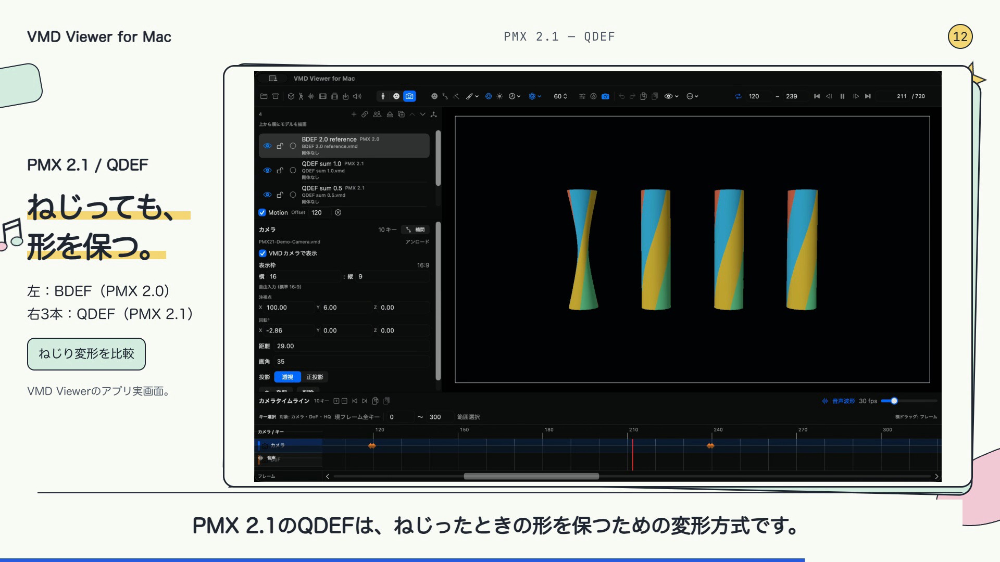
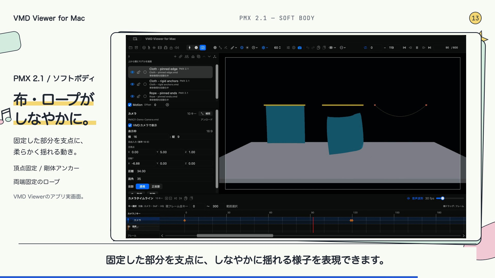

# VvfM紹介動画シナリオ — PMX 2.1追加・3分25秒

MacでVMDをリアルタイム再生して楽しむ紹介動画。既存の3分18秒版に、以前制作したPMX 2.1動画のQDEF・ソフトボディ実演を加えた再構成版。

**全体205秒 / 1920×1080 / 24fps / 日本語AI音声：HeyGen Jhenny、場面5・8・11・12の一部は保存済みJhenny音声を参照したローカルQwen3-TTS再合成 / 字幕あり**。BGMあり・なしの2版を作成。

2026年10月24日の締めイラスト追加版では、場面2（00:12〜00:26）に加え、場面15の03:17以降にも、本編のPMXモデルを参考にしたちびキャラクター2体を添える。場面2の配置と既存PNGはそのまま使い、この段階の変更は場面15だけ。10月23日の発音修正済み音声・字幕・全体205秒の時間割を引き継ぐ構成で、BGMあり・なしの再出力と全編デコード検証を完了した。

[編集用ソースと検証記録](pmx21-3m25s/README.md) · [字幕](pmx21-3m25s/captions-ja.srt) · [以前の3分18秒シナリオ](VvfM_紹介動画シナリオ_3分18秒.md)

## 構成

| 場面 | 時間 | 秒数 | 内容 |
|---:|---|---:|---|
| 01 | 00:00–00:12 | 12 | いつものMacで、VMDをリアルタイム再生 |
| 02 | 00:12–00:26 | 14 | VMD Viewer for Macの紹介 |
| 03 | 00:26–00:38 | 12 | Windowsユーザーにも、出先のMacで |
| 04 | 00:38–00:54 | 16 | PMX、VMD、WAVを読み込んでリアルタイム再生 |
| 05 | 00:54–01:11 | 17 | ボーンと3Dギズモで少しアレンジ |
| 06 | 01:11–01:26 | 15 | モーフとカメラで、お気に入りの瞬間へ |
| 07 | 01:26–01:39 | 13 | リアルタイムで確認し、保存・動画出力へ |
| 08 | 01:39–01:57 | 18 | ToonShader HQで見た目を仕上げる |
| 09 | 01:57–02:12 | 15 | DoFでキャラクターを引き立てる |
| 10 | 02:12–02:25 | 13 | 対応する.fxdayoで演出を加える |
| 11 | 02:25–02:40 | 15 | Macで動きを支える技術とPMX 2.1 |
| 12 | 02:40–02:48 | 8 | QDEFで、ねじったときも形を保つ |
| 13 | 02:48–02:58 | 10 | ソフトボディで、布やロープをしなやかに |
| 14 | 02:58–03:16 | 18 | Bulletの物理演算と二つのモード |
| 15 | 03:16–03:25 | 9 | Macで、気軽にMMDを楽しもう |

QDEFを8秒、ソフトボディを10秒追加。既存の場面04・05を各3秒、06を2秒、07・08・09を各1秒短縮し、合計205秒にした。短縮は台詞の後の余白を中心に行い、既存のナレーション本文は保持した。実演映像の速度は1倍。

## ナレーションと実演

### 01　いつものMacで、VMDをリアルタイム再生（00:00–00:12）

いつものMacで、VMDをリアルタイム再生。好きなキャラクターが、その場で動き出す。気軽にMMDを楽しもう。

### 02　VMD Viewer for Macの紹介（00:12–00:26）

VMD Viewer for Mac。PMXモデルとVMDモーションを読み込んで、アプリ上でリアルタイム再生。動きを楽しみながら、表情やポーズも自分好みに。

この場面では、アプリ枠を横幅1040pxに調整し、左下に赤茶色の片側前髪・紫制服・緑ネクタイ・紺ハイソックスのちびキャラクター、右下に茶短髪・迷彩帽子・紫制服のちびキャラクターを置く。2体は本編のPMXモデルの特徴を取り入れた透過イラスト。左のノートPCの飾りを外し、タイトル・説明文・アプリUI・字幕を隠さない余白に配置する。場面2の配置は先行版から変更しない。

### 03　Windowsユーザーにも、出先のMacで（00:26–00:38）

いつもWindowsで楽しんでいる方も。出先で、あの表情を足したい。気になる姿勢を直したい。そんなときにも、手元のMacで。

### 04　PMX、VMD、WAVを読み込んでリアルタイム再生（00:38–00:54）

PMXモデルとVMDモーション、WAVの音楽を読み込んだら、再生ボタンを押すだけ。VMDの動きを、その場でリアルタイム再生。音楽に合わせて踊るキャラクターを、Macで楽しめます。

### 05　ボーンと3Dギズモで少しアレンジ（00:54–01:11）

腕の角度を少し変えて、お気に入りのポーズに。ボーンを選び、3Dギズモで調整したら、キーを登録。タイムラインで前後を確かめながら、服への食い込みなど、気になる部分も整えられます。

### 06　モーフとカメラで、お気に入りの瞬間へ（01:11–01:26）

表情も、自分好みに。モーフの値は、タイムラインで変化を見ながら調整できます。笑顔を作り、カメラの構図も整えて、お気に入りの瞬間へ。

### 07　リアルタイムで確認し、保存・動画出力へ（01:26–01:39）

リアルタイム再生で、調整した動きを確認。作業はプロジェクトにまとめて保存できます。気に入ったシーンは、音声付きの動画にして残しましょう。

### 08　ToonShader HQで見た目を仕上げる（01:39–01:57）

見た目も、もっと自分好みに。ToonShader HQでは、輪郭線や光を調整できます。リムライトで輪郭に光を、ブルームで輝きを。ディフュージョンで、柔らかな雰囲気も楽しめます。

### 09　DoFでキャラクターを引き立てる（01:57–02:12）

顔にピントを合わせて、背景をふんわり。被写界深度、ディーオーエフで、キャラクターを引き立てられます。ピントの位置もキーに記録して、見せたい表情へ視線を集めましょう。

### 10　対応する.fxdayoで演出を加える（02:12–02:25）

対応するfxdayoで、ステージの演出も。ペンライトや床の反射など、一部の対応エフェクトを使って、シーンの楽しみを広げられます。

### 11　Macで動きを支える技術とPMX 2.1（02:25–02:40）

ボーンや物理の計算と、メタルの描画が、VMDのリアルタイム再生を支えます。PMX2.1のモデルにも対応しています。

### 12　QDEFで、ねじったときも形を保つ（02:40–02:48）

PMX 2.1のQDEFは、ねじったときの形を保つための変形方式です。

以前のPMX 2.1紹介動画の元収録 `shot-2.mov` を再使用。左がPMX 2.0 BDEF、右3本がPMX 2.1 QDEF。タイトルバー・モデル一覧・再生操作部・タイムラインを含むアプリのウインドウ全体を表示する。説明は実画面の外に置く。

### 13　ソフトボディで、布やロープをしなやかに（02:48–02:58）

ソフトボディでは、布やロープの柔らかな動きも。固定した部分を支点に、しなやかに揺れる様子を表現できます。

以前のPMX 2.1紹介動画の元収録 `shot-1.mov` を再使用。頂点固定の布、剛体アンカーの布、両端固定ロープの動きを、モデル一覧とタイムラインを含むアプリのウインドウ全体で見せる。

### 14　Bulletの物理演算と二つのモード（02:58–03:16）

揺れを支える物理演算は、バレット。3.25ネイティブと、2.75互換を選べます。どちらも3.25を使い、互換モードでは、既知の動きの違いを調整しています。

### 15　Macで、気軽にMMDを楽しもう（03:16–03:25）

VMD Viewer for Mac。いつものMacで、VMDをリアルタイム再生。

場面2と同じ透過PNG2体を、03:17（197秒）から0.5秒かけて同時に表示する。表示枠は左が x=490・y=670、右が x=1730・y=670、いずれも160×260px。アプリ枠は x=664・横幅1040pxとし、実画面の縦横比を維持する。左のノートPCの飾りを外し、URL・字幕・アプリUIを隠さない余白に置く。最後は場面全体の204.35〜205秒のフェードに追随する。新たな画像生成やPNG自体の加工は行わない。

## 表記と読みの修正

2026年10月25日の自然ナレーション版では、「腕」「ToonShader HQ」「リムライト」の3文を元の同じ場面の声を参照して読み直す。強いフラット化を外し、自然な抑揚を保ち、前後と音量を合わせる。字幕は「ToonShader HQでは、輪郭線や光を調整できます。」「リムライトで輪郭に光を、ブルームで輝きを。」を維持し、字幕時刻・映像・全体205秒・イラスト配置・BGMを保つ。詳細は[今回の音声差し替え](pmx21-3m25s/checks/natural-narration-validation.json)を参照。

場面10の字幕は「fxdayo」と表記する。2分17秒付近の「床の反射」は「ゆかのはんしゃ（yuka no hansha）」と発声する。音声合成用原稿では読みをひらがなで指定し、画面の字幕では「床の反射」の漢字表記を維持する。修正音声は同じHeyGen Jhennyを使用。

2026年10月23日版では、2分34秒・2分43秒付近の「PMX 2.1」を「ぴーえむえっくす　にーてん　いち」と発声する、次の一文全体の音声を採用する。

- 場面11：ぴーえむえっくす　にーてん　いちのモデルにも対応しています。
- 場面12：ぴーえむえっくす　にーてん　いちのキューデフは、ねじったときの形を保つための変形方式です。

保存済みJhenny音声を参照してローカルQwen3-TTSで再合成した候補を試聴後に採用し、WAV全長をそれぞれ152.5925〜156.4325秒、160.36〜167.24秒に配置する。速度は1倍、ピッチ変更は0。字幕・映像・各場面の時間割は変更せず、「あぷりじょう」と「ゆかのはんしゃ」の先行修正を保持する。元音声との声の同一性を断定するものではない。採用と配置の記録は [音声差し替えの検証](pmx21-3m25s/checks/pmx21-local-voice-adoption-validation.json)、修正箇所は [プレビュー検証](pmx21-3m25s/checks/pmx21-preview-validation.json) を参照。

## 素材と確認範囲

2026年10月24日にCodexの画像生成で制作した透過PNG2点を、場面2と場面15で使用する。PNG自体は加工せず、アルファ値8以上の領域を基準にCSSで位置と大きさを指定する。場面2の左の表示枠は x=450・y=670、場面15の左は x=490・y=670。右はいずれも x=1730・y=670、2体の表示枠はいずれも160×260px。詳細は [生成原稿](pmx21-3m25s/source/imagegen-prompts.json) と [配置記録](pmx21-3m25s/source/character-placement.json) に記録する。

先行する場面2イラスト版では、18秒・24秒の静止画で追加キャラクターが字幕やアプリUIに重ならないことを確認済み。その記録は [場面2のキャラクター追加の検証](pmx21-3m25s/checks/character-illustration-validation.json) と [場面2のプレビュー検証](pmx21-3m25s/checks/character-preview-validation.json) を参照。10月24日の場面15追加版では、18・196.9・197・197.5・201・204.6秒を検査し、登場前後の静止画と完成動画の201秒フレームで配置を確認した。[締めイラスト追加の検証](pmx21-3m25s/checks/ending-illustration-validation.json)、[8秒プレビューの検証](pmx21-3m25s/checks/ending-preview-validation.json)、[配置画像](pmx21-3m25s/images/ending-character-layout.png)、[完成MP4の検証結果](pmx21-3m25s/checks/delivery-validation.json) に結果を記録した。両版とも205秒・1080p・24fps・4,920フレームで、全編の映像・音声デコードを通過した。

音声は前版から、BGMあり・なしそれぞれのAAC圧縮済み音声をコピーする。音声を再合成・再圧縮せず、「あぷりじょう」「ゆかのはんしゃ」「ぴーえむえっくす　にーてん　いち」の修正を保持した。両版で前版との音声ストリームSHA-256一致を確認済み。この10月24日版の出力先は `output/video/vvfm-introduction-character-ending-20261024/`、完成名は `VvfM_紹介動画_締めイラスト追加版_3分25秒_BGMあり_1080p.mp4` と `VvfM_紹介動画_締めイラスト追加版_3分25秒_BGMなし_1080p.mp4`。修正箇所のプレビュー名は `VvfM_締めイラスト配置_8秒プレビュー.mp4`。

PMX 2.1部分はVMD Viewer v0.56.0 build376の実ウインドウ収録。元の紹介動画は `PMX21-App-Demo-Captions-23s.mp4`。元収録から使用時間を選び、画面の切り抜きは行わず、ウインドウ全体を表示している。シーン内で4秒のVMDをループ再生した収録で、連続した性能測定ではない。

既存部分はシナリオの画像と指定された `demo01.mp4` / `demo02.mp4` を使用。BGMは説明用に作成した曲で、デモ元の楽曲ではない。機能実演・字幕・動画の整合を確認する制作物であり、MMD画像互換や再生性能の合格判定ではない。

### アプリ上の読み（2026年10月22日修正）

19秒付近の字幕「アプリ上」はそのままに、音声合成用の読みを「あぷりじょう（apuri jou）」に指定しています。差し替え音声は「あぷりじょうでリアルタイム再生。」です。映像・字幕・各場面の開始時刻と長さは維持しています。

2026年10月22日の一文読み直し版では、15〜20秒付近の「PMXモデルとVMDモーションを読み込んで、アプリ上でリアルタイム再生。」を同じJhennyで一文まとめて読み直しています。「あぷりじょう」は一文の中で発声し、以前の単語単位の差し替え・ピッチ補正を置き換えました。字幕・映像と各場面の長さは維持しています。この音声修正は10月23日のPMX21発音修正版、10月24日の場面2イラスト版と締めイラスト追加版でも保持する構成です。
