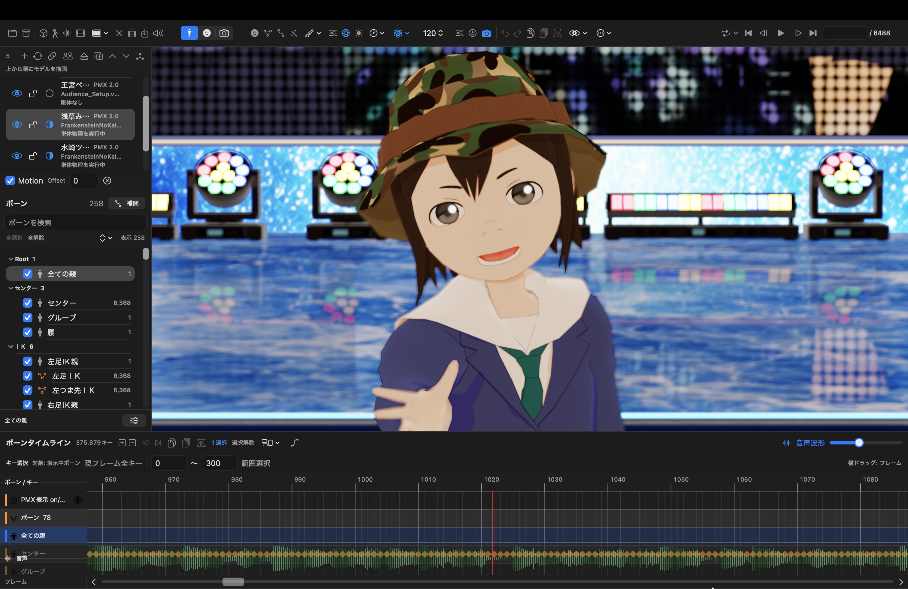
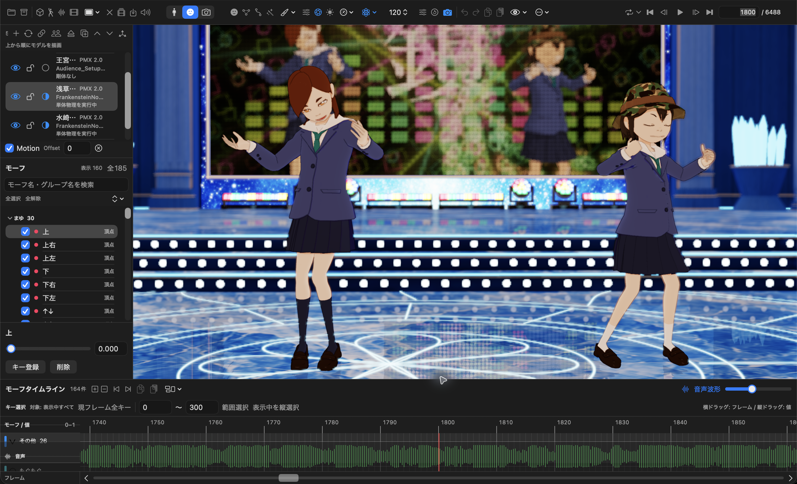
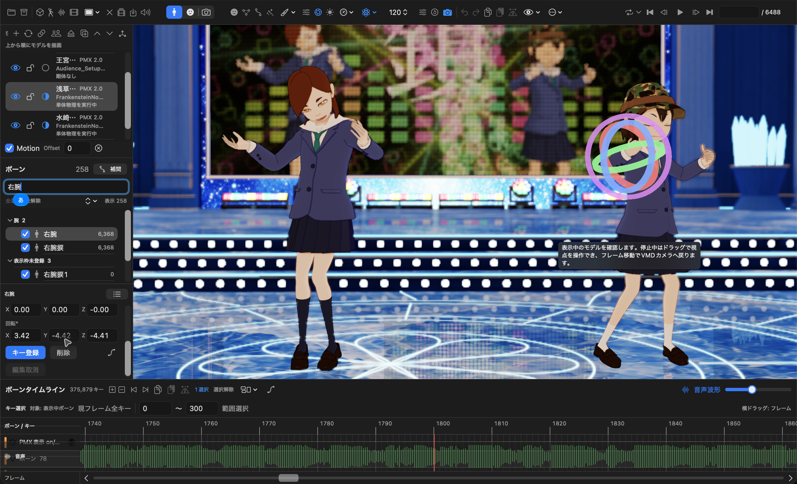
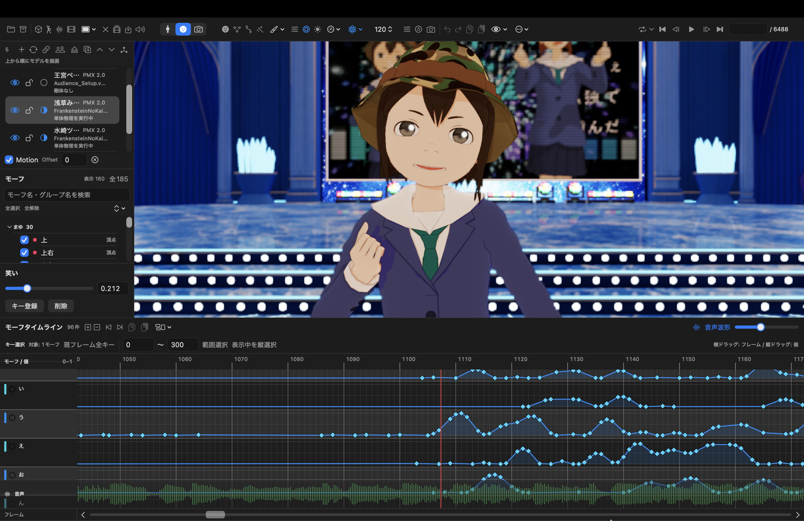
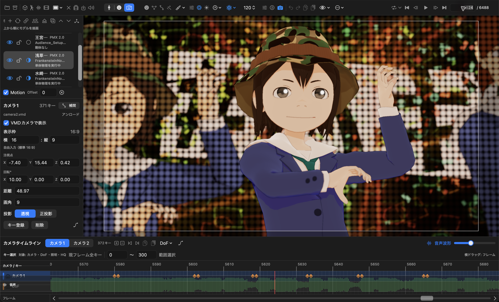
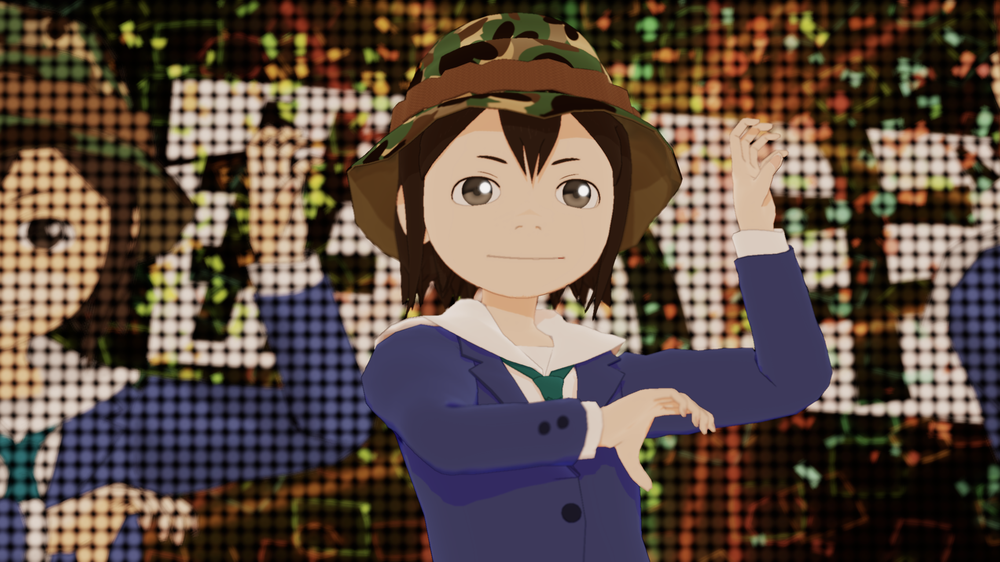
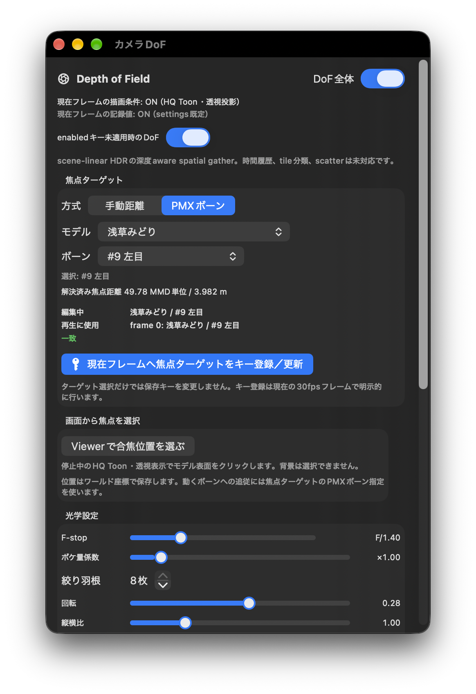
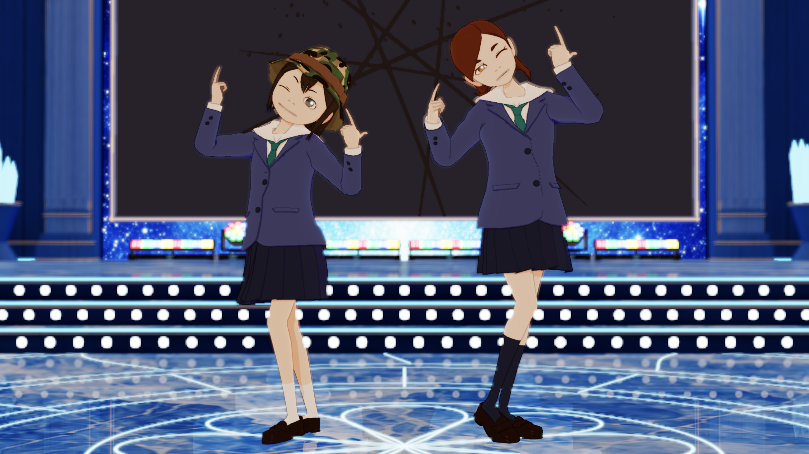
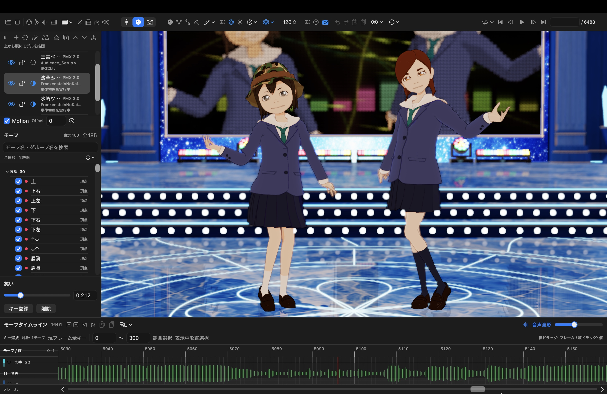

# VMD Viewer for Mac 紹介動画シナリオ

**いつものMacで、VMDをリアルタイム再生。**

PMXモデルとVMDモーションを読み込み、アプリ上でその場で再生して楽しめることを、紹介の中心に置く。冒頭で「VMDのリアルタイム再生」を明示し、基本操作では再生ボタンからキャラクターが動くまでを見せる。表情・ポーズ・見た目の調整は、再生を楽しむ体験を広げる機能として紹介し、保存と動画出力へつなげる。Windowsユーザーの出先での修正は、もう一つの便利な使い方として短く添える。

## 仕様と演出方針

| 項目 | 内容 |
| --- | --- |
| 全体尺 | 3分18秒、198秒 |
| 最優先で伝えること | VMDモーションをMac上でリアルタイム再生し、好きなキャラクターの動きをその場で楽しめる |
| ナレーション | 日本語女性。親しみやすく、落ち着いた明るさ。「推しを動かせた」という楽しさを伝える |
| 主な視聴者 | MacでMMDを楽しんでみたい人、好きなキャラクターを動かしたい人 |
| 補助的な視聴者 | 普段はWindowsで制作し、出先のMacでも確認や修正をしたい人 |
| 主役 | 指定プロジェクト内の浅草みどりと水崎ツバメ。全景では二人を見せ、操作説明と顔アップは浅草みどりを中心にする |
| 画面の方針 | キャラクターを大きく見せ、再生ボタン・進むタイムライン・VMDの動きを一続きで見せる。編集の後にも再生する時間を取る |
| 音の方針 | 軽快で声を邪魔しないBGM。台詞の切れ目で少し持ち上げ、最後はキャラクターの動きに合わせて着地する |
| この版の範囲 | 実画面7枚とユーザー提供画像3枚、計10枚を取り込み。静止画の撮影は途中。音声合成・画面の動画収録・動画生成は未実施 |

以下の時刻は完成尺の設計値。ナレーションの読み尺は未実測のため、将来の仮読みで間と語尾を調整する。尺を合わせるために専門用語を早口で詰め込まない。

リアルタイム再生を示すカットは、再生操作からキャラクターが動くまでの連続した画面収録を等速で使う。掲載中の静止画は構図の参考であり、この再生実演は今後収録する。

## 取り込んだ画像と撮影状況

撮影元は `2Crystal_Hall_Test.vmdviewer`。原本の複製をVMD Viewer for Mac **v0.56.49／build453**で開き、2026年10月20日に撮影した。画像は実際のアプリ画面で、生成画像や合成したUIは使用していない。原本への上書き保存は行っていない。

取得済み7枚とユーザー提供画像3枚を以下の場面に配置した。「映像・操作」は将来の動画収録計画であり、掲載した静止画だけで操作前後・再生・書き出し完了を示すものではない。

| 画像 | 内容 | フレーム | 用途 |
| --- | --- | ---: | --- |
| [01-hero.png](images/crystal-hall/01-hero.png) | 二人とステージの全景、16:9 | 6488 | 場面12の全身・衣装の参考 |
| [02-overview.png](images/crystal-hall/02-overview.png) | モデル一覧・キャラクター・音声波形 | 1800 | アプリ紹介・読込後の状態・技術紹介 |
| [03-bone-gizmo.png](images/crystal-hall/03-bone-gizmo.png) | 浅草みどりの右腕、回転ギズモ、数値欄とキー登録 | 1800 | ボーン編集の仮画像。ヘルプ吹き出しが残るため本番前に再撮影 |
| [04-morph-smile.png](images/crystal-hall/04-morph-smile.png) | 「笑い」モーフを0.600にした未登録プレビュー | 1800 | モーフ操作。キー登録の実施画像ではない |
| [05-camera-timeline.png](images/crystal-hall/05-camera-timeline.png) | 顔アップ、カメラ設定とカメラキー | 5624 | カメラ編集 |
| [06-closeup-dof-on.png](images/crystal-hall/06-closeup-dof-on.png) | DoF全体ONの顔アップ、16:9 | 5624 | 冒頭・HQの仕上がり・DoF |
| [07-dof-settings.png](images/crystal-hall/07-dof-settings.png) | DoF設定、浅草みどり／左目の焦点ターゲット | 5624 | DoFの焦点設定とキー登録欄 |
| [01-opening.jpg](images/crystal-hall/01-opening.jpg) | ユーザー提供の笑顔アップをJPEGへ変換 | 未確認 | 場面01・冒頭 |
| [06-morph-timeline.jpg](images/crystal-hall/06-morph-timeline.jpg) | モーフ値をキーと線で表示したタイムライン | 未確認 | 場面06・値の変化を視覚的に確認 |
| [13-ending.jpg](images/crystal-hall/13-ending.jpg) | ユーザー提供画像をJPEGへ変換 | 未確認 | 場面13・締め |

[画像一覧を開く](images/crystal-hall/index.html)。

16:9画像は2272×1278、主操作画面は2886×1752。DoF設定は独立ウインドウを撮影した。場面01・06・13の提供画像は3024×1964のJPEG。操作画面は縦横比を保ち、将来の16:9編集では余白を設けるか、対象の操作欄へ寄って使う。撮影条件・ハッシュは [capture-manifest.json](images/crystal-hall/capture-manifest.json) に記録した。

**残っている静止画**：PMX／VMD／WAVの個別読込、保存・動画出力設定、Metal／HQ比較、輪郭・RimLight・Bloom・Diffusionの調整、DoFのOFF比較、ペンライトの見やすい引き、Bulletモード設定。ボーン画像の吹き出しを消した再撮影も必要。6枚取得後に画面操作サービスが停止。停止直前に開いていたDoF設定は読み取り専用の撮影で追加できたが、操作の再接続には失敗したため、上記は未撮影のまま区別している。

指定プロジェクト内の5モデルはPMX 2.0。場面11のPMX 2.1は製品の対応機能として紹介し、この画像をPMX 2.1の実例とは扱わない。エフェクト例は、プロジェクトに含まれるペンライトと床反射に合わせた。

## 全体構成

| 場面 | 時間 | 秒数 | 内容 |
| --- | --- | ---: | --- |
| 01 | 00:00–00:12 | 12 | いつものMacで、VMDをリアルタイム再生 |
| 02 | 00:12–00:26 | 14 | VMD Viewer for Macの紹介 |
| 03 | 00:26–00:38 | 12 | Windowsユーザーにも、出先のMacで |
| 04 | 00:38–00:57 | 19 | PMX、VMD、WAVを読み込んでリアルタイム再生 |
| 05 | 00:57–01:17 | 20 | ボーンと3Dギズモで少しアレンジ |
| 06 | 01:17–01:34 | 17 | モーフとカメラで、お気に入りの瞬間へ |
| 07 | 01:34–01:48 | 14 | リアルタイムで確認し、保存・動画出力へ |
| 08 | 01:48–02:07 | 19 | ToonShader HQで見た目を仕上げる |
| 09 | 02:07–02:23 | 16 | DoFでキャラクターを引き立てる |
| 10 | 02:23–02:36 | 13 | 対応する.fxdayoで演出を加える |
| 11 | 02:36–02:51 | 15 | Macで動きを支える技術とPMX 2.1 |
| 12 | 02:51–03:09 | 18 | Bulletの物理演算と二つのモード |
| 13 | 03:09–03:18 | 9 | Macで、気軽にMMDを楽しもう |
| 合計 | 00:00–03:18 | **198** | |

## 場面別シナリオ

### 01 いつものMacで、VMDをリアルタイム再生

**00:00–00:12／12秒**

**取り込み画像**

ユーザー提供のスクリーンショットをJPEGに変換して配置。元の構図・解像度（3024×1964）を維持。冒頭でキャラクターの表情を大きく見せる。

**ナレーション**

> いつものMacで、VMDをリアルタイム再生。好きなキャラクターが、その場で動き出す。気軽にMMDを楽しもう。

**映像・操作**

- 00:00–00:04：再生ボタンを押すところから、Mac上のViewerでキャラクターが動き出すまでを一続きで見せる。
- 00:04–00:08：VMDの動きを等速で見せながら顔へ寄り、表情の魅力を伝える。
- 00:08–00:12：アプリの画面を少し広く見せ、進むタイムラインとキャラクターの動きを一緒に示す。

**テロップ**

「Macで、VMDをリアルタイム再生。」

**演出**

最初の印象は「その場で動かして楽しめる」こととキャラクターの魅力。再生操作と動きの連続性を保ち、「自分もこのMacで再生してみたい」と感じる数秒を作る。

### 02 VMD Viewer for Macの紹介

**00:12–00:26／14秒**

**取り込み画像**

フレーム1800。読込済みのプロジェクトを表示した状態。

**ナレーション**

> VMD Viewer for Mac。PMXモデルとVMDモーションを読み込んで、アプリ上でリアルタイム再生。動きを楽しみながら、表情やポーズも自分好みに。

**映像・操作**

- 00:12–00:17：製品名を表示。背景ではキャラクターのダンスを続ける。
- 00:17–00:22：「VMDを読み込む」「リアルタイム再生」を、対応する短い画面カットで見せる。
- 00:22–00:26：調整したシーンの見栄えのよい瞬間へつなぐ。

**テロップ**

- 主表示：「VMD Viewer for Mac」
- 補助表示：「VMDを読み込む → リアルタイム再生 → 自分好みに」

**演出**

「VMDを読み込んでリアルタイム再生」を製品の中心として伝える。編集に詳しくなくても再生から楽しみ始められる入口を作り、以降の編集・エフェクトへつなぐ。

根拠：[製品概要][S1]、[基本操作と編集][S2]。

### 03 Windowsユーザーにも、出先のMacで

**00:26–00:38／12秒**

**取り込み画像**

フレーム1800。操作説明用の仮画像。ヘルプ吹き出しを消した再撮影と、外出先の状況カットは未撮影。

**ナレーション**

> いつもWindowsで楽しんでいる方も。出先で、あの表情を足したい。気になる姿勢を直したい。そんなときにも、手元のMacで。

**映像・操作**

- 00:26–00:30：外出先のMacという状況を短く提示。「あのモーフも使いたい」「腕が服に入っている」と、確認したい箇所を示す。
- 00:30–00:33：「リモートがつながらない…」の状況テロップ。困りごとはこの短いカットに収める。
- 00:33–00:38：Macに用意したPMX・VMDをVvfMで開き、顔や腕を確認する画面へ。

**テロップ**

「出先のMacでも、ちょっと調整。」

**演出**

便利さの補足として扱い、以降は「自分好みに楽しむ」流れへ戻る。Windows側の作業画面が自動転送されたような演出はせず、Macに用意した素材を開く。

根拠：[読み込みとVMD編集][S2]。

### 04 PMX、VMD、WAVを読み込んでリアルタイム再生

**00:38–00:57／19秒**

**取り込み画像**

フレーム1800。PMX／VMD／WAVの個別読込ダイアログは未撮影。

**ナレーション**

> PMXモデルとVMDモーション、WAVの音楽を読み込んだら、再生ボタンを押すだけ。VMDの動きを、その場でリアルタイム再生。音楽に合わせて踊るキャラクターを、Macで楽しめます。

**映像・操作**

- 00:38–00:43：PMXを読み込み、キャラクターが表示される。
- 00:43–00:48：対象モデルを選択し、0フレームでVMDを読み込む。タイムラインへキーが並ぶ。
- 00:48–00:52：WAVを読み込み、音声波形を表示する。
- 00:52–00:57：再生ボタンを押すところから5秒間、等速・連続の実画面を見せる。キャラクターの動き、進むタイムライン、音楽を一緒に示す。

**テロップ**

順に「PMX＝モデル」「VMD＝動き」「WAV＝音楽」。再生時は「VMDを、その場でリアルタイム再生。」

**収録メモ**

読み込み待ちはカットでつなぐ。PMXとテクスチャのフォルダ構成を維持し、VMDの対象モデルと読込位置を確認する。最後の再生カットは、操作から動きまでを等速の画面収録でつなぐ。

根拠：[PMX、VMD、音声を読み込む][S2]。

### 05 ボーンと3Dギズモで少しアレンジ

**00:57–01:17／20秒**

**取り込み画像**

フレーム1800。ボーンを選択した状態。姿勢変更・キー登録の完了を示す画像ではない。ヘルプ吹き出しは再撮影で除く。

**ナレーション**

> 腕の角度を少し変えて、お気に入りのポーズに。ボーンを選び、3Dギズモで調整したら、キーを登録。タイムラインで前後を確かめながら、服への食い込みなど、気になる部分も整えられます。

**映像・操作**

- 00:57–01:02：再生を止め、腕のボーンを選択する。
- 01:02–01:08：回転ギズモの輪をドラッグ。腕の角度を少し変え、ポーズの変化を見せる。
- 01:08–01:12：「キー登録」を押し、ボーンタイムラインのキーを示す。
- 01:12–01:17：前後を短くループ再生し、動きのつながりを見せる。

**テロップ**

「選ぶ → 動かす → キー登録」

**収録メモ**

登録操作と結果を一組で見せる。服への食い込みはボーンを手で調整する例とし、自動修正機能のようには見せない。

根拠：[ボーン操作と食い込みの修正例][S2]。

### 06 モーフとカメラで、お気に入りの瞬間へ

**01:17–01:34／17秒**

**取り込み画像**

フレーム1800／笑い0.600の未登録プレビュー。撮影後に一時調整を戻した。

モーフ値をタイムラインで視覚的に表示。横軸はフレーム、各モーフ行の縦方向は値0〜1を表す。青いキーとそれを結ぶ線を見ることで、口の形などのモーフが「いつ・どのくらい変わるか」を確認できる。画像下部の音声波形と並べて、表情が変わるタイミングも見比べられる。ユーザー提供のスクリーンショットをJPEGに変換し、元の構図・解像度（3024×1964）を維持した。

フレーム5624。カメラ1の構図・設定値と既存キーを表示。新規キー登録はしていない。

**ナレーション**

> 表情も、自分好みに。モーフの値は、タイムラインで変化を見ながら調整できます。笑顔を作り、カメラの構図も整えて、お気に入りの瞬間へ。

**映像・操作**

- 01:17–01:22：モーフのスライダーを動かして笑顔にし、キー登録。
- 01:22–01:27：モーフタイムラインへ寄る。横軸のフレームと縦方向の値0〜1を示し、青いキーと線で表情の強さ・時間変化を見せる。
- 01:27–01:31：カメラモードへ切り替え、顔へ寄った構図とキー登録を示す。
- 01:31–01:34：笑顔とカメラ移動が重なる短い再生へ。

**テロップ**

「モーフで表情」「値の変化をタイムラインで確認」「カメラで見せ方」

タイムラインのカットだけ「横：フレーム／縦：モーフ値0〜1」を補助表示する。

**演出**

場面01の笑顔を、ここで自分で作れることが伝わるようにする。モーフとカメラの操作欄を一度に強調せず、一つずつ見せる。

根拠：[モーフとカメラの編集][S2]。

### 07 リアルタイムで確認し、保存・動画出力へ

**01:34–01:48／14秒**

**取り込み画像**

再生・保存の説明に使う参考画面。プロジェクト保存ダイアログと動画出力設定は未撮影。動画出力は実行していない。

**ナレーション**

> リアルタイム再生で、調整した動きを確認。作業はプロジェクトにまとめて保存できます。気に入ったシーンは、音声付きの動画にして残しましょう。

**映像・操作**

- 01:34–01:38：調整したシーンをアプリ上でリアルタイム再生し、表情と動きのつながりを音楽とともに確認する。
- 01:38–01:42：プロジェクト保存を短く示し、動画書き出し画面へ切り替える。
- 01:42–01:45：H.264／MP4の設定と「読み込んだ音声を含める」を示す。
- 01:45–01:48：完成例へカット。操作用のギズモやタイムラインがない映像を見せる。

**テロップ**

「リアルタイムで確認」「作業を保存」「音声付きで動画出力」

**収録メモ**

将来の収録では、書き出し完了後の実ファイルを完成例に使う。待ち時間は編集で省略する。今回、この動画出力は実行しない。

根拠：[プロジェクト保存][S2]、[動画出力][S3]。

### 08 ToonShader HQで見た目を仕上げる

**01:48–02:07／19秒**

**取り込み画像**

フレーム5624。現在の仕上がりの参考。Metal／HQや各エフェクトの前後比較、調整画面は未撮影。

**ナレーション**

> 見た目も、もっと自分好みに。トゥーンシェーダー・エイチキューでは、輪郭線や光を調整できます。リムライトで縁に光を、ブルームで輝きを。ディフュージョンで、柔らかな雰囲気も楽しめます。

**映像・操作**

- 01:48–01:52：同じポーズ、カメラ、照明で、Metal表示からToonShader HQへ切り替える。
- 01:52–01:57：輪郭線とRimLightの調整を一つずつ見せる。
- 01:57–02:02：発光するステージ部分で、Bloomの変化を見せる。
- 02:02–02:07：Diffusionの調整前後を見せ、仕上がりを数秒保つ。

**テロップ**

「ToonShader HQ」「輪郭線」「RimLight」「Bloom」「Diffusion」を対応するカットで順に表示する。

**演出**

差が見える同一構図で比較する。スライダーの数より、キャラクターの見え方の変化を主役にする。

根拠：[ToonShader HQのエフェクト][S4]。

### 09 DoFでキャラクターを引き立てる

**02:07–02:23／16秒**

**取り込み画像**

フレーム5624／HQ／透視投影。OFFとの同一構図比較は未撮影で、ぼけの差はまだ比較していない。

DoF全体ON、現在フレームの描画条件ON、PMXボーン「浅草みどり／左目」、F/1.40を表示。焦点ターゲットのキー登録ボタンを確認できる。新規キー登録は実行していない。

**ナレーション**

> 顔にピントを合わせて、背景をふんわり。被写界深度、ディーオーエフで、キャラクターを引き立てられます。ピントの位置もキーに記録して、見せたい表情へ視線を集めましょう。

**映像・操作**

- 02:07–02:12：同一構図でDoFのOFF／ONを比較。顔を保ち、背景がぼける変化を示す。
- 02:12–02:18：焦点ターゲットと、焦点キーを登録する操作を見せる。
- 02:18–02:23：背景のぼけを生かした顔のアップ。説明用の枠を消して表情を見せる。

**テロップ**

- 主表示：「DoFで、見せたい表情へ。」
- 条件表示：「ToonShader HQ・透視投影」

**収録メモ**

DoF全体と当該フレームの有効状態を確認する。焦点キーの登録とDoFの有効化を、同じ操作として見せない。

根拠：[DoFと照明][S5]。

### 10 対応する.fxdayoで演出を加える

**02:23–02:36／13秒**

**取り込み画像**

フレーム1800。MMDayo_SSRとペンライトの定義を同梱するシーン。各効果の寄り・引きとON／OFF比較は未撮影。

**ナレーション**

> 対応するエフエックスダヨーで、ステージの演出も。ペンライトや床の反射など、一部の対応エフェクトを使って、シーンの楽しみを広げられます。

**映像・操作**

- 02:23–02:28：指定プロジェクトのMobFesPenlight_3を、客席が見える構図で示す。
- 02:28–02:33：MMDayo_SSRによる床反射を、キャラクターの足元と一緒に示す。
- 02:33–02:36：キャラクターと演出が一緒に見える引きの構図。

**テロップ**

「.fxdayo 一部対応」

各カットには「MobFesPenlight_3」「MMDayo_SSR」の名称を添える。

**収録メモ**

使用する定義と素材の組み合わせで動作を確認してから撮影する。HQのDoF・Bloomを見せた直前の構成が、すべての.fxdayoにも共通で使えるというつなぎ方は避け、演出例を個別に撮る。

根拠：[.fxdayoの対応範囲][S6]。

### 11 Macで動きを支える技術とPMX 2.1

**02:36–02:51／15秒**

**取り込み画像**

このプロジェクトは全モデルPMX 2.0。PMX 2.1対応は資料に基づく製品説明としてテロップを添える。

**ナレーション**

> ボーンや物理の計算と、メタルの描画が、VMDのリアルタイム再生を支えます。PMX2.1のモデルにも対応しています。

**映像・操作**

- 02:36–02:41：リアルタイム再生中のキャラクターにボーン表示を重ね、「CPU：姿勢・物理の計算」を示す。
- 02:41–02:46：ボーン表示を消してキャラクターの描画へ戻り、「GPU：Metal描画」を示す。
- 02:46–02:51：指定プロジェクトのモデル一覧を見せ、「PMX 2.0／2.1に対応」と製品機能をテロップ表示する。画面内のモデルはPMX 2.0であることを小さく併記する。

**テロップ**

「PMX 2.0／2.1に対応」

前半は「CPU：姿勢・物理の計算」「GPU：Metal描画」を対応するカットで表示する。

**演出**

技術紹介でもリアルタイム再生中のキャラクターを画面に残し、その動きをCPUとGPUが支えることを伝える。原案の「MMD相当をMacで実現」は、モデル・モーションの再生と編集をMac上で行う説明に具体化する。

根拠：[開発側の機能一覧][S7]、[PMX 2.0／2.1対応表][S8]、[描画と物理の仕組み][S9]。

### 12 Bulletの物理演算と二つのモード

**02:51–03:09／18秒**

**取り込み画像**

静止画の構図参考。揺れの動作やBulletモード差を確認する画像ではない。二つのモードを示す設定画面は未撮影。

**ナレーション**

> 揺れを支える物理演算は、バレット。3.25ネイティブと、2.75互換を選べます。どちらも3.25を使い、互換モードでは、既知の動きの違いを調整しています。

**映像・操作**

- 02:51–02:56：髪や衣装が揺れるシーンを見せる。
- 02:56–03:03：「設定 → 再生」で、二つのBulletモードの選択肢を示す。
- 03:03–03:09：選択した設定で再計算した後の動きへ戻る。

**テロップ**

- 「Bullet 3.25 ネイティブ」
- 「Bullet 2.75 互換」
- 補足：「両モードともBullet 3.25を使用」

**収録メモ**

モード変更を実演する場合は「適用して再計算」まで含める。二つのモードの優劣や、MMDと同一の揺れを示す比較にはしない。

根拠：[Bulletモードの操作][S2]、[物理モードの実装範囲][S8]。

### 13 Macで、気軽にMMDを楽しもう

**03:09–03:18／9秒**

**取り込み画像**

ユーザー提供のスクリーンショットをJPEGに変換して配置。元の構図・解像度（3024×1964）を維持。締めの製品名・案内先を重ねるための背景候補。

**ナレーション**

> VMD Viewer for Mac。いつものMacで、VMDをリアルタイム再生。

**映像・操作**

- 03:09–03:14：冒頭と同じキャラクターをアプリ上でリアルタイム再生し、調整した表情とポーズを見せる。
- 03:14–03:18：製品名と案内先を表示。キャラクターの動きとBGMが自然に着地する。

**テロップ**

「いつものMacで、気軽にMMD。」

「VMDをリアルタイム再生」

「VMD Viewer for Mac」

「配布情報・使い方：github.com/opopoposiop/VvfM」

**演出**

冒頭の「MacでVMDをリアルタイム再生」を再提示し、「好きなキャラクターをその場で動かして楽しむ」気持ちに戻す。配布情報と使い方のリンクは、将来の動画説明欄にも載せる。

## ナレーションの読み方

| 表記 | 読み |
| --- | --- |
| VMD Viewer for Mac | ブイエムディー・ビューアー・フォー・マック |
| MMD | エムエムディー |
| PMX／VMD／WAV | ピーエムエックス／ブイエムディー／ウェーブ |
| 3Dギズモ | スリーディー・ギズモ |
| ToonShader HQ | トゥーンシェーダー・エイチキュー |
| RimLight／Bloom／Diffusion | リムライト／ブルーム／ディフュージョン |
| DoF／.fxdayo | ディーオーエフ／エフエックスダヨー |
| Metal／Bullet | メタル／バレット |
| 2.1／2.75／3.25 | に・てん・いち／に・てん・なな・ご／さん・てん・に・ご |

製品名と版番号は上表の読みを仮指定とする。台本の引用部分が読み上げ対象で、条件表示・収録メモ・根拠リンクは読み上げない。

## 制作時にそろえる素材

- 同じキャラクターを通して見せられるPMX、VMD、WAV。表情用モーフ、腕の操作、髪や衣装の揺れを確認できる組み合わせ。
- 再生ボタン、進むタイムライン、VMDの動きを一緒に確認できる等速・連続の画面収録。冒頭・基本操作・締めのリアルタイム再生実演に使う。
- HQの輪郭・光、DoFの背景ぼけが見やすいステージ。
- 指定プロジェクト内のMobFesPenlight_3とMMDayo_SSR、および各エフェクトの必要素材。
- モデル、モーション、音源、ステージ、エフェクトの利用条件と、必要なクレジット。

指定プロジェクトの選定と7枚の静止画撮影を実施し、場面01・06・13にはユーザー提供画像をJPEGで追加した。モーフ画像は一時プレビュー、その他は読込済みシーンの表示例として扱う。エフェクトの定義同梱と画面表示は確認したが、効果別のON／OFF比較は未実施。残りの静止画、仮読み、動作を伴う動画収録、音声収録・合成、動画出力は未実施。

## 原案から調整した表現

| 原案の内容 | シナリオでの扱い |
| --- | --- |
| VMDリアルタイム再生を強調 | 冒頭・製品紹介・読込後の実演・締めで明示。再生操作とVMDの動きを等速・連続の実画面で見せる |
| MacでMMD動画を作りたい、推しキャラを動かしたい | 「VMDをリアルタイム再生して楽しむ」を中心に、自分好みの編集と作品づくりへつなぐ |
| Windowsユーザーの出先での修正、リモート接続の不調 | 場面03に短く残す。主役はMacで気軽に楽しむ体験とする |
| モデルのボーン貫通を発見 | 視聴者に伝わる「腕が服に入り込む」「服への食い込み」とし、手動のボーン調整例で示す |
| MMD相当をMacで実現 | PMX・VMDの再生、姿勢・表情・カメラの編集、物理、Metal描画として説明。MMDとの画像・物理・エフェクトの完全一致はうたわない |
| PMX 2.1対応 | 対応表に沿って紹介。全機能・全モデルの完全互換という表現には広げない |
| 対応fxdayo | 「一部対応」と表示し、指定プロジェクトに含まれるMobFesPenlight_3とMMDayo_SSRを例にする |
| Bullet 2.75互換／3.25ネイティブ | 両モードとも同梱Bullet 3.25を使うことを、音声とテロップで明示する |

## 参照資料

基準日：2026年10月20日。指定された両リポジトリの公開mainのSHAを照合し、該当するローカルGitオブジェクト・資料を読んで作成した。配布側は `0fa323b3121c3b6c8f54fad277074dcf9246fce8`、開発側は `36206626a7214ad8b8de5bba362189a38c285529`（v0.56.49／build453）。以下の機能根拠は、その公開コミットに固定している。これは配布アプリの最新版を認定するものではない。

原案：`Vvfm紹介動画シナリオ.md`（ユーザー提供の原案。このリポジトリには未収録）。原案の3分18秒・日本語女性ナレーションと項目構成を維持し、追加指定の「Macで手軽にMMDを楽しむ」を中心に展開した。2026年10月21日の追加指定を受け、「VMDをリアルタイム再生して楽しめる」ことを最優先の訴求にした。

| 参照 | 資料と確認した内容 |
| --- | --- |
| S1 | [VvfM README][S1]：製品概要、主な機能、入手・利用案内 |
| S2 | [VvfM GUIDE][S2]：PMX・VMD・音声の読込、再生、ボーン・モーフ・カメラ編集、キー登録、保存、Bulletモード |
| S3 | [GUIDE 動画出力][S3]：音声付き出力、H.264／MP4、出力後の確認 |
| S4 | [GUIDE ToonShader HQ][S4]：輪郭線、RimLight、Bloom、Diffusion |
| S5 | [GUIDE DoFと照明][S5]：HQ・透視投影の条件、焦点ターゲットとキー登録 |
| S6 | [GUIDE .fxdayoへの対応][S6]：一部対応、専用処理の例、解析・互換性・実行の区別 |
| S7 | [開発リポジトリ README][S7]：公開mainの機能とMetal描画 |
| S8 | [PMX 2.0／2.1対応表][S8]：PMXの対応範囲、Bullet 2.75互換／3.25ネイティブの意味 |
| S9 | [VvfM技術ガイド][S9]：CPUの姿勢・物理計算とGPU描画の役割 |

[S1]: https://github.com/opopoposiop/VvfM/blob/0fa323b3121c3b6c8f54fad277074dcf9246fce8/README.md
[S2]: https://github.com/opopoposiop/VvfM/blob/0fa323b3121c3b6c8f54fad277074dcf9246fce8/GUIDE.md
[S3]: https://github.com/opopoposiop/VvfM/blob/0fa323b3121c3b6c8f54fad277074dcf9246fce8/GUIDE.md#動画出力
[S4]: https://github.com/opopoposiop/VvfM/blob/0fa323b3121c3b6c8f54fad277074dcf9246fce8/GUIDE.md#toonshader-hqのエフェクト
[S5]: https://github.com/opopoposiop/VvfM/blob/0fa323b3121c3b6c8f54fad277074dcf9246fce8/GUIDE.md#dofと照明
[S6]: https://github.com/opopoposiop/VvfM/blob/0fa323b3121c3b6c8f54fad277074dcf9246fce8/GUIDE.md#fxdayoへの対応
[S7]: https://github.com/opopoposiop/VMDviewer_for_Mac/blob/36206626a7214ad8b8de5bba362189a38c285529/README.md
[S8]: https://github.com/opopoposiop/VMDviewer_for_Mac/blob/36206626a7214ad8b8de5bba362189a38c285529/PMX_2.0_2.1_CONFORMANCE.md
[S9]: https://github.com/opopoposiop/VvfM/blob/0fa323b3121c3b6c8f54fad277074dcf9246fce8/VvfM_Technical_Note.md
